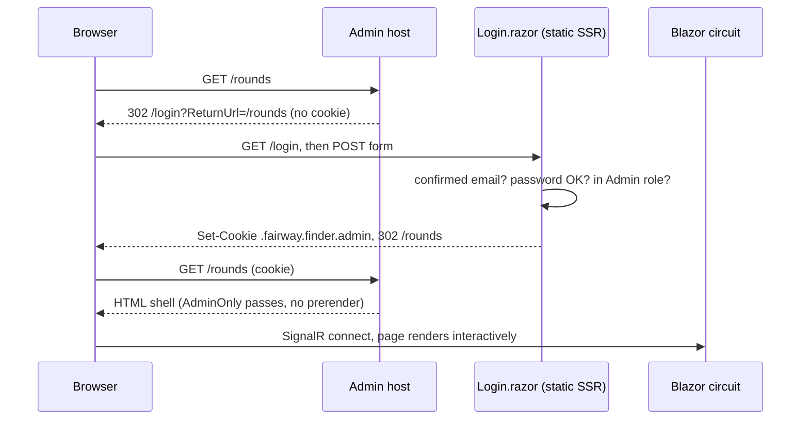

# Admin console

`FairwayFinder.Admin` is an internal Blazor Server app for the people who run FairwayFinder. Every page requires the `Admin` role. This doc goes through how the console is put together and then covers it page by page: what each page shows, and which service methods it calls.

## Purpose and scope

Golfers use the iOS app, and the iOS app talks only to the API (see [../api/overview.md](../api/overview.md)). The console is for work a phone should not do:

- user management and invites
- course and teebox data entry
- viewing and repairing any golfer's rounds and games
- stats and strokes-gained diagnostics for any golfer
- request logs, error logs, health and live connections
- the TGTR transfer and GolfCourseAPI import tools

**Don't add end-user features here.** Anything a golfer needs goes in the API. No golfer can reach the console: the login page turns away accounts without the Admin role.

The admin host also has two system-wide jobs. It applies migrations to both databases and seeds roles and the default admin at startup (see [Startup](#startup-migrations-and-seeding)). It also runs retention for the `app_log` table.

## How it is wired

| Piece | File |
|---|---|
| Host pipeline | `src/FairwayFinder.Admin/Program.cs` |
| Identity + cookie | `src/FairwayFinder.Admin/Startup/AuthenticationConfiguration.cs` |
| `AdminOnly` policy | `src/FairwayFinder.Admin/Startup/AuthorizationConfiguration.cs` |
| Console-only DI (breadcrumbs, circuit handlers, purge job) | `src/FairwayFinder.Admin/Startup/ServiceRegistration.cs` (`RegisterAdminWebServices`) |
| Cross-user domain services, TGTR, GolfCourseAPI | `src/FairwayFinder.Features/ServiceRegistration.cs` (`RegisterAdminServices`) |
| Root component, render mode, theme | `src/FairwayFinder.Admin/Components/App.razor` |
| Router + auth gate | `src/FairwayFinder.Admin/Components/Routes.razor` |

`Program.cs` calls `RegisterFeatureServices()` (shared with the API), then `RegisterAdminServices()`, then `RegisterAdminWebServices()`. The admin services (`UserAdminService`, `AdminDashboardService`, `AdminRoundService`, `AdminDeviceService`, `AdminGameService`, `AppLogService`, `TgtrTransferService`, `GolfCourseApiImportService` and the import job) are registered only here, so the API cannot resolve them. Both `DbContext`s are registered as factories (`AddDbContextFactory`), which suits Blazor Server: a circuit lives a long time, and each service call creates and disposes its own short-lived context.

The host fails fast at startup if the `Apns` section is incomplete. The console never sends a push, but `RoundService` and `FriendService` inject `IPushNotificationService`, so a missing key would otherwise fail the first time an admin opened a round. For the full config list see [../architecture/hosting-and-configuration.md](../architecture/hosting-and-configuration.md).

## Authentication and authorization

### Cookie login

The console signs in with ASP.NET Core Identity cookies (`AuthenticationConfiguration.AddFairwayFinderAuthentication`):

- The password policy matches the API's (8 characters minimum, no character-class rules), so a password set on one side always works on the other.
- Cookie `.fairway.finder.admin`, `Secure` always, 8-hour sliding expiration. Sessions are shorter than a consumer app would use, on purpose.
- `LoginPath = /login`, `LogoutPath = /authentication/logout`, `AccessDeniedPath = /access-denied`.

`Components/Auth/Pages/Login.razor` is a plain `EditForm` posted as a static SSR form. In order, it:

1. looks the user up by email and rejects unconfirmed emails,
2. calls `PasswordSignInAsync` with `lockoutOnFailure: true`,
3. on success, checks the user has the `Admin` role. If they don't, it signs them straight back out and shows "This console is restricted to administrators." A golfer never ends up with a session where every page bounces them.
4. redirects to `ReturnUrl` through `IdentityRedirectManager`.

Logout is a minimal API `GET /authentication/logout` in `Program.cs` (it requires authorization). It calls `SignOutAsync` and redirects to `/login`. The header's profile menu links to it.

### The `AdminOnly` policy

`Policies.AdminOnly` requires an authenticated user in the `Admin` role (`ApplicationRoles.Admin`). It is applied **per page** with `@attribute [Authorize(Policy = Policies.AdminOnly)]`. There is deliberately no `FallbackPolicy`: a fallback would also block the SignalR negotiation that interactive pages need (see the comment in `AuthorizationConfiguration.cs`). Static assets are mapped with `.AllowAnonymous()`.

Authorization is checked in two places:

| Where | Anonymous | Signed in, not admin |
|---|---|---|
| HTTP request to a page endpoint (first load, refresh) | cookie challenge, 302 to `/login?ReturnUrl=...` | cookie forbid, 302 to `/access-denied` |
| Navigation inside the circuit (`AuthorizeRouteView` in `Routes.razor`) | `RedirectToLogin` does a full-page load of `/login?returnUrl=...` | `AccessDeniedMessage` rendered in place |

The anonymous pages are `/login`, `/Error`, `/not-found` and `/access-denied`, all marked `[AllowAnonymous]`.



### Render modes and prerendering

`App.razor` decides the render mode for the whole router:

```csharp
private IComponentRenderMode? PageRenderMode =>
    HttpContext.AcceptsInteractiveRouting() ? new InteractiveServerRenderMode(prerender: false) : null;
```

- Every page renders **Interactive Server with prerendering off**. Pages also declare `@rendermode InteractiveServer` by convention.
- `Login.razor` has `[ExcludeFromInteractiveRouting]`, so `AcceptsInteractiveRouting()` is false and it renders as **static SSR**. It has to: signing in sets a cookie, and only a real HTTP response can do that.
- With prerender off, an HTTP GET of a page returns only the shell, and the body renders after the circuit connects. That is why the integration tests check authorization over HTTP but test page data through the services (see [Tests](#tests)).

## Layout and navigation

`Components/Shared/Layout/MainLayout.razor` is the default layout, set in `AuthorizeRouteView`. It hosts the Radzen services (`RadzenComponents`, `RadzenDialog`, `RadzenContextMenu`, `RadzenNotification`), `ThemeModeSync`, and a `RadzenLayout` containing:

- **`Shared/Wrappers/AppHeader.razor`**: sidebar toggle, the `Breadcrumb`, a `RadzenAppearanceToggle` (light/dark), and a profile menu with "Sign out".
- **`RadzenSidebar`**: the brand mark and a `RadzenPanelMenu`, in this order: Overview `/`, Users `/users`, Rounds `/rounds`, Games `/games`, Stats `/stats`, Devices `/devices`, Courses `/courses`, Invites `/invites`, System `/system`, Health `/health`, Request Logs `/logs`, Error Logs `/app-logs`.
- **`RadzenBody`**, which wraps the page in `<div class="ff-page">`.

`AuthenticationLayout.razor` is a bare `RadzenLayout` + `RadzenBody`. The login and error pages use it.

`ReconnectModal.razor` (with its `.js` and `.css`) is the circuit-reconnect UI from the .NET template. It sits in `App.razor`.

### Breadcrumbs

`BreadcrumbState` (scoped, so one per circuit) holds a list of `BreadcrumbItem(Text, Path?)` and raises `OnChange`. Each page calls `BreadcrumbState.Set(...)`, usually in `OnInitialized`. Detail pages call it after loading so the last crumb can name the entity (e.g. `"{CourseName} - {DatePlayed:M/d/yy}"`). The `Breadcrumb` component in the header subscribes and re-renders. Every page starts the trail with `new BreadcrumbItem("Overview", "/")`.

### Theme

`wwwroot/css/fairway-theme.css` ("Yardage Book") sits on top of Radzen's `default` and `dark` themes. It defines brand tokens (`--ff-brand`, `--ff-fairway`, `--ff-sand`, `--ff-flag`, `--ff-water`, ...) and remaps Radzen's `--rz-base-*` ramp for each mode, keyed off `<html data-mode>`. `wwwroot/js/theme-mode.js` writes that attribute and an `ff-mode` cookie. `App.razor` reads the cookie so the server renders the right Radzen theme on the next load without flashing. `ThemeModeSync.razor` keeps Radzen's `ThemeService` and the attribute and cookie in step when the toggle is used.

## Pages

Most pages follow one pattern: inject a service, load in `OnInitializedAsync` behind a `RadzenProgressBarCircular`, show a `RadzenDataGrid` or cards, and report results with `NotificationService.Notify(new NotificationMessage { ... })`. Pages read the signed-in admin's id from `AuthenticationStateProvider` (`ClaimTypes.NameIdentifier`) and use it **only** to stamp audit fields.

All pages live under `src/FairwayFinder.Admin/Components/Pages/{Domain}/Pages/`.

### Overview (Dashboard)

| Route | File |
|---|---|
| `/` | `Dashboard/Pages/Dashboard.razor` |

This is a point-in-time snapshot with a Refresh button. It shows:

- overall health (dot + per-check badges, linking to `/health`) and the live circuit count,
- a `ScorecardStrip` of key metrics: users, activation, dormant, engagement, rounds, shot-tracking adoption, pending invites, email confirmed,
- `RadzenChart` column charts of signups and rounds per month over the last 12 months,
- most-played courses, recently joined users, recent invites.

Calls `AdminDashboardService.GetDashboardMetricsAsync()`, `HealthCheckService.CheckHealthAsync()`, and `CircuitTrackingService.ActiveCount`. `AdminDashboardService` builds every group from one `DbContext` and one "today", so the numbers agree with each other. It buckets the time series in memory to avoid provider-specific date translation, and bridges `DateOnly` to UTC `DateTime` explicitly (see [../data/database.md](../data/database.md)).

### Users

| Route | File |
|---|---|
| `/users` | `Users/Pages/Users.razor` → `Users/Components/UsersTab.razor` |

A searchable, filterable, paged grid of every user: name, email, role badge, email verified, locked, searchable, created. The page itself only sets breadcrumbs; `UsersTab` does the work.

- **Load**: `UserAdminService.GetAllUsersAsync()`. Search filters client-side by name or email.
- **Row actions**: Edit (dialog), plus links to `/rounds?userId=...` and `/stats?userId=...`.
- **Create User** (`Users/Dialogs/CreateUserDialog.razor`): creates an Identity user with `EmailConfirmed = true` through `UserManager`/`IUserStore` directly. Returns the new id.
- **Edit User** (`Users/Dialogs/EditUserDialog.razor`): receives the target `User` and, separately, `ActingAdminUserId`. On save it calls only the methods whose value changed:
  - `UserAdminService.UpdateUserAsync(id, UpdateUserDto)` for first and last name
  - `ToggleAdminRoleAsync(id)`
  - `SetLockoutAsync(id, bool)`, which sets lockout end to `DateTimeOffset.MaxValue` or clears it
  - `SetSearchHiddenAsync(id, bool)`, which hides the user from friend search
  - **Delete**: `DeleteConfirmDialog`, then `UserAdminService.DeleteUserAsync(id)`, a hard `UserManager.DeleteAsync`.
  - **Send password reset**: `IPasswordResetService.SendResetLinkAsAdminAsync(targetUserId, actingAdminUserId)`. It emails the same link as the app's "forgot password" flow. The admin never sees or sets the password. See [../features/users-and-social.md](../features/users-and-social.md).

### Rounds

| Route | File | Purpose |
|---|---|---|
| `/rounds` | `Rounds/Pages/Rounds.razor` | Every round, all users |
| `/rounds/{RoundId:long}` | `Rounds/Pages/RoundDetail.razor` | One round, read-only + actions |
| `/rounds/{RoundId:long}/edit` | `Rounds/Pages/RoundEdit.razor` | Correct a round on the owner's behalf |

**`/rounds`**: grid of date, player, course, tees, score, to-par, tracking level (`RoundTrackingBadge`), status (complete / in progress), and in-stats. A player dropdown filters the grid; `?userId=` preselects it, which is how the Users page links here. Clicking a row opens the detail page. Calls `UserAdminService.GetAllUsersAsync()` and `AdminRoundService.GetAllRoundsAsync()`.

`GetAllRoundsAsync` returns in-progress rounds as well as complete ones. That is deliberate: the console is where you inspect an open round, unlike golfer-facing lists, which filter `IsComplete == true`. To-par uses the par of the holes actually scored, computed in one grouped query for the whole grid, so a half-entered round doesn't show as 30 under.

**`/rounds/{id}`**: header (course, date, an "In progress, N hole(s) entered" badge, an "Excluded from stats" badge), an owner card with links to that golfer's rounds and stats, a strokes-gained **baseline level** dropdown, then `RoundScoringPills`, `FairwayFinderScorecard` and `RoundStatsPanel`.

- Load: `AdminRoundService.GetRoundForAdminAsync(id, level)`, `GetRoundOwnerIdAsync(id)`, `UserAdminService.GetUserByIdAsync(ownerId)`.
- Exclude/include from stats: `AdminRoundService.SetExcludeFromStatsAsync(id, exclude, adminUserId)`.
- Delete: `DeleteConfirmDialog`, then `AdminRoundService.DeleteRoundAsync(id, adminUserId)`, a soft delete of the round and its scores, stats and shots.

**`/rounds/{id}/edit`**: a three-step editor (setup → scorecard → review) built from `EditRoundSetup`, `CreateRoundScorecard` (with `ShotEntryDialog` and `ShotList` for shot-tracked rounds) and `CreateRoundReview`. State lives in `CreateRoundState`. On load it reads the round (`AdminRoundService.GetRoundDetailAsync`), tees (`ICourseService.GetTeeboxesAsync`), holes (`ICourseService.GetHolesAsync`) and, for shot-tracked rounds, `IRoundService.GetShotsByRoundIdAsync`. If the admin changes the teebox, holes are reloaded, and existing scores, stats and `ScoreId`s are carried over by hole number, so the update modifies rows in place instead of re-inserting them. Save builds an `UpdateRoundRequest` and calls `AdminRoundService.UpdateRoundAsAdminAsync(request, adminUserId)`.

The scoring rules behind all of this live in Features; see [../features/rounds.md](../features/rounds.md).

### Acting admin vs target user

This is the most important rule in the console. **The admin who is acting and the golfer whose data is being changed are always separate values.** The target comes from the data, never from the admin's identity. The admin's id is used only for audit stamping (`UpdatedBy`, `SentBy`) and log lines.

`AdminRoundService.UpdateRoundAsAdminAsync` (`src/FairwayFinder.Features/Services/Admin/AdminRoundService.cs`) is the model:

1. Re-resolve the owner server-side: `roundService.GetRoundOwnerIdAsync(request.RoundId)`. If the round doesn't exist, return `false`.
2. Overwrite `request.UserId` with that owner. Whatever the caller put there is ignored.
3. Call the normal `IRoundService.UpdateRoundAsync(request)`. Its ownership guard stays as it is. This service never loosens the guard; it only supplies the correct owner.
4. Log `"Admin {AdminUserId} edited round {RoundId} owned by {OwnerUserId}"`.

So an admin can fix anyone's round without the round changing hands, and a bug in a page cannot reassign it. `AdminRoundServiceTests.Admin_edit_keeps_the_round_with_its_owner_even_if_the_request_names_someone_else` holds this in place.

The rest of the console follows the same rule:

- `RoundDetail`/`RoundEdit` keep `_adminUserId` and `_ownerUserId` as separate fields, with comments saying which is which.
- `AdminGameService` participant methods take **only a participant id**, never a game id or user id, so a repair cannot move a player between games or reassign their line to another golfer. Relinking re-checks that the round belongs to the participant and is on the game's course.
- `EditUserDialog` takes `User` (the target) and `ActingAdminUserId` as separate parameters.
- Admin paths never send pushes (`AdminGameService` has no `IPushNotificationService` on purpose).

When you add an admin action on someone else's data, pass the target id in, look the owner up server-side, and use the admin id only for stamping.

### Games

| Route | File |
|---|---|
| `/games` | `Games/Pages/Games.razor` |
| `/games/{GameId:long}` | `Games/Pages/GameDetail.razor` |

**`/games`**: every non-deleted game (date, type, course, host, players, holes, scoring, status via `GameStateBadge`, join code), filterable by host and state. `?userId=` preselects the host. Calls `AdminGameService.GetAllGamesAsync()`.

**`/games/{id}`**: header with type and state, the `GameScorecardGrid`, and `GameParticipantsGrid`. Actions:

| Action | Call | Notes |
|---|---|---|
| Load | `AdminGameService.GetGameForAdminAsync(id)` | |
| Repair a participant | `RepairParticipantDialog` → `RelinkParticipantRoundAsync`, `RepairParticipantAsync`, `RefreshParticipantDisplayNameAsync` | Relink runs first, because it forces the teebox. Options come from `GetRepairTeeboxOptionsAsync` (archived tees included and badged) and `GetRelinkCandidatesAsync` (the participant's own rounds on this course). |
| Re-run scoring | `RecomputeFinalScoreboardAsync(id, adminUserId)` | Only for a posted (Completed) game. A live game's scoreboard is computed on every read, so there is nothing stored to rebuild. |
| Reopen / Abandon | `SetGameStateAsync(id, state, adminUserId)` | Reopen moves Completed back to Active so the game can be corrected and re-posted. |
| Delete | `DeleteConfirmDialog` → `DeleteGameAsync(id, adminUserId)` | Rounds behind the game are left alone. |

`AdminGameService.RemoveParticipantAsAdminAsync` exists but no page calls it yet.

`GameScorecardGrid` knows nothing about game types. It renders a `GameCardModel` (`Games/Components/GameCardModel.cs`), which reduces each scoreboard to sides, per-hole winners (`Awards`, with an optional tag such as `L`, `H` or `×3`), a result row and a running standing. A new game type adds one case to `GameCardModel.From` and a test in `tests/FairwayFinder.Admin.IntegrationTests/Pages/GameCardModelTests.cs`. Without that case the card still shows scores and sides, just no hole winners. For the full flow use the `new-game-type` skill, and see [../features/games.md](../features/games.md).

### Stats

| Route | File |
|---|---|
| `/stats` | `Stats/Pages/StatsExplorer.razor` |
| `/stats/{UserId}/course/{CourseId:long}` | `Stats/Pages/StatsCourseDetail.razor` |

**`/stats`**: pick a player (`?userId=` preselects one), then filter by year, course, round type (full rounds only) and date range. Strokes gained is shown at a **baseline** level with a **compare to** level side by side (defaults Scratch vs Hcp10), followed by scoring, ball-striking, short-game and par-type tables (`MetricTable`/`MetricRow`) and a most-played-courses grid linking to the course page.

- `UserAdminService.GetAllUsersAsync()` for the player list
- `IStatsService.GetAvailableYearsAsync(userId)`, `GetUserCoursesAsync(userId)` for the filter options
- `IStatsService.GetUserStatsAsync(userId, filter, level)`, called once per level, or once when both levels match

**Compare years** (the mode switch at the start of the filter bar): pick two or three years (defaults to the two most recent) and every table becomes one column per year plus a **Change** column (newest − oldest), coloured green for an improvement and red for a regression. Course, round type and baseline level still apply; the date range is hidden because it would override `Year` and make every column identical. Trends are dropped (they are within-period slopes), and the scoring distribution is shown as a share of holes played so a busier year doesn't look better. Calls `GetUserStatsAsync` once per year, sequentially (the calls share one `DbContext`). The rows and better/worse rules live in `Stats/Components/YearComparisonModel.cs`, rendered by `YearComparison.razor` and covered by `YearComparisonModelTests`.

`IStatsService` takes the target user id and level as plain parameters with no ownership guard, which lets the console compute anyone's stats.

**`/stats/{userId}/course/{courseId}`**: one golfer on one course, with teebox, full-round and level filters, a per-hole grid (`Courses/Components/CourseHoleStatsGrid.razor`), metric tables, and round history (`Courses/Components/CourseRoundHistoryGrid.razor`, linking to `/rounds/{id}` and showing exclusion state). Calls `IStatsService.GetCourseStatsAsync(userId, courseId, teeboxId, fullRoundOnly, level)` and `IRoundService.GetRoundsWithDetailsAsync(userId, StatsFilter, level)`.

The calculations are documented in [../features/stats-and-strokes-gained.md](../features/stats-and-strokes-gained.md).

### Devices

| Route | File |
|---|---|
| `/devices` | `Devices/Pages/Devices.razor` |

Read-only grid of every registered push device: device, platform, owner name and email, active state, last seen, registered. A refresh button reloads it. Calls `AdminDeviceService.GetAllDevicesAsync()`. See [../features/notifications-and-email.md](../features/notifications-and-email.md).

### Courses

| Route | File |
|---|---|
| `/courses` | `Courses/Pages/CourseList.razor` |
| `/courses/{CourseId:long}` | `Courses/Pages/CourseDetail.razor` |
| `/courses/{CourseId:long}/teebox/new` | `Courses/Pages/TeeboxForm.razor` |
| `/courses/{CourseId:long}/teebox/{TeeboxId:long}/edit` | `Courses/Pages/TeeboxForm.razor` |

**`/courses`**: course, club, city, state, country, teebox count. Add Course opens `AddEditCourseDialog` → `ICourseService.CreateCourseAsync(request, adminUserId)` and navigates to the new course. Load: `GetAllCoursesAsync()`.

**`/courses/{id}`**: course info and a teebox grid (name, par, rating, slope, out, in, total, type) with edit and delete actions. Calls `GetCourseDetailAsync`, `UpdateCourseAsync` (via `AddEditCourseDialog`), `DeleteCourseAsync` and `DeleteTeeboxAsync` (both via `DeleteConfirmDialog`).

**Teebox form**: one page handles both create and edit. It has teebox info (name, par, rating, slope, 9-hole, women's) and a front/back hole grid with yardage, par and handicap, plus totals and validation (e.g. no duplicate handicaps).

- On a new teebox, par and handicap are pre-filled from `GetParHandicapTemplateAsync(courseId, isWomens, isNineHole)`, taken from a representative tee of the same gender and hole count. They are re-pulled when either toggle changes.
- Saving a **new** teebox calls `CreateTeeboxAsync(model, adminUserId)`.
- Saving an **edit** always opens `SaveTeeboxModeDialog` first, so a re-rating can't overwrite history by accident:
  - *Update this teebox* (`UpdateTeeboxAsync`) corrects a mistake. The new values apply to every past round on the tee.
  - *Save as a new teebox* (`CreateTeeboxVersionAsync`) is for a re-rated course. Past rounds keep the old rating, slope and handicaps.
  - If the course has other active tees of the same gender and hole count, a **cascade** checkbox applies the same par and handicap to them in the same mode.

Teebox versioning is covered in [../features/courses.md](../features/courses.md).

### Invites

| Route | File |
|---|---|
| `/invites` | `Invites/Pages/Invites.razor` |

All invites, newest first, with status (Pending / Claimed / Expired), sent, expires and claimed. Calls:

- `IUserInvitationService.GetPendingInvitesAsync()` for the list (despite the name, it returns every non-deleted invite)
- **Send Invite** → `Invites/Dialogs/SendInviteDialog.razor` → `CreateAndSendInviteAsync(email, sentByUserId)`
- **Resend** → `ResendInviteAsync(id, adminUserId)`, which emails the same registration link
- **Revoke** → `DialogService.Confirm`, then `RevokeInviteAsync(id, adminUserId)`

Invite flow and deep links: [../features/users-and-social.md](../features/users-and-social.md).

### System

| Route | File |
|---|---|
| `/system` | `SystemOps/Pages/SystemOps.razor` |

The folder is named `SystemOps`, not `System`, because a `...Components.Pages.System` namespace would shadow the global `System` namespace for every sibling folder.

The page has three `RadzenTabs`:

- **TGTR** (`SystemOps/Components/TgtrAdminTab.razor`): transfer rounds from TGTR (`TgtrTransferService.TransferRoundsAsync`) and list per-round errors. Manages player, course and teebox mappings (`Get*/Add*MapAsync`); the player tab can create a user for a mapping.
- **Course Import** (`SystemOps/Components/CourseImportTab.razor`): GolfCourseAPI course mappings (`GolfCourseApiImportService.GetMappingsAsync`/`AddMappingAsync`), and starting or cancelling an import from a chosen page (`GolfCourseApiImportJob.TriggerImport(startPage)` / `CancelImport()`). The import runs in the hosted job. The tab polls the singleton `GolfCourseApiImportState` on a timer for progress and the last result, so an admin who navigates away and back, or reconnects, sees a running import.
- **Connections** (`SystemOps/Components/WebSocketConnectionsTab.razor`): live Blazor circuits from `CircuitTrackingService.GetActiveCircuits()`, refreshed on a timer.

Pipeline details: [../features/course-imports.md](../features/course-imports.md).

### Diagnostics

| Route | File |
|---|---|
| `/health` | `Diagnostics/Pages/HealthChecks.razor` |
| `/logs` | `Diagnostics/Pages/RequestLogs.razor` |
| `/app-logs` | `Diagnostics/Pages/AppLogs.razor` |

**`/health`**: runs `HealthCheckService.CheckHealthAsync()` and shows the overall status plus a grid per check (status, response time, description, tags), followed by a System Information section about the host.

**`/logs`** (API request log) and **`/app-logs`** (Warning-or-worse application log) work the same way:

- A server-paged `RadzenDataGrid` (`LoadData`, 25/50/100 per page) over `ApiRequestLogService.GetLogsAsync` / `AppLogService.GetLogsAsync`. Search is debounced at 300 ms (Enter searches immediately), with a status filter on `/logs` and level and application filters on `/app-logs` (`AppLogService.GetApplicationsAsync`).
- Silent auto-refresh every 10 s. It re-fetches the current page window and swaps the data in place without a loading overlay. It can be paused, and it freezes while a row is expanded.
- Expanding an app-log row loads `AppLogService.GetLogDetailAsync(id)` (stack trace, properties). `null` means the entry was purged.
- A "purge older than 30 days" button calls `PurgeOlderThanAsync(30)` after a `DeleteConfirmDialog`. The 30 is hard-coded on the page. The scheduled jobs use their configured retention.

Both read from `LogDbContext`. The logging pipeline that writes these tables is covered in [../operations/logging-and-observability.md](../operations/logging-and-observability.md).

### Auth and error pages

| Route | File | Layout | Notes |
|---|---|---|---|
| `/login` | `Auth/Pages/Login.razor` | `AuthenticationLayout` | Static SSR, `[AllowAnonymous]` |
| `/access-denied` | `Error/AccessDenied.razor` | `AuthenticationLayout` | Wraps `AccessDeniedMessage`, which offers "Sign in as someone else" (logout) |
| `/Error` | `Error/Error.razor` | `AuthenticationLayout` | `UseExceptionHandler` target outside Development, shows the request id |
| `/not-found` | `Error/NotFound.razor` | `AuthenticationLayout` | `UseStatusCodePagesWithReExecute` target and router `NotFoundPage` |

## Shared components

Under `src/FairwayFinder.Admin/Components/Shared/`:

| Component | Use |
|---|---|
| `Scoring/ScoreMark.razor` | One hole score in scorecard notation: circle for birdie, double circle for eagle or better, square for bogey, double square for double bogey or worse. Gross against the golfer's own par, so it reads the same in a net game. The tooltip names the score (`ScoreMark.NameFor(toPar)`, "Hole in one" for a 1). |
| `Scoring/ScoreMarkLegend.razor` | Key for `ScoreMark`. Put it under any card that uses the notation. `ChildContent` appends game-specific keys (pops, hole winners). |
| `Layout/Breadcrumb/*` | `Breadcrumb`, `BreadcrumbItem`, `BreadcrumbState` (see [Breadcrumbs](#breadcrumbs)). |
| `Dialogs/DeleteConfirmDialog.razor` | Generic delete confirm. Parameters `EntityName` and optional `WarningMessage`; closes with `true`/`false`. Used for users, rounds, games, courses, teeboxes and log purges. |
| `Display/PageHeader.razor` | Title, subtitle, and right-aligned actions. |
| `Display/ScorecardStrip.razor` + `ScorecardCell.razor` + `ScorecardTone` | Joined metric boxes like the boxes on a scorecard (label, value, note, colored tick, optional link). |
| `RoundTrackingBadge.razor` | Shot Tracked / Hole Stats / Basic badge from `RoundTrackingLevel`. |
| `StatsFilterBar.razor` | Date-range filter bar. Currently unused; `StatsExplorer` builds its own filters. |

CLAUDE.md says every hole score should be shown with `ScoreMark`. Today only the game scorecard (`GameScorecardGrid`) does. The round scorecard (`Rounds/Components/FairwayFinderScorecard.razor`) still uses its own styling. New score displays should use `ScoreMark` + `ScoreMarkLegend`.

## Circuit services

Interactive pages run inside a SignalR circuit, not an HTTP request. Two `CircuitHandler`s (`src/FairwayFinder.Admin/Services/`) cover what HTTP middleware can't see.

**`CircuitTrackingService`** (singleton) + **`TrackingCircuitHandler`** (scoped): a `ConcurrentDictionary` of `ActiveCircuit` (id, user name and email from the `HttpContext` at open, connected-at, `Connected`/`Disconnected` state). The handler adds on `OnCircuitOpenedAsync`, marks disconnected and reconnected on `OnConnectionDown/UpAsync`, and removes on `OnCircuitClosedAsync`, which fires only once the reconnect window has expired. The Dashboard shows `ActiveCount` and the Connections tab lists them. The data is in-memory and per process.

**`LogContextCircuitHandler`** (scoped): wraps every inbound circuit activity (click, form submit, JS interop callback) in `LogContext.PushProperty("UserId", ...)` / `("UserEmail", ...)`. For plain HTTP, `UseUserLogContext()` does this. Without the handler, a Warning or worse raised from a button click would land in `app_log` with no user. It reads the admin from `AuthenticationStateProvider` once per circuit, since identity can't change mid-circuit.

## Startup migrations and seeding

`Program.cs` runs these before the pipeline starts, through `IApplicationStartupService` (`src/FairwayFinder.Admin/Services/ApplicationStartupService.cs`):

1. **`RunMigrationsAsync`**: `MigrateAsync()` on `ApplicationDbContext`, then on `LogDbContext`. Creating the logs database needs the `CREATEDB` privilege; without it, create `db-fairwayfinder-logs` by hand once. The API never migrates and assumes the schema exists, so **deploy Admin first** when a release contains migrations.
2. **`EnsureRolesExistAsync`**: creates `Admin` and `User` if they are missing.
3. **`SeedDefaultUserAsync`**: if `SeedUserSettings` has an email and password and no user with that email exists, it creates the user, sets `EmailConfirmed = true` *after* `SetEmailAsync` (which resets it), adds the `Admin` role, and creates a profile through `IProfileService.GetOrCreateProfileAsync` so the admin is searchable. It is idempotent.

`AppLogPurgeService` (hosted, registered in `RegisterAdminWebServices`) runs at startup and then every 24 h, deleting `app_log` rows older than `AppLogging:RetentionDays`. The console owns this because it owns the logs database's migrations. The API runs its own purge for request logs.

See [../data/database.md](../data/database.md) for the migrations workflow.

## UI conventions

- **Radzen only.** No Bootstrap or other CSS framework. Layout uses `RadzenStack`, `RadzenRow`/`RadzenColumn` and `RadzenCard`. Use Radzen utility classes (`rz-p-4`, `rz-m-0`, `rz-mt-2`, ...) before writing raw CSS.
- **Colors come from variables.** Use `var(--rz-text-color)`, `var(--rz-text-secondary-color)`, `var(--rz-border-color)`, `var(--rz-success)`, `var(--rz-danger)` and the other `--rz-*` variables, or the theme's `--ff-*` brand tokens (e.g. chart fills use `var(--ff-brand)`/`var(--ff-fairway)`). Never hard-code a hex value in a component. The only literal colors live in `fairway-theme.css`.
- Use component properties for style (`ButtonStyle`, `BadgeStyle`, `Shade`, `Variant`, `Size`).
- `@code` blocks are inline. Scoped `.razor.css` is used where a component needs real CSS (scorecards, `ScoreMark`, layout).
- **Dialogs**: `DialogService.OpenAsync<TDialog>(title, parameters, new DialogOptions { Width = ..., CloseDialogOnOverlayClick = false, CloseDialogOnEsc = true })`. The dialog closes with a result (`DialogService.Close(true)`), and the caller reloads and notifies. Use `DialogService.Confirm` for a plain yes/no.
- **Notifications**: `NotificationService.Notify(new NotificationMessage { Severity, Summary, Detail, Duration })`, 4000 ms for success and 6000 ms for errors.
- **Folder layout per domain**: `Pages/` (routable, `@page` + `AdminOnly`), `Components/` (child components, no `@page`), `Dialogs/` (opened with `OpenAsync`). Only create the subfolders you need. Cross-domain pieces go in `Shared/`.
- **Pages call services, never a `DbContext`.** Services in Features return DTOs. Admin-only domain logic goes in `Features/Services/Admin`; `Admin/Services` is only for console infrastructure.

## Adding a page

1. **Service first.** If the data doesn't exist yet, add or extend a service in `src/FairwayFinder.Features`. Cross-user admin logic goes in `Services/Admin/` and is registered in `RegisterAdminServices`. For a brand-new entity, the **`crud-service`** skill scaffolds entity, DTOs, interface, service, DI and `DbSet`. Add a migration (`MigrationTests` fails without one).
2. **Scaffold the page** under `Components/Pages/{Domain}/Pages/` with the matching skill from `.claude/skills/`:
   - **`list-page`**: `RadzenDataGrid` with search, paging and CRUD actions
   - **`detail-page`**: a route-parameter detail view with edit and delete
   - **`form-dialog`**: an add/edit dialog in `{Domain}/Dialogs/`
   - **`blazor-page`**: anything else (loading state, breadcrumbs, auth)
3. **Checklist for the page itself:**
   - `@page`, `@rendermode InteractiveServer`, and `@attribute [Authorize(Policy = Policies.AdminOnly)]`. `PageAuthorizationTests` fails without the attribute.
   - `BreadcrumbState.Set(new BreadcrumbItem("Overview", "/"), ...)`.
   - `<PageTitle>`.
   - If it acts on another user's data: take the target id as a parameter, re-resolve ownership server-side, and use the admin's id only for `CreatedBy`/`UpdatedBy` and logs.
   - Don't send pushes from admin paths.
   - Radzen components and CSS variables only.
4. **Navigation**: add a `RadzenPanelMenuItem` to `MainLayout.razor` if the page should appear in the sidebar.
5. **Tests**: `PageAuthorizationTests` picks up the new route by reflection and checks anonymous → `/login`, golfer → `/access-denied`, admin → 200. If the route uses a parameter that isn't `:long`, check that `Resolve` produces a usable placeholder. Pages don't render over HTTP (prerender is off), so test the **service** the page calls in `tests/FairwayFinder.Admin.IntegrationTests/Services/`, against real Postgres. See [../testing.md](../testing.md).

## Tests

`tests/FairwayFinder.Admin.IntegrationTests` boots the real admin host (`AdminFactory`) against Testcontainers Postgres.

| File | Covers |
|---|---|
| `Pages/PageAuthorizationTests.cs` | Every routable page, discovered by reflection: carries `AdminOnly` (except `/login`, `/Error`, `/not-found`, `/access-denied`), redirects anonymous and non-admin visitors correctly, and lets admins through. `TestAuthHandler` signs requests in from `X-Test-User`/`X-Test-Roles` headers. |
| `Auth/LoginTests.cs` | The real cookie login: admin gets a cookie, sign-out ends the session, golfers are refused, a wrong password issues no cookie, the seeded admin can sign in. |
| `Startup/AdminStartupTests.cs` | Migrations applied, roles created, provisioning idempotent, seed admin created. |
| `Pages/GameCardModelTests.cs` | `GameCardModel.From` per game type. |
| `Services/AdminRoundServiceTests.cs` | Admin edit keeps the owner; missing round; all-rounds includes open ones; exclude and delete across owners stamp the admin. |
| `Services/UserAdminServiceTests.cs` | Roles, lockout, search-hidden, rename and delete, admin password reset, invite resend. |
| `Services/AdminOperationsServiceTests.cs` | Dashboard counts, devices, game inspect/reopen/delete/recompute, request-log search and purge. |
| `Services/AppLogServiceTests.cs` | Paging, filters, detail, purge. |
| `Services/CourseManagementTests.cs` | Course and teebox create, in-place edit, re-rating as a new version, delete. |
| `Services/ExternalImportTests.cs` | GolfCourseAPI import and TGTR transfer with stubbed HTTP. |
