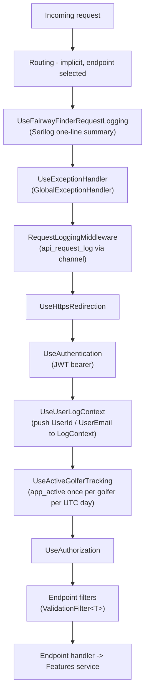
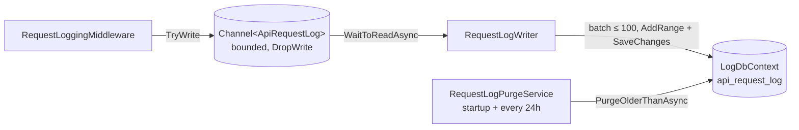

# API host overview

`FairwayFinder.Api` is the only end-user surface: a Minimal API over JWT bearer auth that the iOS app calls, plus three small public routes (the Apple app-site-association file and two deep-link landing pages). This page covers how a request moves through the host, how auth works, how errors and validation come back, and what runs in the background. The endpoint reference is in [endpoints.md](endpoints.md).

Host wiring shared with the admin console (Serilog, OpenTelemetry, settings binding, `RegisterFeatureServices`) is covered in [../architecture/hosting-and-configuration.md](../architecture/hosting-and-configuration.md).

## Startup in brief

`src/FairwayFinder.Api/Program.cs` does, in order:

1. `AddServiceDefaults()` (Serilog, OTel, health checks, HttpClient resilience).
2. Registers `IDbContextFactory<ApplicationDbContext>` (`fairwayfinder`) and `IDbContextFactory<LogDbContext>` (`fairwayfinderlogs`). Both connection strings are required; a missing one throws at startup.
3. ASP.NET Core Identity over `ApplicationDbContext` with the same password policy as Admin: minimum 8 characters, no character-class rules, unique email. No cookie config, because the API never signs in with cookies.
4. JWT bearer authentication. Startup throws if `Jwt:Secret` is missing or shorter than 32 characters.
5. Shared settings, then an APNs check: startup throws unless `Apns:BundleId`, `KeyId`, `TeamId` and `P8Contents` are all set.
6. `RegisterFeatureServices(...)` for the domain layer, plus `ActiveGolferTracker` and `TimeProvider.System`.
7. The request-log channel, `RequestLoggingMiddleware`, and the two hosted services.
8. `GlobalExceptionHandler` + `AddProblemDetails()`, FluentValidation validators from the API assembly, and OpenAPI with the bearer scheme transformer.

The API never runs migrations. The admin host owns migrations and role seeding ([../data/database.md](../data/database.md)).

## Request pipeline

`WebApplication` inserts routing at the start of the pipeline automatically (there is no explicit `UseRouting`), so every middleware below can already see the matched endpoint. That is how both request loggers record the route template.



| Step | Source | Notes |
|---|---|---|
| Serilog request logging | `src/FairwayFinder.ServiceDefaults/LoggingExtensions.cs` (`UseFairwayFinderRequestLogging`) | One `HTTP {Method} {Path} responded {StatusCode}` line per request. Placed before the exception handler so it sees the final status. 5xx or an exception logs at Error; excluded paths drop to Verbose. Adds `RouteTemplate` and `UserId`. |
| Exception handler | `src/FairwayFinder.Api/Exceptions/GlobalExceptionHandler.cs` | Turns exceptions into ProblemDetails. See [Errors](#errors-and-problemdetails). |
| Request log | `src/FairwayFinder.Api/Middleware/RequestLoggingMiddleware.cs` | Writes an `ApiRequestLog` row to a bounded channel; see [Background services](#background-services). |
| Authentication | `Program.cs` | JWT bearer, the default authenticate and challenge scheme. |
| User log context | `LoggingExtensions.UseUserLogContext` | Every log event for the rest of the request carries `UserId` and `UserEmail`, which is how `app_log` rows and PostHog exceptions are tied to a golfer. |
| Active golfer | `src/FairwayFinder.Api/Middleware/ActiveGolferMiddleware.cs` | Reads the `NameIdentifier` claim directly (never `GetUserId()`, which throws) and calls `ActiveGolferTracker.MarkActive`. Tied to requests, not token refresh, because the app only refreshes after its token expires. |
| Authorization | `Program.cs` | Default `AddAuthorization()`; policies are attached per route group. |

Health endpoints (`/health`, `/alive`) come from `MapDefaultEndpoints()` and are only mapped in Development. Logging and tracing details are in [../operations/logging-and-observability.md](../operations/logging-and-observability.md).

> Ordering caveat: `RequestLoggingMiddleware` sits inside `UseExceptionHandler`. When a handler throws (for example `NotFoundException`), the exception passes back through the middleware's `finally` before the handler writes the ProblemDetails response, so the status code it records for thrown errors is whatever the response held at that moment (normally 200), not the final 4xx/5xx. Responses returned as results (`Results.NotFound()`, `Results.Problem(...)`) are recorded correctly. The Serilog summary line is not affected because it sits outside the handler.

There is no rate limiting, CORS, response compression or output caching configured. Login lockout is the only brute-force protection (see below).

## Authentication

### Tokens

| | Access token | Refresh token |
|---|---|---|
| Format | JWT, HMAC-SHA256 over `Jwt:Secret` | 64 random bytes, Base64 |
| Lifetime | `Jwt:AccessTokenExpirationMinutes` (15 in `appsettings.json`; class default 60) | `Jwt:RefreshTokenExpirationDays` (30) |
| Stored | Not stored | `refresh_token` table, as a SHA-256 hex hash only (`RefreshToken.TokenHash`), with `ExpiresAt`, `RevokedAt`, `ReplacedByTokenHash`, `DeviceName` |
| Claims | `NameIdentifier` (user id), `Email`, `GivenName`, `Surname`, one `Role` per Identity role | n/a |

Validation (`Program.cs`) checks issuer (`Jwt:Issuer`, `FairwayFinder.Api`), audience (`Jwt:Audience`, `FairwayFinder.Mobile`), lifetime and signing key, with `ClockSkew = TimeSpan.Zero`, so a token is rejected the second it expires.

All token work lives in `src/FairwayFinder.Api/Auth/JwtTokenService.cs` (scoped). It uses `IDbContextFactory<ApplicationDbContext>` directly; it is API infrastructure, not a Features service.

### Issue, refresh, rotate, revoke

- **Issue**: `POST /api/auth/login` and `POST /api/auth/register` call `GenerateAccessToken` and `IssueRefreshTokenAsync(userId, deviceName)`. Both return `LoginResponse` (`AccessToken`, `RefreshToken`, `ExpiresAt`, `UserId`, `Email`, `FirstName`, `LastName`).
- **Login checks** use `SignInManager.CheckPasswordSignInAsync(..., lockoutOnFailure: true)`. A locked account gets `423 Locked` with a ProblemDetails body; an unknown email or wrong password gets a bare `401`.
- **Rotate**: `POST /api/auth/refresh` calls `RotateRefreshTokenAsync`. A valid token is marked revoked (`RevokedAt = now`, `ReplacedByTokenHash = new hash`) and a new one is issued with the same `DeviceName`. A fresh access token is minted with the user's current roles, so a role change takes effect at the next refresh.
- **Reuse detection**: presenting a token that is already revoked is treated as theft. The service logs a Warning and revokes every active refresh token for that user with one `ExecuteUpdate`, then returns 401. The legitimate client is signed out too, which is the intent.
- **Revoke**: `POST /api/auth/logout` calls `RevokeRefreshTokenAsync` and always answers 204, whether the token existed or not. Access tokens are not revocable; they simply expire.

```mermaid
sequenceDiagram
    participant App as iOS app
    participant API as AuthEndpoints
    participant Tok as JwtTokenService
    participant DB as refresh_token

    App->>API: POST /api/auth/login {email, password, deviceName}
    API->>API: CheckPasswordSignInAsync (lockout on failure)
    API->>Tok: GenerateAccessToken(user, roles)
    API->>Tok: IssueRefreshTokenAsync(userId, deviceName)
    Tok->>DB: INSERT hash(R1), expires +30d
    API-->>App: 200 {accessToken A1, refreshToken R1, expiresAt}

    Note over App: calls API with Authorization: Bearer A1 until it expires

    App->>API: POST /api/auth/refresh {R1}
    API->>Tok: RotateRefreshTokenAsync(R1)
    Tok->>DB: find hash(R1)
    alt R1 active
        Tok->>DB: R1.RevokedAt = now, ReplacedBy = hash(R2); INSERT hash(R2)
        API-->>App: 200 {A2, R2}
    else R1 already revoked (reuse)
        Tok->>DB: revoke ALL active tokens for user
        API-->>App: 401
    else unknown or expired
        API-->>App: 401
    end

    App->>API: POST /api/auth/logout {R2}
    API->>Tok: RevokeRefreshTokenAsync(R2)
    Tok->>DB: R2.RevokedAt = now
    API-->>App: 204
```

`JwtTokenService.RevokeAllForUserAsync` exists but nothing calls it today. In particular a password reset does not revoke existing refresh tokens; sessions on other devices stay valid until their refresh token expires.

### Registration and password reset

Registration is invite-only. `POST /api/auth/register` re-validates the invite code with `IUserInvitationService.ValidateInviteAsync` and takes the email **from the invite, never from the request**, so an account always matches who was invited. It then creates the user (email confirmed, role `User`), claims the invite, captures `user_signed_up`, creates the profile up front (best effort, logged on failure) so the golfer is searchable as a friend immediately, and returns tokens.

Password reset mechanics live in `IPasswordResetService` (Features), because the admin console sends the same link from the other host. `forgot-password` always returns 204 so it cannot be used to enumerate accounts. See [../features/users-and-social.md](../features/users-and-social.md).

### Reading the user id

Endpoints read the signed-in golfer with `ctx.User.GetUserId()` (`src/FairwayFinder.Api/Extensions/ClaimsPrincipalExtensions.cs`), which returns the `ClaimTypes.NameIdentifier` claim and throws `UnauthorizedAccessException` if it is missing. On an authorized endpoint the claim is always present. Never take a user id from a request body: `POST /api/rounds` and `PUT /api/rounds/{id}` overwrite `request.UserId` with the claim before calling the service.

Middleware that must not fail a request (active-golfer tracking, request logging) reads the claim with `FindFirstValue` instead.

### Authorization conventions

- Each endpoint file creates a route group and calls `.RequireAuthorization()` on it. `AuthEndpoints` instead calls `.AllowAnonymous()` on `/api/auth`.
- Admin-only routes use `.RequireAuthorization(p => p.RequireRole(ApplicationRoles.Admin))` (`/api/admin/invites`, `POST /api/devices/test`).
- Access to another golfer's data is checked in the endpoint: `RoundEndpoints.EnsureRoundAccess` returns 404 if the round does not exist and 403 if it belongs to someone else. Friend and game endpoints deliberately return 404 instead of 403 so the response does not confirm that a resource exists.
- `tests/FairwayFinder.Api.IntegrationTests/Conventions/EndpointAuthorizationConventionTests.cs` enforces this over every mapped endpoint (below).

## Errors and ProblemDetails

`AddProblemDetails()` plus `GlobalExceptionHandler` (`src/FairwayFinder.Api/Exceptions/`) give thrown errors an `application/problem+json` body. Endpoints signal failures by throwing the API's exception types, or by returning `Results.Problem(...)` / `Results.ValidationProblem(...)` directly when they need extra fields.

| Exception | Status | Body |
|---|---|---|
| `NotFoundException(entity, id)` | 404 | ProblemDetails, `detail` = "`{entity}` with ID '`{id}`' was not found." |
| `ForbiddenException(entity, id)` | 403 | ProblemDetails, `detail` = "You do not have access to ..." |
| `ConflictException(message)` | 409 | ProblemDetails, `detail` = the message |
| Any other `HttpResponseException(status, message)` | `status` | ProblemDetails, `detail` = message |
| `BadHttpRequestException` (model binding: missing required query value, unparsable body or route value) | its own status, normally 400 | ProblemDetails, `detail` = framework message |
| `FluentValidation.ValidationException` | 400 | `ValidationProblemDetails` with `errors` grouped by property name |
| Anything else | 500 | ProblemDetails, `detail` = "An unexpected error occurred" (no internals leaked) |

Logging follows the rule in CLAUDE.md: only 5xx is logged at Error (with the exception, which also reaches `app_log` and PostHog Error Tracking). A 4xx is logged at Information without a stack trace, since it is the client's mistake answered as designed.

`HttpResponseException` carries a `Value` object (for example `{ error, message, id }`), but the handler forwards only the message. Anything else the client needs must be returned directly. `POST /api/rounds/start` does this for `ActiveRoundExists` so the app gets the open round's id.

Some responses do not use ProblemDetails. Clients should expect these shapes:

| Endpoint | Status | Body |
|---|---|---|
| `POST /api/auth/login`, `/refresh` | 401 | empty |
| `POST /api/rounds/start` (open round exists) | 409 | `{ error: "ActiveRoundExists", message, roundId }` |
| `POST /api/friends/requests` (already friends, already pending, self, unknown user) | 409 | `{ error }` |
| `GET /api/friends/search` (query under 2 chars) | 400 | `{ error }` |
| `DELETE /api/admin/invites/{id}` (not found) | 404 | empty |

Features services cannot throw API exception types (the dependency runs Api to Features), so `RoundEntryService` and `GameService` return result objects (`RoundEntryResult<T>`, `GameResult<T>`) with a status enum. `RoundEndpoints.MapHoleResult` and `GameEndpoints.MapGameResult` map each status to HTTP in one place so the same refusal fails the same way on every route. The mappings are listed in [endpoints.md](endpoints.md).

## Validation

FluentValidation validators live in `src/FairwayFinder.Api/Validators/` and are registered with `AddValidatorsFromAssemblyContaining<Program>()`. They run only when the endpoint opts in:

```csharp
group.MapPost("/start", handler).AddEndpointFilter<ValidationFilter<StartRoundRequest>>();
```

`ValidationFilter<T>` finds the `T` argument, validates it, and throws `ValidationException` on failure, which `GlobalExceptionHandler` turns into a 400 `ValidationProblemDetails`. There is no automatic validation; a validator that exists but is not attached to a route never runs.

| Validator | Request | Notable rules |
|---|---|---|
| `CreateRoundRequestValidator`, `HoleScoreEntryValidator` | `CreateRoundRequest` | ids > 0, holes non-empty; hole number 1–18, par 3–6, score > 0; if `Shots` is present, `StrokesGainedCalculator.ValidateShots` checks the shot chain |
| `UpdateRoundRequestValidator` | `UpdateRoundRequest` | same hole rules |
| `StartRoundRequestValidator` | `StartRoundRequest` | must set one of `FullRound`/`FrontNine`/`BackNine` |
| `UpsertHoleRequestValidator` | `UpsertHoleRequest` | score > 0, shot chain; no par rule because par is resolved server-side from the teebox |
| `CreateGameRequestValidator`, `JoinGameRequestValidator`, `AddParticipantRequestValidator`, `UpsertGameHoleRequestValidator` | game requests | `GameType` must be a declared enum value; handicap allowance 1–100; course handicap -10 to 54; participant needs `UserId` or `DisplayName`; strokes > 0 |
| `RegisterRequestValidator` | `RegisterRequest` | names ≤ 100, `PreferredTees` 0–1, password ≥ 8 |
| `ForgotPasswordRequestValidator`, `ResetPasswordRequestValidator` | password reset | email format, token present, password ≥ 8 |
| `SendInviteRequestValidator` | `SendInviteRequest` | email ≤ 256 |
| `SendFriendRequestRequestValidator` | `SendFriendRequestRequest` | addressee id present |
| `RegisterDeviceRequestValidator`, `SendTestPushRequestValidator` | device requests | token ≤ 256, title ≤ 200, body ≤ 1000, badge ≥ 0 |
| `LoginRequestValidator` | `LoginRequest` | **not attached**: `/api/auth/login` has no `ValidationFilter`, so a malformed login just fails as 401 |

Some rules are domain checks rather than shape checks and stay in the service (a teebox on the wrong course, a round not on the game's course). Those come back as 404/409 through the result mapping.

## Enums and JSON

The API uses the default `System.Text.Json` web options. Enums that clients send or read by name carry `[JsonConverter(typeof(JsonStringEnumConverter))]` on the type itself: `BaselineLevel`, `RoundTrackingLevel`, `GameType`, `GameState`. Other enums (`LieType`, `PreferredTees`, `FriendshipState`, `FriendRequestDirection`) serialize as integers. Query-string enum parameters such as `?level=Hcp10` bind by name.

`DateOnly` values (`DatePlayed`, filter bounds) are `yyyy-MM-dd`. The client sends its own local date for a round; see [../data/database.md](../data/database.md) for why these are not `DateTime`.

## Caching and ETags

The only conditional response is `GET /api/games/{gameId}`, the endpoint a phone polls every few seconds during a live match. `GameEndpoints.WithETag` serializes the whole `GameStateResponse`, hashes it with SHA-256 and returns a weak ETag (`W/"<32 hex chars>"`). If the request's `If-None-Match` contains that tag, it answers `304 Not Modified` with no body.

The hash covers the whole response on purpose: a host changing a course handicap, tees or rules moves net scores without changing any stroke, and a narrower hash would leave a phone showing a stale result. This saves bandwidth only; the game reader and scoring engine have already run by the time the hash is computed. No other endpoint sets cache headers.

## OpenAPI

`AddOpenApi` with `BearerSecuritySchemeTransformer` (`src/FairwayFinder.Api/OpenApi/`) adds an HTTP bearer scheme named `Bearer` and applies it as a document-wide security requirement. In Development only, `Program.cs` maps:

- `/openapi/v1.json` (`MapOpenApi`)
- `/scalar`, a Scalar API reference (title "FairwayFinder API") with C# `HttpClient` as the default snippet

Paste the `accessToken` from `/api/auth/login` into Scalar's auth panel. The three public web routes are `.ExcludeFromDescription()`. Route groups add a tag per file (`Auth`, `Rounds`, ...). Only the deprecated `POST /api/rounds` has a `WithSummary`.

## Background services

Request logging is decoupled from the request so a slow logs database never slows the API.



| Service | File | What it does |
|---|---|---|
| `RequestLoggingMiddleware` | `Middleware/RequestLoggingMiddleware.cs` | Builds an `ApiRequestLog` (method, path, route template, query string, status, duration, user id/email, IP from `X-Forwarded-For` or the connection, user agent, trace id) and `TryWrite`s it. If the channel is full the entry is dropped with a Warning. Exceptions are caught and logged; logging never affects the response. Skipped when `RequestLogging:Enabled` is false or the path matches `RequestLogging:ExcludedPathPrefixes`. |
| `RequestLogWriter` | `BackgroundServices/RequestLogWriter.cs` | Drains the channel in batches of up to 100 into `LogDbContext.ApiRequestLogs`. A failed batch is logged and discarded. |
| `RequestLogPurgeService` | `BackgroundServices/RequestLogPurgeService.cs` | On startup and every 24 hours, calls `ApiRequestLogService.PurgeOlderThanAsync(RequestLogging:RetentionDays)` to hard-delete old rows. |

`RequestLogging` settings: `Enabled` (true), `RetentionDays` (30), `ChannelCapacity` (10000), `ExcludedPathPrefixes` (`/health`, `/alive`, `/openapi`, `/scalar`, `/.well-known`, `/register`, `/reset-password`). The same prefix list is reused by OpenTelemetry tracing and the Serilog summary, so a path not worth a request-log row is not traced either. The admin console shows the rows at its request-logs page ([../admin/console.md](../admin/console.md)).

These are the only hosted services in the API. The GolfCourseAPI import job is registered by `RegisterAdminServices` and runs only in Admin. The `app_log` and PostHog log sinks are Serilog sinks, not hosted services; see [../operations/logging-and-observability.md](../operations/logging-and-observability.md).

## Public web surface

`fairwayfinder.pro` used to serve a Blazor web app. What is left of it is three anonymous routes mapped at the end of `Program.cs`, all `.ExcludeFromDescription()` and excluded from request logging:

| Route | Response | Purpose |
|---|---|---|
| `GET /.well-known/apple-app-site-association` | `application/json`, a constant string | `webcredentials` lets passwords saved for the domain appear on the iOS login screen. `applinks` routes `/register*` and `/reset-password*` into app `J2J8V2R7F8.BjorkTech.FairwayFinder-iOS` when it is installed. |
| `GET /register` | `text/html` landing page | Invite link target (`Invites:RegistrationUrlBase` + `?code=...`). |
| `GET /reset-password` | `text/html` landing page | Password reset link target (`Auth:PasswordResetUrlBase`). |

Both landing pages come from `BuildAppLandingPage(appInstallUrl)`, a static dark page that says the link opens in the app. With `Invites:AppInstallUrl` set (a TestFlight link in `appsettings.json`) it shows a "Get the app" button; otherwise it tells the user to install the app and open the link again. When the app is installed iOS intercepts the link and the page never renders. The query string (invite code, reset token) is not read server-side; the app parses it.

There is no `wwwroot` and no static file middleware.

## Adding an endpoint

1. **Service first.** Put the logic in a Features service method that takes the acting user id as a parameter and returns DTOs or a result object. Endpoints never touch `DbContext`. (`LookupEndpoints` `/miss-types` queries `ApplicationDbContext` directly; it predates the rule and should not be copied.)
2. **Map it in the matching `Endpoints/*Endpoints.cs`** inside the existing group, so it inherits `.RequireAuthorization()` and the tag. A new file needs a `Map...Endpoints` call in `Program.cs`.
3. **Read the user from the token** with `ctx.User.GetUserId()`. Never trust a user id from the body or query.
4. **Check ownership** in the endpoint (`EnsureRoundAccess`-style) or in the service via a result status. Prefer 404 over 403 when a 403 would reveal that something exists.
5. **Validate**: add an `AbstractValidator<T>` in `Validators/` and attach `.AddEndpointFilter<ValidationFilter<T>>()`.
6. **Errors**: throw `NotFoundException`/`ForbiddenException`/`ConflictException`, or map a service result status in one helper like `MapHoleResult`. Return a body directly only when the client needs more than a message.
7. **Analytics**: if the service method is only ever called for the signed-in golfer, capture in the service. If the admin console or a friend view also calls it, capture in the endpoint (see `StatsEndpoints.CaptureStatsViewed`). Add the name to `AnalyticsEvents`. See [../operations/analytics.md](../operations/analytics.md).
8. **Tests** in `tests/FairwayFinder.Api.IntegrationTests/Endpoints/*Tests.cs`, through HTTP, using `SignInNewUserAsync()` (or `SignInNewAdminAsync()`). Cover the happy path, auth (401 without a token, 403/404 for another golfer's data), and validation. See [../testing.md](../testing.md).
9. **Auth convention test**: `EndpointAuthorizationConventionTests` fails for any endpoint that neither requires authorization nor is on its `AnonymousEndpoints` list. Do not add to that list without a reason; if you do, the route must be `.AllowAnonymous()` and get a test in `PublicEndpointsTests` or `AuthEndpointsTests`. Anything under `/api/admin/` must also be on `AdminOnlyEndpoints` and require the `Admin` role.
10. **Config**: a new startup-required config key must be added to `TestSettings` or the host will not boot under test.

The current anonymous list: `POST /api/auth/login`, `/refresh`, `/logout`, `/forgot-password`, `/reset-password`, `/register`, `GET /api/auth/invites/{code}`, `GET /.well-known/apple-app-site-association`, `GET /register`, `GET /reset-password`. Admin-only: `GET`/`POST /api/admin/invites/`, `DELETE /api/admin/invites/{id:int}`, `POST /api/devices/test`.
