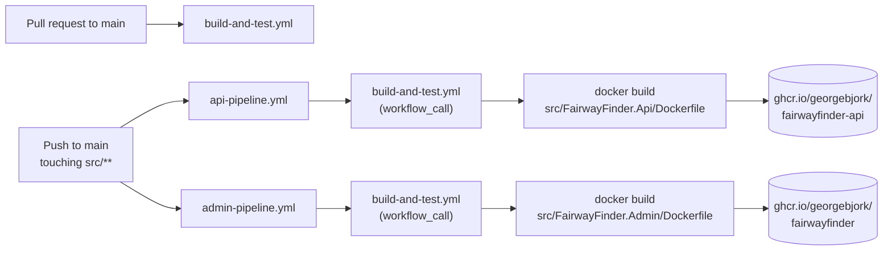

# Deployment

How code gets from `main` to running containers: three GitHub Actions workflows build and test the solution, then build one Docker image per host and push it to GitHub Container Registry. Running those images (the server, reverse proxy, Postgres and secrets) is configured outside this repository.

## Pipeline

### `build-and-test.yml`

Runs on pull requests to `main`, on manual dispatch, and as a reusable workflow (`workflow_call`) from both image pipelines, so nothing reaches GHCR without passing tests.

1. Checkout, set up .NET `10.0.x`.
2. `dotnet restore FairwayFinder.sln`
3. `dotnet build FairwayFinder.sln --configuration Release --no-restore`
4. `dotnet test FairwayFinder.sln --configuration Release --no-build`, writing TRX files to `TestResults/`. The integration tests start Postgres with Testcontainers, which works because `ubuntu-latest` runners have Docker.
5. Upload `TestResults/*.trx` as the `test-results` artifact, even on failure.

A concurrency group cancels an in-progress run when a newer commit lands on the same PR. Runs triggered by pushes to `main` are not cancelled.

### `api-pipeline.yml` and `admin-pipeline.yml`

Identical apart from the Dockerfile and image name. Triggered by a push to `main` that changes anything under `src/`, or manually. Each calls `build-and-test.yml`, then:

1. Logs in to `ghcr.io` with the workflow's `GITHUB_TOKEN` (the workflow has `packages: write`).
2. Builds with `docker/build-push-action@v6`, context = repo root.
3. Pushes two tags: `latest` and the commit SHA.

| Host | Dockerfile | Image |
|---|---|---|
| Api | `src/FairwayFinder.Api/Dockerfile` | `ghcr.io/georgebjork/fairwayfinder-api:{latest,sha}` |
| Admin | `src/FairwayFinder.Admin/Dockerfile` | `ghcr.io/georgebjork/fairwayfinder:{latest,sha}` |

The admin image keeps the name `fairwayfinder` from when that container was the public Blazor web app.

Because the two pipelines are separate workflows, every qualifying push runs the full test suite twice, once per pipeline, and both images are rebuilt even if only one host changed. Changes outside `src/` (docs, tests, workflows) build no images.

## Dockerfiles

Both are the standard Visual Studio multi-stage layout:

| Stage | Base | Does |
|---|---|---|
| `base` | `mcr.microsoft.com/dotnet/aspnet:10.0` | Runs as the non-root `$APP_UID`, exposes 8080 and 8081 |
| `build` | `mcr.microsoft.com/dotnet/sdk:10.0` | Copies `.csproj` files, `dotnet restore`, copies the repo, `dotnet build -c Release` |
| `publish` | `build` | `dotnet publish -c Release /p:UseAppHost=false` |
| `final` | `base` | Copies the publish output, `ENTRYPOINT ["dotnet", "<Host>.dll"]` |

The .NET 10 ASP.NET images listen on port 8080 (HTTP) by default. Nothing configures HTTPS inside the container, so TLS is expected to terminate in front of it.

The Admin Dockerfile copies all six project files it depends on before restoring, so the restore layer is cached until a project file changes. The Api Dockerfile copies only `FairwayFinder.Api.csproj` before its restore; the real restore then happens implicitly in `dotnet build` after `COPY . .`, so for the Api that layer cache does little.

`.dockerignore` (repo root, linked into both projects) excludes `bin/`, `obj/`, `.git`, IDE folders, `.env`, Dockerfiles and compose files.

The AppHost, the test projects and `FairwayFinder.Agents` are not part of either image.

## Environments

| Environment | How it runs | Config source |
|---|---|---|
| Local development | `dotnet run --project src/FairwayFinder.AppHost/`: Aspire runs Postgres and both hosts ([Getting started](../getting-started.md)) | `appsettings.Development.json`, user secrets, AppHost parameters |
| CI | GitHub Actions; Testcontainers Postgres per test assembly | `TestSettings` in the test infrastructure ([Testing](../testing.md)) |
| Production | The two GHCR images, one Postgres server with both databases | Environment variables |

There is no staging environment defined in the repo. `ASPNETCORE_ENVIRONMENT` is unset in the images, so they run as `Production`.

### What production needs

The full key list is in [Hosting and configuration](hosting-and-configuration.md#configuration-reference). For a working production deployment, per container:

| Setting | Api | Admin |
|---|---|---|
| `ConnectionStrings__fairwayfinder`, `ConnectionStrings__fairwayfinderlogs` | Required | Required |
| `Jwt__Secret` (32+ characters) | Required | |
| `Apns__BundleId`, `Apns__KeyId`, `Apns__TeamId`, `Apns__P8Contents` | Required | Required (startup check) |
| `Apns__UseSandbox=false` | Needed: the Api's `appsettings.json` commits `true` | Already `false` |
| `Resend__ApiKey` | Needed for invite and reset emails | Needed for invite and reset emails |
| `GolfCourseApi__ApiKey` | | Needed for imports |
| `SeedUser__*` | | Optional, first admin account |
| `PostHog__ProjectToken` | Optional, turns on analytics and error tracking | Same |
| `OTEL_EXPORTER_OTLP_ENDPOINT`, `_PROTOCOL`, `_HEADERS` | Optional; production ships logs and traces to PostHog (`https://us.i.posthog.com/i`, `http/protobuf`, `Authorization=Bearer%20phc_...`) | Same |

The database user for Admin needs rights to run migrations. If it lacks `CREATEDB`, create `db-fairwayfinder-logs` by hand before the first start. Admin migrates both databases at startup and the Api assumes the schema is there, so after a release that includes a migration, the Admin container has to start (and finish migrating) before the new Api serves traffic that depends on the change.

The public hostname `api.fairwayfinder.pro` must route to the Api container: invite and password-reset links point at its `/register` and `/reset-password`, and iOS fetches `/.well-known/apple-app-site-association` from it for universal links. See [API overview](../api/overview.md).

### Operational notes

- **No production health endpoint.** `MapDefaultEndpoints` maps `/health` and `/alive` only in Development, so a container orchestrator's HTTP health probe has nothing to call. Use a TCP check, or change `MapDefaultEndpoints`.
- **Reverse proxy headers.** Neither host calls `UseForwardedHeaders`. Both call `UseHttpsRedirection`, and the admin cookie is `Secure` only. Behind a TLS-terminating proxy, the hosts see plain HTTP unless forwarded headers are enabled (for example `ASPNETCORE_FORWARDEDHEADERS_ENABLED=true`). Check this before changing the proxy setup.
- **Data Protection keys live in the main database**, so containers can be replaced freely without invalidating admin sessions or reset links. Keep the `FairwayFinder` application name unchanged ([Hosting and configuration](hosting-and-configuration.md#data-protection)).
- **Log retention runs inside the hosts**: `RequestLogPurgeService` in the Api and `AppLogPurgeService` in Admin, at startup and every 24 hours. There are no external cron jobs. See [Logging and observability](../operations/logging-and-observability.md).
- **Rollback** is redeploying the previous SHA tag. EF migrations are not rolled back automatically, so a rollback across a schema change needs a manual down-migration or a forward fix.
