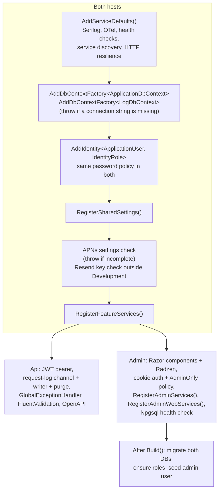
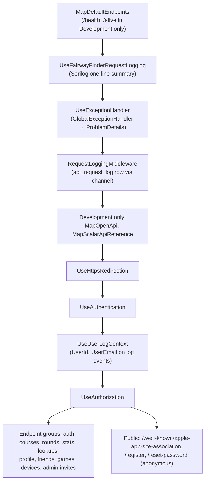

# Hosting and configuration

How the two hosts start up: what each `Program.cs` registers, the order of their middleware pipelines, what the Aspire AppHost and ServiceDefaults add, and every configuration key the code reads. For the bigger picture see the [Architecture overview](overview.md); for containers and CI see [Deployment](deployment.md).

## Startup at a glance



The order of the steps differs slightly between the two files (the Api reads the JWT section before `RegisterSharedSettings`), but the content is as shown.

## FairwayFinder.Api

`src/FairwayFinder.Api/Program.cs`, in order:

1. `builder.AddServiceDefaults()` (see [ServiceDefaults](#servicedefaults)).
2. Two `IDbContextFactory` registrations, `ApplicationDbContext` on `ConnectionStrings:fairwayfinder` and `LogDbContext` on `ConnectionStrings:fairwayfinderlogs`. Either missing throws `InvalidOperationException`.
3. ASP.NET Core Identity with the shared password policy (8 characters minimum, no character-class rules, unique email, no confirmed account required) and default token providers. No cookie configuration; the API never issues cookies.
4. JWT: binds `Jwt` to `JwtSettings` (`src/FairwayFinder.Api/Auth/JwtSettings.cs`), throws unless `Jwt:Secret` is at least 32 characters, registers `JwtTokenService`, and configures `JwtBearer` as the default authenticate and challenge scheme with issuer, audience, lifetime and signing-key validation and `ClockSkew = TimeSpan.Zero` (an expired access token is rejected at once, so the app must refresh). Token issuing and refresh tokens are covered in [API overview](../api/overview.md).
5. `RegisterSharedSettings`, then the [APNs and Resend checks](#startup-checks).
6. `RegisterFeatureServices(configuration, isDevelopment)`.
7. Request logging to the database: a bounded `Channel<ApiRequestLog>` sized by `RequestLogging:ChannelCapacity` with `DropWrite` on overflow, the scoped `RequestLoggingMiddleware`, and two hosted services, `RequestLogWriter` (drains the channel into `api_request_log`) and `RequestLogPurgeService` (deletes rows older than `RequestLogging:RetentionDays`, at startup and every 24 hours).
8. `GlobalExceptionHandler` plus `AddProblemDetails()`.
9. FluentValidation validators from the Api assembly (`src/FairwayFinder.Api/Validators`).
10. OpenAPI with `BearerSecuritySchemeTransformer`, so Scalar shows a bearer auth input.

### Api pipeline



The ordering is deliberate:

- The Serilog request summary sits before `UseExceptionHandler` so it sees the final status code that the handler writes. The exception itself is logged by the handler, not twice.
- `RequestLoggingMiddleware` runs inside the exception handler, so it records the status the client actually got, and it reads the user on the way out, after authentication has run further in.
- `UseUserLogContext` comes straight after `UseAuthentication`, because it reads the `NameIdentifier` claim.

Endpoints and the public surface are documented in [API overview](../api/overview.md) and [Endpoint reference](../api/endpoints.md). `public partial class Program;` at the bottom exposes the entry point to `WebApplicationFactory` in the integration tests.

## FairwayFinder.Admin

`src/FairwayFinder.Admin/Program.cs`, in order:

1. `AddServiceDefaults()`.
2. The same two context factories and connection-string checks, plus `AddDatabaseDeveloperPageExceptionFilter()`.
3. `AddRazorComponents().AddInteractiveServerComponents()` and `AddRadzenComponents()`.
4. `AddFairwayFinderAuthentication()` (`src/FairwayFinder.Admin/Startup/AuthenticationConfiguration.cs`): Identity with the same password policy as the API, so a password set on one side is valid on the other, plus the application cookie: name `.fairway.finder.admin`, `Secure` always, 8 hours sliding, login `/login`, logout `/authentication/logout`, access denied `/access-denied`.
5. `AddFairwayFinderAuthorization()` (`Startup/AuthorizationConfiguration.cs`): one policy, `Policies.AdminOnly`, requiring an authenticated user in the `Admin` role. There is deliberately no fallback policy; it would block the SignalR negotiation that interactive server pages use. Each page opts in with `[Authorize(Policy = Policies.AdminOnly)]`, and `AuthorizeRouteView` in `Components/Routes.razor` enforces it.
6. `AddCascadingAuthenticationState()`, `RegisterSharedSettings`, the APNs check, then the Resend key check outside Development (the console sends invites and password resets). The admin console never sends a push, but `FriendService`, `GameService` and the round notification helpers inject `IPushNotificationService`, which resolves the `IApnsClient` singleton, so the check is there to fail at boot instead of when an admin first opens a round.
7. `RegisterFeatureServices`, `RegisterAdminServices`, and `RegisterAdminWebServices()` (`Startup/ServiceRegistration.cs`): `IdentityRedirectManager`, `BreadcrumbState`, `ApplicationStartupService`, the singleton `CircuitTrackingService` with its `TrackingCircuitHandler`, `LogContextCircuitHandler` (pushes the admin's user onto log events inside a Blazor circuit, where there is no per-request middleware), the hosted `AppLogPurgeService`, and `IHttpContextAccessor`.
8. An Npgsql health check named `FairwayFinderDatabase` against the main connection string, shown on the admin Health page.

After `Build()`, before the pipeline, Admin creates a scope and calls `IApplicationStartupService` (`src/FairwayFinder.Admin/Services/ApplicationStartupService.cs`):

- `RunMigrationsAsync` applies pending migrations to `ApplicationDbContext`, then `LogDbContext`. Migrating the logs context creates `db-fairwayfinder-logs` if it doesn't exist, which needs `CREATEDB`; without that privilege create the database by hand once.
- `EnsureRolesExistAsync` creates the `Admin` and `User` roles.
- `SeedDefaultUserAsync` creates the `SeedUser` account as a confirmed `Admin` with a profile, if both email and password are set and the email is not taken.

The Api never migrates, so on a fresh database Admin must start first. The AppHost doesn't enforce that ordering (both wait only for the databases); in practice Admin migrates within a few seconds.

### Admin pipeline

1. `MapDefaultEndpoints()` (Development only).
2. `UseFairwayFinderRequestLogging()`, which also skips `/_framework`, `/_content` and `/_blazor` traffic.
3. Development: `UseMigrationsEndPoint()`. Otherwise: `UseExceptionHandler("/Error")` and `UseHsts()`.
4. `UseStatusCodePagesWithReExecute("/not-found")`.
5. `UseHttpsRedirection`, `UseAuthentication`, `UseUserLogContext`, `UseAuthorization`, `UseAntiforgery`.
6. `MapStaticAssets().AllowAnonymous()`, `MapRazorComponents<App>().AddInteractiveServerRenderMode()`.
7. `GET /authentication/logout`, which signs out and redirects to `/login`.

The admin Health page is routed at `/health` (`Components/Pages/Diagnostics/Pages/HealthChecks.razor`), the same path `MapDefaultEndpoints` uses in Development. Over plain HTTP that path answers with a login redirect, which is why the AppHost health-checks Admin on `/alive` instead.

## Data Protection

Registered at the top of `RegisterFeatureServices` (`src/FairwayFinder.Features/ServiceRegistration.cs`) so both hosts get the identical setup:

```csharp
services.AddDataProtection()
    .PersistKeysToDbContext<ApplicationDbContext>()
    .SetApplicationName("FairwayFinder");
```

Identity's password-reset tokens are Data Protection payloads, and the admin console can mint a reset link that the API redeems. That only works if both hosts read the same key ring (stored in Postgres, not in each container's filesystem, which would also be lost on redeploy) and use the same application discriminator (by default derived from the content root path, which differs between the two containers). Changing the application name invalidates every outstanding reset link and every admin cookie.

## Domain service registration

`RegisterFeatureServices(config, isDevelopment)`, called by both hosts:

| Registration | Lifetime | Notes |
|---|---|---|
| Data Protection | | See above |
| `IRoundService`, `IRoundEntryService`, `IStatsService`, `ICourseService`, `IProfileService`, `IFriendService`, `IGameService` | Transient | Core domain services |
| `GameScoreReader` | Transient | Where a game's two score sources converge ([Games](../features/games.md)) |
| `IGameScoringEngine` ×3 (`MatchPlay`, `Skins`, `HighLow`), `IGameScoringEngineResolver` | Singleton | Stateless engines indexed by `GameType` |
| `IUserInvitationService`, `ApiRequestLogService` | Transient | Used by both hosts |
| `ILogEventSink` → `DatabaseLogSink` | Singleton | Only if `AppLogging:Enabled` is not false. Picked up by Serilog's `ReadFrom.Services` |
| `IPasswordResetService` | Transient | |
| Named `HttpClient` `"apns"`, `IApnsClient` (JWT auth from `ApnsSettings`) | Singleton | Built on first resolve, not at startup |
| `IPushNotificationService` | Scoped | |
| `IEmailSender` | Transient | `DevEmailSender` in Development (logs instead of sending), `ResendEmailSender` otherwise |

`RegisterAdminServices(config)`, Admin only:

| Registration | Notes |
|---|---|
| `UserAdminService`, `AdminDashboardService`, `AdminRoundService`, `AdminDeviceService`, `AdminGameService`, `AppLogService` | Cross-user administration |
| Typed `HttpClient` `TgtrHttpClient`, `TgtrTransferService` | Base address from `Tgtr:BaseUrl` |
| Typed `HttpClient` `GolfCourseApiHttpClient`, `GolfCourseApiImportService` | Base address `GolfCourseApi:BaseUrl`, header `Authorization: Key {GolfCourseApi:ApiKey}` |
| `Channel<int>` (capacity 1), `GolfCourseApiImportState`, `GolfCourseApiImportJob` (also as hosted service) | The background import pipeline ([Course imports](../features/course-imports.md)) |

The Tgtr and GolfCourseApi `?? throw` checks run inside the `HttpClient` configure delegates, so a missing value fails when the client is first created, not at startup. An empty string (as in `appsettings.json` for the API key) passes the check.

Every `HttpClient` from the factory gets `AddStandardResilienceHandler()` (retries, timeouts, circuit breaker) and service discovery via ServiceDefaults.

## ServiceDefaults

`src/FairwayFinder.ServiceDefaults` is the Aspire-style shared project both hosts call first.

- **`AddServiceDefaults()`** (`Extensions.cs`): `ConfigureSerilog()`, `ConfigureOpenTelemetry()`, a `self` liveness health check tagged `live`, service discovery, and resilience on every `HttpClient`.
- **Serilog** (`LoggingExtensions.ConfigureSerilog`): replaces the logger factory. Levels from the `Serilog` section, sinks from DI (`ReadFrom.Services`, which is how `DatabaseLogSink` attaches), console always (with a timestamp only in Development), and an OTLP sink only when `OTEL_EXPORTER_OTLP_ENDPOINT` is set. The OTLP sink ships Warning+ from anything plus Information from `FairwayFinder.*` sources and the request summary line. There is intentionally no static bootstrap logger because the integration tests build several hosts per process.
- **OpenTelemetry** (`ConfigureOpenTelemetry`): resource `service.name` = application name and `deployment.environment`. Metrics from the named meters only (`Microsoft.AspNetCore.Hosting`, `System.Net.Http`, `Npgsql`, and `FairwayFinder.Rounds/Stats/Imports/Email/Agents/Games`). Tracing with `AlwaysOnSampler`, ASP.NET Core (minus excluded paths), HttpClient and Npgsql instrumentation, and the `FairwayFinder.*` activity sources. Exporters are added only when `OTEL_EXPORTER_OTLP_ENDPOINT` is set.
- **Incoming trace context is ignored.** `IgnoreIncomingTraceContextPropagator` drops any `traceparent` from callers and the SDK's default text-map propagator is set to an empty composite. The callers are phones whose parent spans never reach the backend, which would otherwise leave every request orphaned under a missing root, and an unsampled `-00` header would drop spans. Outgoing calls still carry the context.
- **Excluded paths** (`GetExcludedPaths`): `/health`, `/alive`, plus `RequestLogging:ExcludedPathPrefixes`. One list drives the trace filter, the Serilog request-summary level, and (in the Api) `RequestLoggingMiddleware`, so they cannot drift.
- **`MapDefaultEndpoints()`** maps `/health` (all checks) and `/alive` (`live` checks) **only in Development**. Production containers expose no health endpoint.
- **`UseFairwayFinderRequestLogging()`** and **`UseUserLogContext()`**: see the pipelines above and [Logging and observability](../operations/logging-and-observability.md).

## Aspire AppHost

`src/FairwayFinder.AppHost/AppHost.cs` is for local development only; production does not use Aspire (see [Deployment](deployment.md)). It declares parameters for the Postgres credentials and every secret, starts the pinned `postgres:17.6-bookworm` container with a persistent volume and PgWeb, creates the two databases, and runs both projects with references to both databases (Aspire injects `ConnectionStrings__fairwayfinder` and `ConnectionStrings__fairwayfinderlogs`) plus the secrets as environment variables. The `WithApns` and `WithDashboardLinks` helpers at the bottom of the file keep the two project declarations short. It also sets the `OTEL_*` variables, so locally logs, traces and metrics flow to the Aspire dashboard. Setup steps are in [Getting started](../getting-started.md).

## Startup checks

What stops a host from booting:

| Check | Host | Where |
|---|---|---|
| `ConnectionStrings:fairwayfinder` present | Both | `Program.cs` |
| `ConnectionStrings:fairwayfinderlogs` present | Both | `Program.cs` |
| `Jwt:Secret` present and at least 32 characters | Api | `Program.cs` |
| `Apns:BundleId`, `KeyId`, `TeamId`, `P8Contents` all non-blank | Both | `Program.cs` |
| `Resend:ApiKey` non-blank, outside Development only (Development uses `DevEmailSender`) | Both | `Program.cs` |
| Both databases reachable and migratable | Admin | `ApplicationStartupService.RunMigrationsAsync` |

`tests/FairwayFinder.IntegrationTests.Common/TestSettings.cs` holds a value for every key either host needs to boot. A new startup-required key must be added there too, or neither host starts under test. Tests run in the `Testing` environment, so the Resend check is live under test; `tests/FairwayFinder.Api.IntegrationTests/Conventions/ProductionConfigurationTests.cs` asserts the Api refuses to boot without the key and that the committed `Apns:UseSandbox` is `false` outside Development.

## Configuration reference

Configuration comes from `appsettings.json`, `appsettings.{Environment}.json`, user secrets (Development; each host and the AppHost have their own `UserSecretsId`), and environment variables (`Section__Key`). In production, secrets are environment variables.

"Startup" means the host refuses to boot without it. "Lazy" means it fails, or silently misbehaves, on first use.

| Key | Read by | Required | Default / committed value | Notes |
|---|---|---|---|---|
| `ConnectionStrings:fairwayfinder` | Both `Program.cs`; Admin health check | Startup | `localhost`, `db-fairwayfinder`, `user`/`password` | Injected by Aspire locally |
| `ConnectionStrings:fairwayfinderlogs` | Both `Program.cs` | Startup | `localhost`, `db-fairwayfinder-logs` | |
| `Jwt:Secret` | Api `Program.cs`, `JwtTokenService` | Startup (≥32 chars) | none | HMAC signing key. Aspire parameter `jwt-secret` |
| `Jwt:Issuer` | Api | No | `FairwayFinder.Api` | Validated on every token |
| `Jwt:Audience` | Api | No | `FairwayFinder.Mobile` | Validated on every token |
| `Jwt:AccessTokenExpirationMinutes` | `JwtTokenService` | No | 15 (class default 60) | |
| `Jwt:RefreshTokenExpirationDays` | `JwtTokenService` | No | 30 | |
| `Apns:BundleId`, `Apns:KeyId`, `Apns:TeamId` | Both `Program.cs`; `IApnsClient` factory | Startup | empty | |
| `Apns:P8Contents` | Same | Startup | empty | The `.p8` key text |
| `Apns:UseSandbox` | `PushNotificationService` | No | `false` in both `appsettings.json` files; `true` in both Development files | Sends to APNs' development server. Only Development uses it; App Store / TestFlight builds need the production server |
| `Resend:ApiKey` | `ResendEmailSender` (non-Development); both `Program.cs` | Startup (outside Development) | empty | Placeholder in both `appsettings.json` files; production must set `Resend__ApiKey` on both hosts. The AppHost passes it only to Admin, which is fine because Aspire runs in Development |
| `Invites:RegistrationUrlBase` | `UserInvitationService` | No | `https://api.fairwayfinder.pro/register` (code fallback `https://fairwayfinder.pro/register`) | Invite link base |
| `Invites:AppInstallUrl` | `UserInvitationService`; Api landing pages | No | TestFlight join link | Shown in invite emails and on `/register`, `/reset-password` |
| `Auth:PasswordResetUrlBase` | `PasswordResetService` | No | `https://api.fairwayfinder.pro/reset-password` | Reset link base |
| `RequestLogging:Enabled` | `RequestLoggingMiddleware` | No | `true` | Api only. Tests set it `false` |
| `RequestLogging:RetentionDays` | `RequestLogPurgeService` | No | 30 | |
| `RequestLogging:ExcludedPathPrefixes` | `RequestLoggingMiddleware`; ServiceDefaults (both hosts) | No | health, docs, `/.well-known`, `/register`, `/reset-password` | Also excludes from traces and the request summary log |
| `RequestLogging:ChannelCapacity` | Api `Program.cs` | No | 10000 | Overflow drops entries |
| `AppLogging:Enabled` | `RegisterFeatureServices` | No | `true` (class default; not in any appsettings) | Registers `DatabaseLogSink` |
| `AppLogging:MinimumLevel` | `DatabaseLogSink` | No | `Warning` | Lowest level written to `app_log` |
| `AppLogging:QueueLimit`, `AppLogging:FlushIntervalMs` | `DatabaseLogSink` | No | 10000, 2000 | |
| `AppLogging:RetentionDays` | `AppLogPurgeService` (Admin) | No | 30 | |
| `SeedUser:Email`, `Password`, `FirstName`, `LastName` | `ApplicationStartupService` (Admin) | No | empty | Seeding skipped unless email and password set |
| `Tgtr:BaseUrl` | `TgtrHttpClient` (Admin) | Lazy | `https://tgtr-api.azurewebsites.net` | |
| `GolfCourseApi:BaseUrl` | `GolfCourseApiHttpClient` (Admin) | Lazy | `https://api.golfcourseapi.com` | |
| `GolfCourseApi:ApiKey` | `GolfCourseApiHttpClient` (Admin) | Lazy | empty | Aspire parameter `golfcourseapi-api-key` |
| `OpenAI:Model`, `OpenAI:ApiKey` | `OpenAiAgentFactory` (Agents) | No | not set | Bound by `RegisterSharedSettings` but unused: Agents is unreferenced |
| `Claude:Model`, `Claude:ApiKey` | `ClaudeAgentFactory` (Agents) | No | not set | Same |
| `Serilog:MinimumLevel:*` | Serilog | No | Information, with `Microsoft`, EF Core, Npgsql, `System.Net.Http`, Polly at Warning | Development raises `Microsoft.EntityFrameworkCore.Database.Command` to Information to show SQL |
| `AllowedHosts` | ASP.NET Core | No | `*` | |
| `OTEL_EXPORTER_OTLP_ENDPOINT` (env) | ServiceDefaults | No | unset | Turns on the OTLP exporters and Serilog OTLP sink. In production, point it at whichever OTLP backend should receive logs and traces |
| `OTEL_EXPORTER_OTLP_PROTOCOL`, `OTEL_EXPORTER_OTLP_HEADERS`, `OTEL_SERVICE_NAME`, `OTEL_RESOURCE_ATTRIBUTES` (env) | OTel SDK, Serilog OTLP sink | No | unset | Whatever the chosen backend needs (protocol, auth header) |
| `ASPNETCORE_ENVIRONMENT` (env) | Both | No | `Production` | See below |

### What `Development` changes

| Behaviour | Development | Otherwise |
|---|---|---|
| `IEmailSender` | `DevEmailSender` (logs) | `ResendEmailSender` |
| `/health`, `/alive` | Mapped | Not mapped |
| OpenAPI + Scalar (Api) | Mapped | Not mapped |
| Admin error handling | `UseMigrationsEndPoint`, developer exception page | `/Error` page, HSTS |
| Console log template | With timestamp | Without (the platform adds one) |
| APNs | Sandbox (via `appsettings.Development.json`) | Per `Apns:UseSandbox` |
| User secrets | Loaded | Not loaded |
