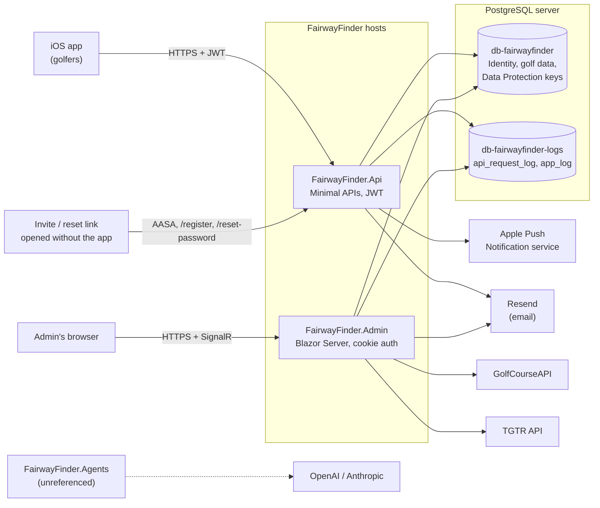
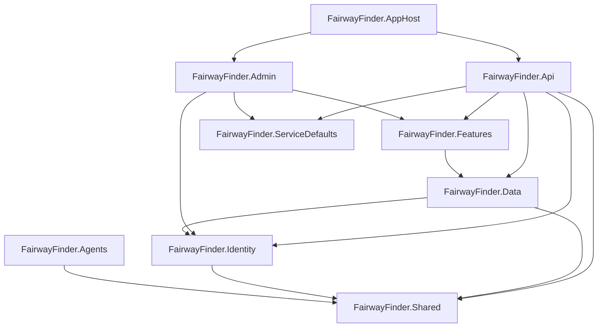
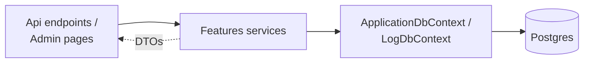

# Architecture overview

FairwayFinder is a golf stat tracker with two ASP.NET Core 10 hosts over one PostgreSQL server: a JWT-secured REST API that the iOS app uses, and an internal Blazor Server admin console. Both share a single domain layer (`FairwayFinder.Features`) that talks to EF Core directly, with no repository layer in between.

## System context

| External system | Used by | For | Doc |
|---|---|---|---|
| APNs | Api (Admin registers the client but does not send) | Push notifications for friend requests, rounds, games | [Notifications and email](../features/notifications-and-email.md) |
| Resend | Both, outside Development | Invite and password-reset emails | [Notifications and email](../features/notifications-and-email.md) |
| GolfCourseAPI | Admin | Bulk course import | [Course imports](../features/course-imports.md) |
| TGTR | Admin | Transferring a player's rounds from the external TGTR API, through mapped players, courses and teeboxes | [Course imports](../features/course-imports.md) |
| OpenAI / Anthropic | Nobody yet | `FairwayFinder.Agents` scorecard OCR, kept for a future API feature | below |

## The two hosts

**`FairwayFinder.Api`** is the only end-user surface. The iOS app calls `/api/*` endpoints with a bearer JWT (short-lived access token plus refresh tokens). It also serves the little that is left of the old public website: `/.well-known/apple-app-site-association` and two static landing pages, `/register` and `/reset-password`, for invite and reset links opened on a device without the app. In production `api.fairwayfinder.pro` is the host for those links. See [API overview](../api/overview.md).

**`FairwayFinder.Admin`** is an internal Blazor Server console (Radzen components, interactive server rendering). Every page requires the `Admin` role through the `AdminOnly` policy. It covers user management, invites, course and teebox data entry, cross-user round inspection and repair, stats and strokes-gained diagnostics, request and app logs, health, and the import tools. It also owns the database lifecycle: it applies EF migrations for both databases and seeds roles and the seed admin user on startup, and it runs the `app_log` retention purge. End-user features do not belong here. See [Admin console](../admin/console.md).

The split exists because the public website was removed: the iOS app replaced it for golfers, and what remained was operator tooling that a phone shouldn't do. Splitting the hosts means the API's attack surface is only what the app needs, and admin-only services (imports, cross-user edits) are not even registered in the API container.

| | Api | Admin |
|---|---|---|
| Users | Golfers, via the iOS app | Admins only |
| Auth | JWT bearer (`Microsoft.AspNetCore.Authentication.JwtBearer`) | Identity cookie `.fairway.finder.admin`, 8 h sliding |
| UI | None (JSON), plus 3 static public routes | Blazor Server + Radzen |
| Feature services | `RegisterFeatureServices` | `RegisterFeatureServices` + `RegisterAdminServices` |
| Background jobs | `RequestLogWriter`, `RequestLogPurgeService` | `GolfCourseApiImportJob`, `AppLogPurgeService` |
| Migrations | Assumes the schema exists | Applies both on startup |
| Container image | `ghcr.io/georgebjork/fairwayfinder-api` | `ghcr.io/georgebjork/fairwayfinder` |

Both hosts share Identity tables and a Data Protection key ring stored in Postgres, pinned to the application name `FairwayFinder`. That is what lets the admin console mint a password-reset token that the API can redeem. Details in [Hosting and configuration](hosting-and-configuration.md#data-protection).

## Projects

| Project | Role |
|---|---|
| `src/FairwayFinder.Api` | REST API host: endpoints, JWT issuing, validators, exception handling, request-log middleware and background writer |
| `src/FairwayFinder.Admin` | Admin console host: Razor components under `Components/`, startup migrations and seeding (`Services/ApplicationStartupService.cs`), auth setup (`Startup/`) |
| `src/FairwayFinder.Features` | Domain services, DTOs (`Data/`), game engines (`Games/`), scoring and stats helpers (`Helpers/`), HTTP clients for external APIs, `ServiceRegistration.cs` |
| `src/FairwayFinder.Data` | `ApplicationDbContext`, `LogDbContext`, entities, enums, the audit interceptor, migrations |
| `src/FairwayFinder.Identity` | `ApplicationUser`, `ApplicationRoles` (`Admin`, `User`), `PreferredTees` |
| `src/FairwayFinder.Shared` | Settings classes (`Settings/`), `RegisterSharedSettings`, `IAuditable` |
| `src/FairwayFinder.ServiceDefaults` | Serilog setup, OpenTelemetry, default health checks, HTTP client resilience, request-log and user-log-context middleware |
| `src/FairwayFinder.AppHost` | .NET Aspire orchestration for local development only |
| `src/FairwayFinder.Agents` | `ScorecardScoresReaderAgent` (reads handwritten scores from a scorecard photo) on Microsoft Agents AI, with `OpenAiAgentFactory` and `ClaudeAgentFactory`. **Not referenced by any host.** It is in the solution and builds, but nothing registers `AddAgentServices()`. |
| `tests/*` | Unit tests, API and Admin integration tests, and shared test infrastructure. See [Testing](../testing.md). |

## Project dependencies

Project references as declared in the `.csproj` files:

`ServiceDefaults` has no project references; it only depends on ASP.NET Core, OpenTelemetry and Serilog packages. `Agents` hangs off `Shared` alone and nothing depends on it.

The arrow from `Features` to the hosts never reverses. That is why `RoundEntryService` returns a `RoundEntryResult<T>` status instead of throwing the API's `NotFoundException`/`ConflictException`: Features cannot see those types, so `RoundEndpoints` maps the status to HTTP.

## Layering rules

- Endpoints and Razor pages call services. They never touch a `DbContext`.
- Services in Features own business logic and query EF Core directly, almost always through an injected `IDbContextFactory<ApplicationDbContext>`. There are no repositories.
- Services return DTOs (in `src/FairwayFinder.Features/Data/`), never EF entities.
- `FairwayFinder.Data` owns the contexts, entity configuration and migrations, and nothing else.
- Features and Data contain no UI code.
- `src/FairwayFinder.Admin/Services/` is for UI-layer plumbing only (`CircuitTrackingService`, `LogContextCircuitHandler`, `ApplicationStartupService`, `AppLogPurgeService`). Domain logic goes in Features.
- Admin code acting on another user's data passes the target user id explicitly and uses the admin's id only for `CreatedBy`/`UpdatedBy`. `AdminRoundService.UpdateRoundAsAdminAsync` is the reference: it re-resolves the round's owner on the server.

Services are grouped by domain (rounds, stats, courses, profiles, friends, games, invitations, password reset, push). Rounds are deliberately split by lifecycle into `RoundService` (reads, edits, deprecated whole-round submit) and `RoundEntryService` (hole-by-hole entry), sharing `Helpers/RoundScoringHelper` so their scoring cannot drift. See [Rounds](../features/rounds.md).

## Key decisions

| Decision | Reason | Where |
|---|---|---|
| Service → EF Core, no repositories | Less indirection; EF's `DbContext` already is the unit of work. | `src/FairwayFinder.Features/Services` |
| Two databases on one server | Log volume and retention deletes never touch golf data. | [Database](../data/database.md) |
| Admin owns migrations | One process applies schema changes; the API assumes the schema exists. | `src/FairwayFinder.Admin/Program.cs` |
| Shared Data Protection key ring in Postgres, fixed application name | Reset tokens minted by Admin must decrypt in the Api, and survive redeploys. | `RegisterFeatureServices` |
| Hosts throw at startup on missing required config | A misconfigured container fails its deploy instead of failing the first request that needs the setting. | [Hosting and configuration](hosting-and-configuration.md#startup-checks) |
| Every incoming request starts a new trace | Phone SDKs send `traceparent` headers pointing at spans the backend never receives. | `IgnoreIncomingTraceContextPropagator` |
| `round.is_complete` gates every list and stats query | An in-progress round's running total would otherwise look like a great round. | [Rounds](../features/rounds.md) |
| Calendar dates are `DateOnly`, audit stamps are UTC `timestamptz` | A round is played on the golfer's local day. | [Database](../data/database.md) |
| No end-user web UI | The iOS app is the product; the admin console is tooling. | This page |

## Where to go next

- How the hosts boot, what they register and every configuration key: [Hosting and configuration](hosting-and-configuration.md)
- CI, images and environments: [Deployment](deployment.md)
- Data model: [Database](../data/database.md), [Schema](../data/schema.md)
