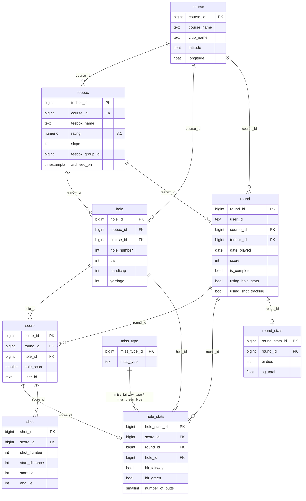
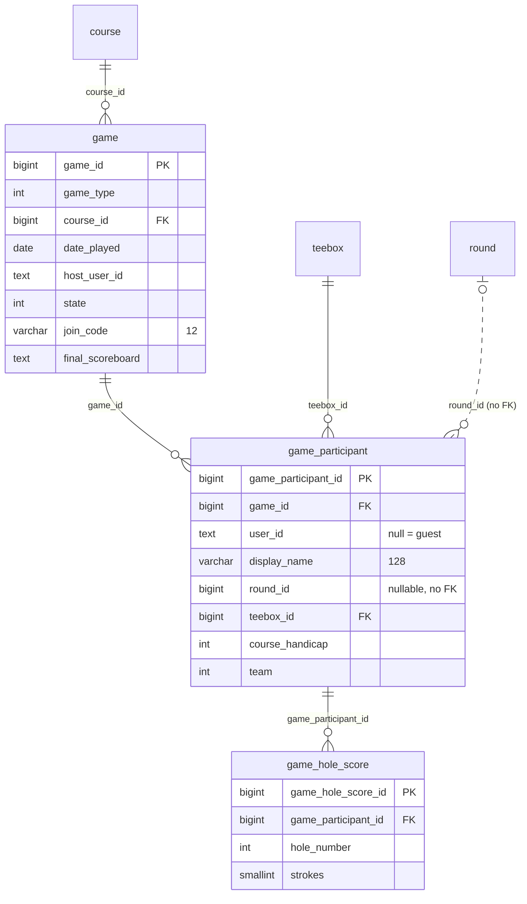
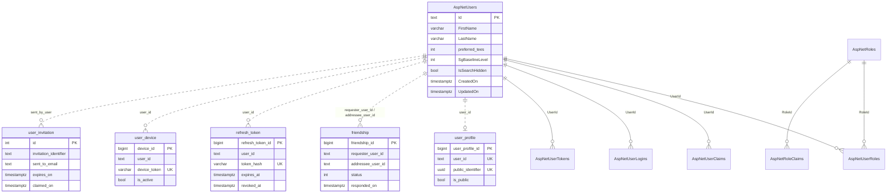
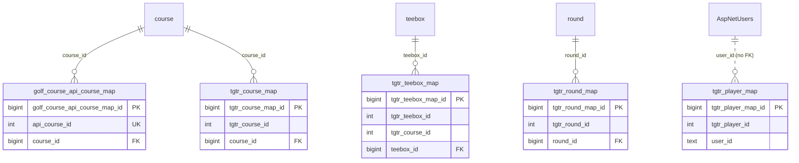
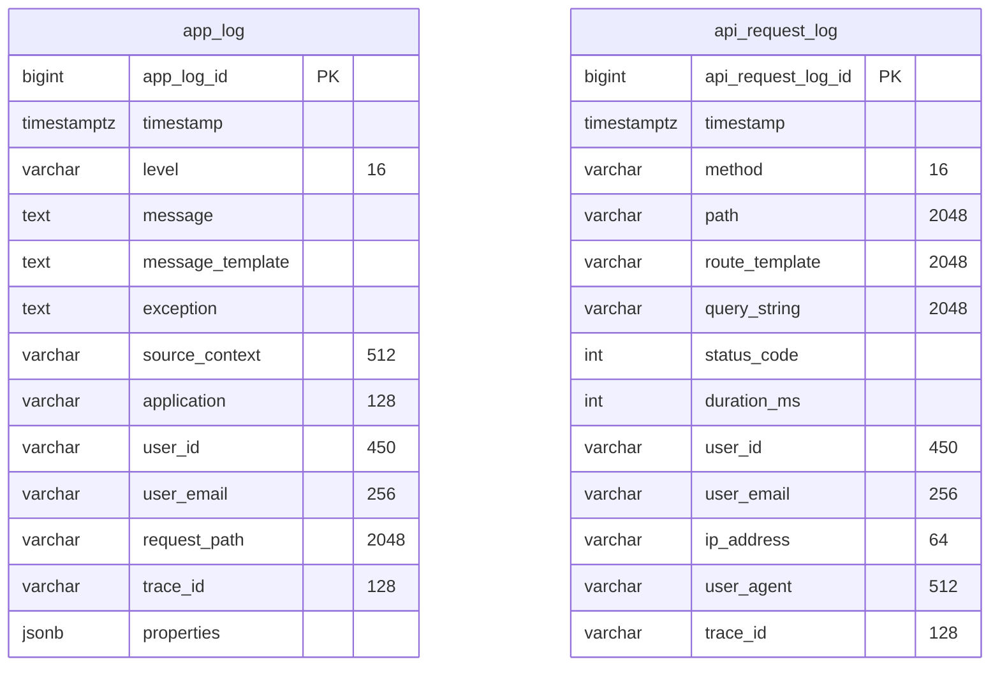

# Schema

Table-by-table reference for both databases: what each table holds, how it relates to the others, and what each index enforces. Conventions shared by all tables (snake_case names, audit columns, `is_deleted`, UTC timestamps) are explained in [database.md](database.md) and not repeated per table. The source of truth is `OnModelCreating` in `src/FairwayFinder.Data/ApplicationDbContext.cs` and `src/FairwayFinder.Data/LogDbContext.cs`, plus `Migrations/ApplicationDbContextModelSnapshot.cs` and `Migrations/Logs/LogDbContextModelSnapshot.cs`.

**Common columns.** Unless a table says otherwise, it has `created_by text`, `created_on timestamptz`, `updated_by text`, `updated_on timestamptz` and `is_deleted boolean` (the entity implements `IAuditable`). The `_by` columns hold an Identity user id.

**Users are not foreign keys.** Every `user_id`, `host_user_id`, `requester_user_id`, `created_by` and similar column is a plain `text` holding an `AspNetUsers.Id`. Only the Identity tables themselves have foreign keys to `AspNetUsers`. Deleting a user therefore does not cascade anywhere; services resolve users by id.

**All foreign keys are `ON DELETE RESTRICT`.** Nothing cascades in the database. Parent deletes are soft deletes done by services (e.g. `CourseService` soft-deletes a course's teeboxes and holes along with it).

## Main database (`ApplicationDbContext`)

### Courses and rounds

### Games

### Identity, social and devices

`AspNetUsers` is shown with the columns FairwayFinder adds; the other `AspNet*` tables are the stock ASP.NET Core Identity schema. Dotted lines are user-id columns with no foreign key.

### Imports

## Courses

See [../features/courses.md](../features/courses.md) for how these are edited and versioned.

### `course` (`Course`)

A golf course. Name, club name, address, city/state/country, latitude/longitude, phone number. No indexes beyond the primary key.

### `teebox` (`Teebox`)

One set of tees on a course, with its par, `rating numeric(3,1)`, `slope`, yardages (`yardage_out`, `yardage_in`, `yardage_total`), `is_nine_hole` and `is_womens`.

| Column | Notes |
|---|---|
| `teebox_group_id` | Lineage key. A new teebox gets its own id here; "save as new version" copies the source's group id, so stats can treat all versions of a tee as one while each round keeps the values it was played on. Backfilled to `teebox_id` by `AddTeeboxVersioning`. |
| `archived_on`, `archived_by` | Null while active. Set on the old version when a newer one supersedes it. Active-tee queries filter `ArchivedOn == null`. |

| Index | Enforces / serves |
|---|---|
| `ix_teebox_teebox_group_id` | Looking up every version of a tee |
| `IX_teebox_course_id` | FK lookup |

### `hole` (`Hole`)

A hole **on a specific teebox**: `hole_number`, `par`, `handicap` (stroke index), `yardage`. Blue's 4th and White's 4th are different rows. Carries both `teebox_id` and `course_id` (FKs to each). Indexes: `IX_hole_teebox_id`, `IX_hole_course_id`.

## Rounds, scores and stats

See [../features/rounds.md](../features/rounds.md) and [../features/stats-and-strokes-gained.md](../features/stats-and-strokes-gained.md).

### `round` (`Round`)

One golfer's round on one teebox.

| Column | Notes |
|---|---|
| `user_id` | The golfer. Default `'unknown'` is a legacy leftover; services always set it. |
| `date_played` | `date`, the golfer's local calendar day. |
| `score`, `score_out`, `score_in` | Totals, recomputed by `RoundScoringHelper`. |
| `full_round`, `front_nine`, `back_nine` | Which holes were played. `full_round` defaults to true. |
| `is_complete` | False while the round is being entered hole by hole; true once posted. All list/stats/friend queries filter on it. Defaults to false; `AddIsCompleteToRound` set every pre-existing round to true. |
| `using_hole_stats`, `using_shot_tracking` | Which detail level the golfer recorded. Shot tracking implies hole stats. |
| `exclude_from_stats` | Golfer-chosen opt-out from aggregates. |

| Index | Enforces / serves |
|---|---|
| `ix_round_user_id_active` | **Unique** on `user_id` where `is_complete = false AND is_deleted = false`: at most one round in progress per golfer. Enforced in the database because two devices could race a check-then-insert. |
| `IX_round_course_id`, `IX_round_teebox_id` | FK lookups |

### `score` (`Score`)

A golfer's stroke count on one hole of a round: `round_id`, `hole_id`, `hole_score smallint`, and a denormalized `user_id`.

| Index | Enforces / serves |
|---|---|
| `ix_score_round_id_hole_id` | **Unique** on `(round_id, hole_id)` where `is_deleted = false`: one live score per hole per round. Makes the per-hole upsert safe under concurrency. Also replaced the old `IX_score_round_id`, since `round_id` is its leading column. |
| `IX_score_hole_id` | FK lookup |

### `hole_stats` (`HoleStat`)

Optional per-hole detail, one row per score when the round uses hole stats. Denormalizes `round_id` and `hole_id` alongside `score_id`.

| Column | Notes |
|---|---|
| `hit_fairway`, `hit_green` | Nullable booleans (null = not recorded). |
| `miss_fairway_type`, `miss_green_type` | FK to `miss_type`. |
| `number_of_putts` | `smallint`. |
| `approach_yardage` | Nullable int. |
| `tee_shot_penalty`, `approach_shot_penalty` | Renamed from `*_ob` in `RenameObToPenaltyOnHoleStats`. |
| `tee_shot_out_of_position`, `approach_shot_out_of_position` | Non-null booleans. |

Indexes: EF convention indexes on each FK (`IX_hole_stats_score_id`, `_round_id`, `_hole_id`, `_miss_fairway_type`, `_miss_green_type`). Nothing enforces one row per score in the database.

### `shot` (`Shot`)

Shot-by-shot data for shot-tracked rounds, feeding strokes gained. `shot_number`, `start_distance` + `start_distance_unit` (`"yards"` or `"feet"`, constants in `Features/Enums/DistanceUnit.cs`), `start_lie`, nullable `end_distance`/`end_distance_unit`/`end_lie` (null when holed), and `penalty_strokes` (default 0). Lies are `LieType` ints: Tee 0, Fairway 1, Rough 2, Sand 3, Green 4.

Index: `ix_shot_score_id`.

### `round_stats` (`RoundStat`)

Per-round aggregates derived when a round is saved: scoring distribution (`hole_in_one`, `double_eagles`, `eagles`, `birdies`, `pars`, `bogies`, `double_bogies`, `triple_or_worse`) and strokes-gained totals (`sg_total`, `sg_putting`, `sg_tee_to_green`, `sg_off_the_tee`, `sg_approach`, `sg_around_the_green`), which are null for rounds without shot tracking. Index: `IX_round_stats_round_id` (not unique).

### `miss_type` (`MissType`)

Lookup for fairway/green misses, seeded by migrations: `Left`, `Right`, `Short`, `Long`, and `None` (id 999). No audit or `is_deleted` columns. Kept by the test Respawner because the rows belong to the schema.

## Games

See [../features/games.md](../features/games.md). A game is a side contest laid over rounds people are already entering. It never owns strokes for registered players; it reads them from their linked rounds.

### `game` (`Game`)

| Column | Notes |
|---|---|
| `game_type` | `GameType` as int: MatchPlay 0, Skins 1, HighLow 5. 2–4 are reserved for StrokePlay, Nassau and Stableford. Never renumber. |
| `state` | `GameState` as int: Setup 0, Active 1, Completed 2, Abandoned 3. |
| `host_user_id` | The golfer who created it. |
| `join_code` | `varchar(12)`. Short code friends type or deep-link to join. |
| `date_played` | `date`. |
| `full_round`, `front_nine`, `back_nine` | Holes covered, fixed at create so a late joiner on a nine-hole tee can't change them. |
| `use_net`, `handicap_allowance_percent` (default 100), `strokes_off_low` (default true), `skins_carryover` (default true), `skins_value numeric(10,2)` | Rule settings. Typed columns rather than jsonb on purpose. |
| `final_scoreboard` | Serialized `GameScoreboard` snapshot taken when the game is posted, so a later round edit can't change a settled result. Must be serialized with `GameScoreboard` as the static type to keep the polymorphic discriminator. |

| Index | Enforces / serves |
|---|---|
| `ix_game_join_code_live` | **Unique** on `join_code` where `state < 2 AND is_deleted = false`: codes are unique only among live (Setup/Active) games. Lookups must filter on state too, or a code can match an old game. Collisions are retried in `GameService`. |
| `ix_game_host_state` | `(host_user_id, state)` for "my games" |
| `IX_game_course_id` | FK lookup |

### `game_participant` (`GameParticipant`)

One player in a game: either a registered golfer (`user_id` set) or a guest the host scores by hand (`user_id` null).

| Column | Notes |
|---|---|
| `display_name` | `varchar(128)` snapshot of the name at join, so scoring never touches `AspNetUsers`. |
| `round_id` | Set once the player links their own round; it then becomes the source of their strokes and `game_hole_score` is ignored for them. **No foreign key** to `round`. |
| `teebox_id` | FK. Par and stroke index come from here. Forced to the linked round's teebox when `round_id` is set. |
| `course_handicap` | Strokes received over the holes this game covers (a nine-hole game wants a nine-hole number). Default 0. |
| `team` | Side for team games; null for individuals. |

| Index | Enforces / serves |
|---|---|
| `ix_game_participant_game_user` | **Unique** on `(game_id, user_id)` where `user_id IS NOT NULL AND is_deleted = false`: a golfer joins a game once. Guests are exempt so a game can have several. |
| `ix_game_participant_user` | `(user_id, game_id)` for "games I'm in" |
| `ix_game_participant_round` | `round_id` where `round_id IS NOT NULL AND is_deleted = false`: "which games did this round feed?", read on every round detail load |
| `IX_game_participant_teebox_id` | FK lookup. `game_id` lookups use the unique index above. |

### `game_hole_score` (`GameHoleScore`)

Strokes the host entered for a participant without a round: `game_participant_id`, `hole_number`, `strokes smallint`. Deliberately not a shadow `round` (that would need a fake user id to get past `ix_round_user_id_active` and would leak into round lists and stats).

Keyed on `hole_number`, not `hole_id`, because hole rows belong to a teebox and moving a guest between tees would strand hole-id rows on the old tee. The cost is no FK to `hole`; `GameService` validates the hole number on write.

| Index | Enforces / serves |
|---|---|
| `ix_game_hole_score_participant_hole` | **Unique** on `(game_participant_id, hole_number)` where `is_deleted = false`. Mirrors `ix_score_round_id_hole_id` for the per-hole upsert. |

## Identity, social and devices

See [../features/users-and-social.md](../features/users-and-social.md), [../api/overview.md](../api/overview.md) for tokens, and [../features/notifications-and-email.md](../features/notifications-and-email.md) for devices.

### `AspNetUsers` and the other Identity tables (`ApplicationUser`)

Stock ASP.NET Core Identity schema (`AspNetUsers`, `AspNetRoles`, `AspNetUserRoles`, `AspNetUserClaims`, `AspNetUserLogins`, `AspNetUserTokens`, `AspNetRoleClaims`) with PascalCase columns and Identity's own indexes (`EmailIndex`, `UserNameIndex`, `RoleNameIndex`, `IX_AspNet*`). Roles are `Admin` and `User`, created at Admin startup.

`ApplicationUser` (`src/FairwayFinder.Identity/ApplicationUser.cs`) adds:

| Column | Notes |
|---|---|
| `FirstName`, `LastName` | `varchar(250)`, nullable. |
| `preferred_tees` | `PreferredTees` as int: Mens 0, Womens 1. Default 0. The only snake_case column on the table. |
| `SgBaselineLevel` | Default strokes-gained baseline, stored as the `BaselineLevel` enum's int (Scratch 0, Hcp5 5 … Hcp25 25, Tour -1). Kept as int to avoid an Identity → Features dependency. |
| `IsSearchHidden` | Excludes the user from user/friend search. Default false. |
| `CreatedOn`, `UpdatedOn` | `timestamptz`, default `NOW()`. `ApplicationUser` is `IAuditable`, so the interceptor stamps them too. |

`IsAdmin` is `[NotMapped]`.

### `user_profile` (`UserProfile`)

Public-facing profile handle per user: `user_id`, `public_identifier uuid`, `is_public` (default false).

| Index | Enforces |
|---|---|
| `ix_user_profile_user_id` | **Unique**: one profile per user (not filtered on `is_deleted`) |
| `ix_user_profile_public_identifier` | **Unique** public id |

### `friendship` (`Friendship`)

A friend request and its outcome between two users. `status` is `FriendshipStatus` as int: Pending 0, Accepted 1, Rejected 2, Cancelled 3. `responded_on` is set when accepted or rejected. A rejected or cancelled row is reactivated in place on a new request, swapping requester/addressee as needed.

| Constraint / index | Enforces / serves |
|---|---|
| `ux_friendship_pair_active` | **Unique** on `(LEAST(requester, addressee), GREATEST(requester, addressee))` where `is_deleted = false AND status IN (0, 1)`: at most one pending-or-accepted relationship per pair, whichever direction it was sent. **Raw SQL only**, not in the EF model. |
| `ck_friendship_no_self` | Check `requester_user_id <> addressee_user_id`. **Raw SQL only.** |
| `ix_friendship_addressee_status` | `(addressee_user_id, status)`: incoming requests |
| `ix_friendship_requester_status` | `(requester_user_id, status)`: outgoing requests |

### `refresh_token` (`RefreshToken`)

JWT refresh tokens for the iOS app. Only the hash is stored. Not `IAuditable` and no `is_deleted`.

| Column | Notes |
|---|---|
| `token_hash` | `varchar(128)`. |
| `expires_at`, `created_at` (default `NOW()`), `revoked_at` | `timestamptz`. |
| `replaced_by_token_hash` | Set on rotation, linking the chain. |
| `device_name` | `varchar(200)`. |

`IsActive` is computed in C# and ignored by EF.

| Index | Enforces / serves |
|---|---|
| `ix_refresh_token_token_hash` | **Unique** hash; the refresh lookup |
| `ix_refresh_token_user_id` | Revoke-all for a user |
| `ix_refresh_token_expires_at` | Expiry sweeps |

### `user_device` (`UserDevice`)

APNs device registrations: `device_token varchar(256)`, `device_name`, `platform` (default `ios`), `created_at`/`updated_at`/`last_seen_at` (default `NOW()`), `is_active` (default true). Not `IAuditable`; deactivated rather than deleted.

| Index | Enforces / serves |
|---|---|
| `ix_user_device_device_token` | **Unique** token: a physical device belongs to one row, re-pointed at whoever last registered it |
| `ix_user_device_user_id_is_active` | Finding a user's active devices to push to |

### `user_invitation` (`UserInvitation`)

Admin-sent invitations to register. `id` is an `int`. `invitation_identifier` is the token in the invite link, `sent_to_email`, `sent_by_user`, `expires_on` and `claimed_on` (`timestamptz`). There is no unique index on `invitation_identifier`.

### `data_protection_key`

The ASP.NET Core Data Protection key ring shared by both hosts: `id`, `friendly_name`, `xml`. Framework-owned, not `IAuditable`. See [database.md](database.md#data-protection-keys).

## Imports

See [../features/course-imports.md](../features/course-imports.md).

### `golf_course_api_course_map` (`GolfCourseApiCourseMap`)

Maps a GolfCourseAPI course id (`api_course_id int`) to a local `course`. No audit or soft-delete columns.

| Index | Enforces |
|---|---|
| `ix_golf_course_api_course_map_api_course_id` | **Unique**: an external course is imported once |
| `IX_golf_course_api_course_map_course_id` | FK lookup |

### TGTR maps (`tgtr_course_map`, `tgtr_teebox_map`, `tgtr_round_map`, `tgtr_player_map`)

Link ids in the external TGTR system to local rows so the transfer tool (`TgtrTransferService`) can be re-run without duplicating data. `tgtr_teebox_map` also stores `tgtr_course_id`. `tgtr_player_map.user_id` maps a TGTR player to a FairwayFinder user (no FK). Only convention FK indexes exist; uniqueness of the external ids is not enforced by the database.

## Logs database (`LogDbContext`)

Both tables are append-only diagnostics, hard-deleted by retention purges. No audit or soft-delete columns, no foreign keys (the user id and email are denormalized because the users live in the other database). See [../operations/logging-and-observability.md](../operations/logging-and-observability.md).

### `app_log` (`AppLogEntry`)

Every Warning-or-worse Serilog event from either host, written by `DatabaseLogSink`. `level` is the Serilog level name, `message` is rendered, `message_template` is the raw template (identical across occurrences, so it groups them), `exception` is the full `ToString()`, `application` is the host name, `properties` holds every other event property as `jsonb`. Column lengths come from `AppLogColumns`, which the sink also uses to truncate.

Indexes: `ix_app_log_timestamp`, `ix_app_log_level`, `ix_app_log_user_id`, `ix_app_log_trace_id`.

### `api_request_log` (`ApiRequestLog`)

One row per API request, written by the API's request-logging middleware: method, path, matched `route_template` (null when no endpoint matched), query string, status, duration, user id/email from the JWT, IP, user agent, trace id.

Indexes: `ix_api_request_log_timestamp`, `ix_api_request_log_user_id`, `ix_api_request_log_status_code`.

## Index summary: what the database enforces

| Index | Table | Rule |
|---|---|---|
| `ix_round_user_id_active` | `round` | One in-progress round per golfer |
| `ix_score_round_id_hole_id` | `score` | One live score per hole per round |
| `ix_game_join_code_live` | `game` | Join code unique among live games |
| `ix_game_participant_game_user` | `game_participant` | A registered golfer joins a game once |
| `ix_game_hole_score_participant_hole` | `game_hole_score` | One live guest score per hole per participant |
| `ux_friendship_pair_active` (raw SQL) | `friendship` | One pending/accepted relationship per pair |
| `ck_friendship_no_self` (raw SQL) | `friendship` | No friending yourself |
| `ix_user_profile_user_id` | `user_profile` | One profile per user |
| `ix_user_profile_public_identifier` | `user_profile` | Unique public id |
| `ix_refresh_token_token_hash` | `refresh_token` | Unique token hash |
| `ix_user_device_device_token` | `user_device` | One row per device token |
| `ix_golf_course_api_course_map_api_course_id` | `golf_course_api_course_map` | External course imported once |

How services react when one of these fires is in [database.md](database.md#concurrency-unique-indexes-as-the-guard).
