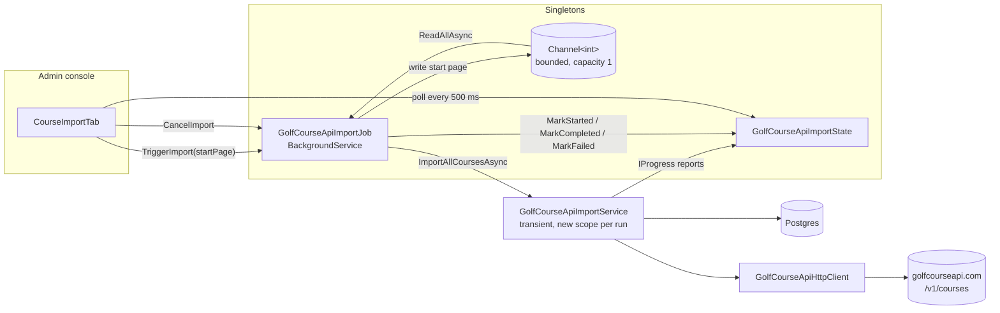
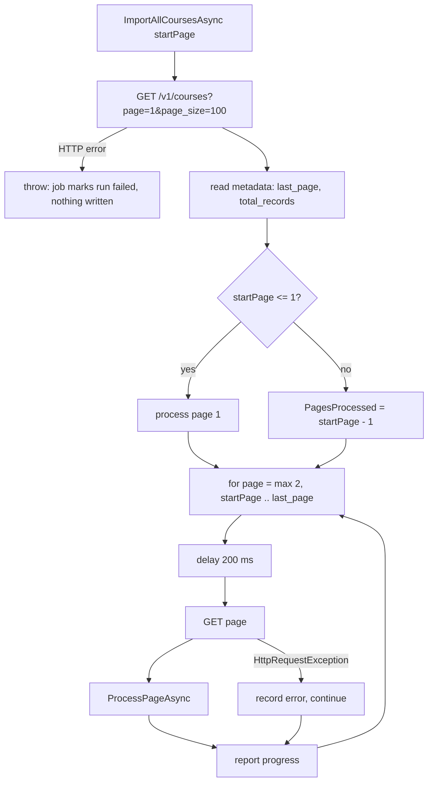
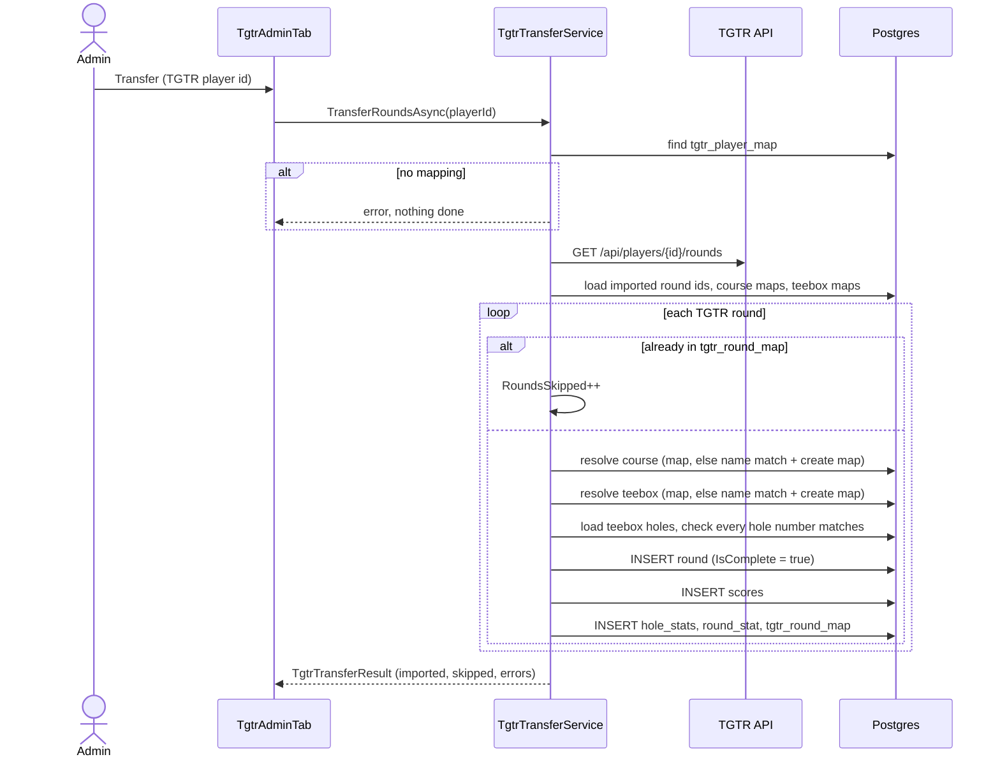

# Course imports and TGTR transfer

Two admin-only tools bring outside data in. The **GolfCourseAPI import** bulk-loads courses, teeboxes and holes from golfcourseapi.com as a background job. The **TGTR transfer** copies one golfer's historical rounds from TGTR, an older golf tracker, onto existing local courses. Both live in Features but are registered only by `RegisterAdminServices`, so the API host cannot reach them.

Related: [courses](courses.md) (the data these tools write), [rounds](rounds.md), [admin console](../admin/console.md) (System page tabs), [logging and observability](../operations/logging-and-observability.md).

## Where things are

| Piece | File |
|---|---|
| GolfCourseAPI HTTP client | `src/FairwayFinder.Features/HttpClients/GolfCourseApiHttpClient.cs` |
| Response DTOs | `src/FairwayFinder.Features/Data/GolfCourseApi/GolfCourseApiResponses.cs`, `GolfCourseApiImportResult.cs` |
| Import logic | `src/FairwayFinder.Features/Services/GolfCourseApi/GolfCourseApiImportService.cs` |
| Background job | `src/FairwayFinder.Features/Services/GolfCourseApi/GolfCourseApiImportJob.cs` |
| Shared run state | `src/FairwayFinder.Features/Services/GolfCourseApi/GolfCourseApiImportState.cs` |
| Mapping entity | `src/FairwayFinder.Data/Entities/GolfCourseApiCourseMap.cs` |
| TGTR HTTP client | `src/FairwayFinder.Features/HttpClients/TgtrHttpClient.cs` |
| TGTR DTOs | `src/FairwayFinder.Features/Data/TGTR/TgtrRoundResponse.cs`, `TgtrTransferResult.cs` |
| TGTR logic | `src/FairwayFinder.Features/Services/TGTR/TgtrTransferService.cs` |
| TGTR mapping entities | `src/FairwayFinder.Data/Entities/Tgtr{Player,Course,Teebox,Round}Map.cs` |
| Admin UI | `src/FairwayFinder.Admin/Components/Pages/SystemOps/Components/CourseImportTab.razor`, `TgtrAdminTab.razor` (on `/system`) |

### Configuration

| Key | Default (Admin `appsettings.json`) | Notes |
|---|---|---|
| `GolfCourseApi:BaseUrl` | `https://api.golfcourseapi.com` | Required at startup by `RegisterAdminServices`. |
| `GolfCourseApi:ApiKey` | empty | Required. Sent as `Authorization: Key {apiKey}` on every request. |
| `Tgtr:BaseUrl` | `https://tgtr-api.azurewebsites.net` | Required at startup. |

`RegisterAdminServices` throws if any of these is missing (an empty string passes the check). Tests point both base URLs at fake hosts and answer with `StubHttpHandler`.

## GolfCourseAPI import

### Architecture

The import walks every page of the external catalogue, which takes a long time, so it runs outside the Blazor circuit in a hosted service. The admin page only triggers it and polls its state.

Registration (`src/FairwayFinder.Features/ServiceRegistration.cs`): `Channel.CreateBounded<int>(1)` and `GolfCourseApiImportState` are singletons; `GolfCourseApiImportJob` is a singleton that is also added as the hosted service (`AddHostedService(sp => sp.GetRequiredService<GolfCourseApiImportJob>())`), so the page and the host share the same instance.

### Job lifecycle

1. **Trigger.** `TriggerImport(startPage)` returns `false` if `State.IsRunning`; otherwise it writes `max(1, startPage)` to the channel and returns `true`.
2. **Run.** `ExecuteAsync` loops over `_trigger.Reader.ReadAllAsync`. For each message it skips if already running, calls `State.MarkStarted()`, creates a linked `CancellationTokenSource` (host shutdown or admin cancel), opens a DI scope, resolves `GolfCourseApiImportService`, and runs `ImportAllCoursesAsync(startPage, progress, token)`. A `Progress<T>` callback pushes each report into `State.UpdateProgress`.
3. **Finish.**
   - Success: `MarkCompleted(result)`.
   - `OperationCanceledException`: `MarkCompleted(lastProgress, cancelled: true)`.
   - Any other exception: `MarkFailed(message)`, which stores a result with a single error.
4. **Cancel.** `CancelImport()` cancels the current token source. The service checks the token before every page and during the rate-limit delay.

`GolfCourseApiImportState` holds `IsRunning`, `CurrentProgress`, `LastResult` and `WasCancelled` under a lock. It is in memory only: an Admin restart forgets progress, and a run interrupted by a restart is resumed by entering a start page by hand. `ClearLastResult` frees the last result once the page has shown it.

The tab disables the button while `IsRunning`, polls state every 500 ms with a `Timer`, and shows a toast when a run ends.

### What a run does

- **Page size** 100; **rate limit** a fixed 200 ms delay between pages.
- **Page 1 is always fetched** to read the totals, even when resuming. On resume it is not processed.
- A failure fetching page 1 throws out of the method. That is the "outage" case: the job records the run as failed and nothing has been written. Failures on later pages are recorded as errors and the run continues.
- Errors are capped at 200 (`MaxErrors`) so a bad run does not hold a huge list in memory.
- Rows are written with `CreatedBy`/`UpdatedBy` = `"system"`.

### Per-course processing (`ProcessPageAsync`)

One `ApplicationDbContext` per page. The page's existing `GolfCourseApiCourseMap` rows are loaded in one query, then each course goes down one of three paths:

| Situation | Action | Counter |
|---|---|---|
| A mapping exists for the API course id | `UpdateCourseAsync`: update in place | `CoursesUpdated` |
| No mapping and the course has no male or female tees | Skip | `CoursesSkipped` |
| No mapping, has tees | `InsertCourseAsync` | `CoursesImported` |

An exception on one course is logged, added to `Errors`, and the loop moves on. Each path also increments a `FairwayFinderDiagnostics.Gca*` counter, and the whole run is wrapped in an `imports.gca.run` activity with a duration histogram.

**Insert** uses three saves, to get generated ids in order: insert the `Course`; insert all its teeboxes (male tees with `IsWomens = false`, female tees with `IsWomens = true`); insert all holes plus the `GolfCourseApiCourseMap` row. Hole numbers come from the position in the API's hole list (`i + 1`). `IsNineHole` is `number_of_holes == 9`. For 18-hole tees `YardageOut` is the first 9 holes and `YardageIn` the rest; `Par` and `YardageTotal` come from the API's `par_total` and `total_yards`.

**Update** loads the course, its non-deleted teeboxes and holes, then for each gender:

- Teeboxes are matched to API tees **by name, case-insensitively, within the same gender**. A match is updated in place (par, rating, slope, yardages, nine-hole flag), and its holes are updated in place by hole number, with missing hole numbers inserted.
- An unmatched API tee is inserted as a new teebox, saved to get its id, then its holes added.
- Local teeboxes or holes that are no longer in the API are left as they are.

The mapping row is only written on insert, so re-running the import updates rather than duplicates (`Golf_course_api_reimport_updates_in_place_rather_than_duplicating`).

### Mapping table

`golf_course_api_course_map` (`GolfCourseApiCourseMap`): `ApiCourseId` (unique) to local `CourseId`. It has no audit or soft-delete columns. It is the only link between the external catalogue and local courses; the import never matches by name. To attach an existing hand-entered course to its API record (so the next run updates it rather than inserting a duplicate), add a mapping from the tab: `GolfCourseApiImportService.AddMappingAsync` checks the local course exists and the API id is not already mapped.

### Interaction with teebox versioning

The importer writes `Teebox` rows directly, not through `CourseService`, so some of the rules in [courses](courses.md) do not apply:

- New teeboxes (on first import and when a re-import adds a tee) start their own lineage after the save that gives them an id, through the same `Teebox.StartOwnLineage()` that `CourseService.CreateTeeboxAsync` calls (`Golf_course_api_imported_teeboxes_each_start_their_own_lineage`). Before this, imported teeboxes kept the column default `0`, which lumped them together in course stats and let the game stroke-index fallback borrow across courses. The `BackfillTeeboxGroupIds` migration (SQL only) repaired those rows: since a version has no parent link, it treats `0`-group teeboxes with the same course, name (case-insensitive), gender and hole count as one lineage rooted at the lowest `teebox_id`. A version that was renamed becomes its own lineage.
- Updates change rating, slope, par and stroke index in place. Rounds already played on that teebox will show the new values, the same as the admin "Update this teebox" mode.
- The update path does not exclude archived versions. Teeboxes are put in a dictionary keyed by name per gender, so a course with an archived and an active version of the same tee name throws for that course, and the course is recorded as an error.

## TGTR transfer

TGTR is the golfer's previous stat tracker. The transfer pulls all of one TGTR player's rounds over HTTP and writes them as completed local rounds for a mapped FairwayFinder user. It does not create courses or teeboxes; those must already exist locally (for example from the GolfCourseAPI import).

### Mapping tables

All four are `IAuditable` with soft delete.

| Table | Maps | How it is created |
|---|---|---|
| `tgtr_player_map` | TGTR player id to local `UserId` | By hand on the TGTR tab. **Required**: without it the transfer does nothing. |
| `tgtr_course_map` | TGTR course id to local `CourseId` | By hand, or automatically on the first case-insensitive exact name match. |
| `tgtr_teebox_map` | TGTR teebox id to local `TeeboxId` (also stores the TGTR course id) | By hand, or automatically on a name match within the resolved course. |
| `tgtr_round_map` | TGTR round id to local `RoundId` | Written for every imported round. Used to skip duplicates. |

None of these tables has a unique index on the TGTR id.

### Steps

Per round:

1. **Skip** if its TGTR id is already in `tgtr_round_map`. Newly imported ids are added to the in-memory set too, in case the API returns duplicates.
2. **Resolve the course.** Use `tgtr_course_map`; otherwise find a non-deleted local course whose name equals the TGTR course name (case-insensitive) and save a mapping. No match: a per-round error naming the course.
3. **Resolve the teebox** the same way within that course. No match: per-round error. The name match does not filter out archived versions.
4. **Load the teebox's holes** and check every TGTR hole number exists locally. Any mismatch is an error for that round.
5. **Write the round.** `DatePlayed` from the TGTR date, `Score`/`ScoreOut`/`ScoreIn` and the front/back/full flags as TGTR reports them, `UsingHoleStats = true`, `IsComplete = true` (imported rounds are finished), owner and `CreatedBy` = the mapped golfer.
6. **Write `Score` rows**, one per TGTR hole score, then **`HoleStat` rows** with fairway hit, green in regulation and putts.
7. **Write a `RoundStat`.** If TGTR sends a stats block, its eagle/birdie/par/bogey/double/triple+worse counts are used; otherwise they are computed from score minus par per hole.
8. **Write the `tgtr_round_map`** row.

Steps 5 to 8 use three `SaveChangesAsync` calls with no surrounding transaction. If a round fails part way, its `round` row can exist without a `tgtr_round_map`, and a later run will import it again. Any exception for a round is caught, reported as "Unexpected error", and the next round continues.

The transfer writes `RoundStat` and `HoleStat` itself rather than going through `RoundScoringHelper`, and the round is not announced to friends (no push) and emits no analytics. TGTR has no shot data, so imported rounds have none and contribute nothing to strokes gained.

Result: `TgtrTransferResult` with `RoundsImported`, `RoundsSkipped`, and a list of `TgtrTransferError { TgtrRoundId, Reason }`. A fetch failure from the TGTR API is reported as a single error with round id 0. Telemetry: `imports.tgtr.transfer` activity, `Tgtr*` counters, and a duration histogram.

## Tests

`tests/FairwayFinder.Admin.IntegrationTests/Services/ExternalImportTests.cs` runs both tools against real Postgres with stubbed HTTP:

| Test | Checks |
|---|---|
| `Golf_course_api_import_creates_courses_teeboxes_and_holes_with_a_mapping` | Insert path, gender split, hole count, API key header. |
| `Golf_course_api_reimport_updates_in_place_rather_than_duplicating` | Mapping drives update. |
| `Golf_course_api_courses_without_tees_are_skipped` | Skip path. |
| `Golf_course_api_outage_fails_the_import_without_writing_anything` | Page 1 failure. |
| `Tgtr_transfer_imports_rounds_for_the_mapped_player_matching_course_and_teebox_by_name` | Name matching and auto-mapping. |
| `Tgtr_transfer_without_a_player_mapping_does_nothing` | Player map required. |
| `Tgtr_rounds_on_unknown_courses_are_reported_per_round` | Per-round errors. |

The background job and state class have no direct tests.
