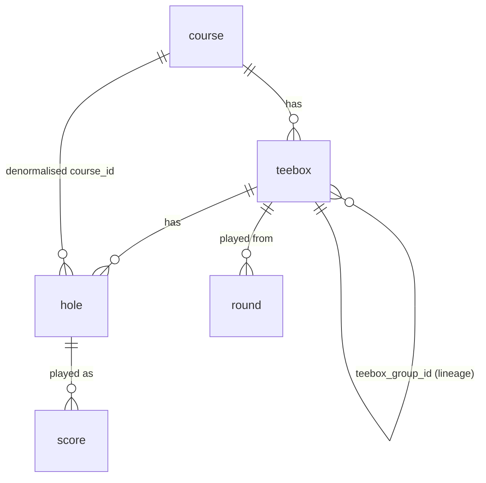
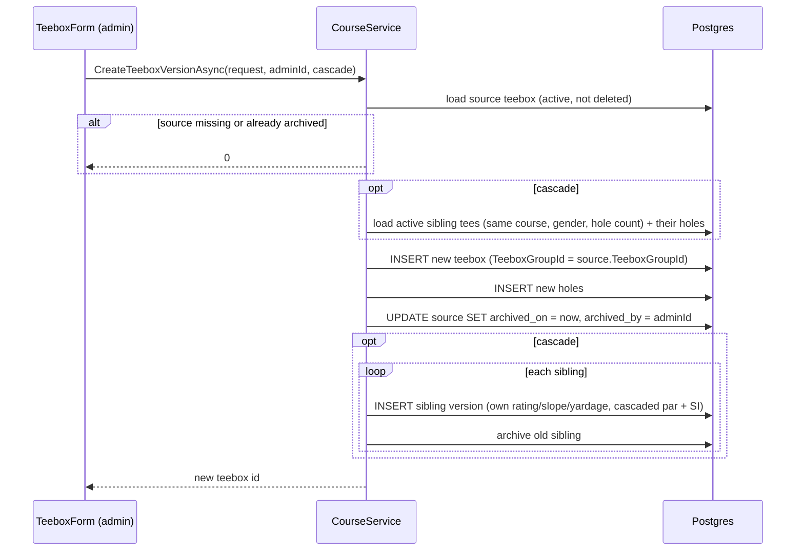

# Courses, teeboxes and holes

A course has teeboxes, and each teebox has its own set of holes with par, yardage and stroke index. `CourseService` owns reading this data for the iOS app and editing it from the admin console, including teebox versioning, which lets a re-rated tee change without rewriting history for rounds already played on it.

Related: [schema reference](../data/schema.md), [course imports](course-imports.md) (GolfCourseAPI and TGTR), [admin console](../admin/console.md), [API endpoints](../api/endpoints.md).

## Data model

| Entity | File | Notes |
|---|---|---|
| `Course` | `src/FairwayFinder.Data/Entities/Course.cs` | Name, club name, address, city/state/country, lat/long, phone. Soft-deleted with `IsDeleted`. |
| `Teebox` | `src/FairwayFinder.Data/Entities/Teebox.cs` | Name, par, `Rating` (`numeric(3,1)`), `Slope`, yardage out/in/total, `IsNineHole`, `IsWomens`, plus the versioning columns `TeeboxGroupId`, `ArchivedOn`, `ArchivedBy`. |
| `Hole` | `src/FairwayFinder.Data/Entities/Hole.cs` | `HoleNumber`, `Par`, `Yardage`, `Handicap` (the stroke index). Carries both `TeeboxId` and `CourseId`. |

Points worth knowing:

- **Holes belong to a teebox, not to a course.** The same physical hole has one `hole` row per teebox, because yardage (and sometimes par and stroke index) differ by tee. A round's `score` rows point at `hole_id`, so a round is tied to one specific teebox's holes.
- **`Hole.CourseId` is denormalised.** It lets `DeleteCourseAsync` and the GolfCourseAPI updater load every hole of a course in one query.
- **Teebox totals are derived.** `Par`, `YardageOut` (holes 1-9), `YardageIn` (holes 10+) and `YardageTotal` are summed from the hole entries on every create/update. `SaveTeeboxRequest` does not accept them.
- **Gender is a flag on the teebox** (`IsWomens`). It matches the golfer's `ApplicationUser.PreferredTees` (`Mens = 0`, `Womens = 1`, in `src/FairwayFinder.Identity/PreferredTees.cs`).
- **All deletes are soft.** Every query in `CourseService` filters `!IsDeleted`.
- **Stroke index is `Hole.Handicap`**, a non-nullable `int`. `0` means "not set". Consumers that need a stroke index fall back when it is `0`; see [Stroke index](#stroke-index-holehandicap).

There are no unique indexes on course or teebox names. The only index specific to this area is `ix_teebox_teebox_group_id` (configured in `src/FairwayFinder.Data/ApplicationDbContext.cs`).

## CourseService

`src/FairwayFinder.Features/Services/CourseService.cs` (interface `Services/Interfaces/ICourseService.cs`). DTOs live in `src/FairwayFinder.Features/Data/CourseManagementDtos.cs` (admin shapes) and `Data/CreateRoundRequest.cs` (`CourseSearchResult`, `TeeboxOption`, `HoleInfo`, used by the round-entry pickers). It creates a short-lived `ApplicationDbContext` per call from `IDbContextFactory`.

### Read methods (used by the API)

| Method | Endpoint | Behaviour |
|---|---|---|
| `SearchCoursesAsync(query)` | `GET /api/courses/search?query=` | Case-insensitive substring match on `CourseName`, non-deleted, ordered by name, **top 20**. Empty/whitespace query returns an empty list. |
| `GetTeeboxesAsync(courseId, filter?)` | `GET /api/courses/{courseId}/teeboxes?usePreferredTees=` | Active teeboxes only (`ArchivedOn == null`), ordered by total yardage. When `usePreferredTees=true` the endpoint loads the signed-in user's `PreferredTees` and filters by `IsWomens`. |
| `GetHolesAsync(teeboxId)` | `GET /api/courses/teeboxes/{teeboxId}/holes` | Non-deleted holes ordered by number. Does not check that the teebox is active, so a resumed round on an archived teebox still loads its holes. |

All three endpoints are in `src/FairwayFinder.Api/Endpoints/CourseEndpoints.cs` and require authentication. There are no write endpoints in the API: course data is edited only from the admin console.

**Search implementation.** `SearchCoursesAsync` uses `c.CourseName.ToLower().Contains(query.ToLower())`, which Npgsql translates to `lower(course_name) LIKE '%...%'`. It does not use `EF.Functions.ILike` (user search in `FriendService` does). It searches only `CourseName`, not club name or city. `CourseSearchResult.DisplayText` formats `"Name — City, State"` for the picker.

### Admin methods

Called from the admin pages under `src/FairwayFinder.Admin/Components/Pages/Courses/` (`CourseList`, `CourseDetail`, `TeeboxForm`, and the `SaveTeeboxModeDialog`).

| Method | Behaviour |
|---|---|
| `GetAllCoursesAsync` | All non-deleted courses with a teebox count (the count includes archived versions). |
| `GetCourseDetailAsync` | Course plus all non-deleted teeboxes, **active first, then archived**, each ordered by yardage. Exposes `TeeboxGroupId` and `ArchivedOn` so the page can show history. |
| `CreateCourseAsync` / `UpdateCourseAsync` | Name, address, phone only. The other columns (city, state, lat/long, club) are filled by the GolfCourseAPI import. |
| `DeleteCourseAsync` | Soft-deletes the course, all its teeboxes, and all its holes. |
| `GetTeeboxDetailAsync` | Teebox plus holes, for the edit form. |
| `GetParHandicapTemplateAsync(courseId, isWomens, isNineHole)` | Pre-fills par and stroke index for a **new** teebox from the newest active tee with the same gender and hole count, falling back to any active tee with the same hole count. Returns empty if there is none. |
| `CreateTeeboxAsync` | Inserts a teebox and its holes. Calls `Teebox.StartOwnLineage()` (`TeeboxGroupId = TeeboxId`) after the first save, so a new tee is its own lineage. |
| `UpdateTeeboxAsync(request, userId, cascade)` | Edit in place (see below). |
| `CreateTeeboxVersionAsync(request, userId, cascade)` | Save as a new version (see below). |
| `DeleteTeeboxAsync` | Soft-deletes a teebox and its holes. |

`userId` is the acting admin and is written to `CreatedBy`/`UpdatedBy`. `CreatedOn`/`UpdatedOn` are stamped by the audit interceptor ([database conventions](../data/database.md)).

## Teebox versioning (lineage and archiving)

Rounds reference a teebox and its holes directly, and the round views and stats read rating, slope, par and stroke index from those rows. So editing a teebox in place silently changes every past round played on it. That is right for fixing a typo, and wrong when a course is re-rated and old rounds should keep the numbers they were played under.

When an admin saves an existing teebox, `TeeboxForm` opens `SaveTeeboxModeDialog`, which offers two modes:

| Mode | Method | Effect on past rounds |
|---|---|---|
| **Update this teebox** | `UpdateTeeboxAsync` | Values change for every round on this teebox. For corrections. |
| **Save as a new teebox** | `CreateTeeboxVersionAsync` | Past rounds keep the old teebox and holes; new rounds use the new one. For re-ratings. |

### How a version is created

- **`TeeboxGroupId` is the lineage key.** Every version of the same logical tee shares it. A brand-new tee gets its own id as group id through `Teebox.StartOwnLineage()`, which every path that creates a teebox from scratch calls (`CourseService.CreateTeeboxAsync` and both GolfCourseAPI import paths). The `AddTeeboxVersioning` migration backfilled existing rows the same way, and `BackfillTeeboxGroupIds` fixed the imported teeboxes that had been left at `0` (see [course imports](course-imports.md)). A lineage only ever spans one course: consumers that look a lineage up key it by course and group id.
- **Archived means superseded, not deleted.** The source keeps `IsDeleted = false` and keeps its holes, so historical rounds still resolve their original rating, slope and stroke index. `ArchivedOn` is a UTC `DateTime` and `ArchivedBy` is the admin.
- **Only active tees are offered for new rounds.** `GetTeeboxesAsync` and `GetParHandicapTemplateAsync` filter `ArchivedOn == null`. `CreateTeeboxVersionAsync` refuses to version an already-archived teebox (returns `0`).
- **Siblings are captured before the new version is inserted**, so the freshly created row is not picked up and versioned again.

### Where lineage is used

- `StatsService` course stats (`src/FairwayFinder.Features/Services/StatsService.cs`) groups rounds by `Teebox.TeeboxGroupId`, so the teebox filter shows one option per logical tee (labelled with its most-used name) and the incoming `teeboxId` filter is a group id.
- `StatsCalculator` per-hole stats take par, yardage and stroke index from the newest version played (highest `TeeboxId`).
- `GameScoreReader` borrows a missing stroke index from another version in the same lineage on the same course.
- `RoundTeebox` (in `Data/RoundResponse.cs`) exposes `TeeboxGroupId` to the client.

See [stats and strokes gained](stats-and-strokes-gained.md) and [games](games.md) for those consumers.

### Cascading par and stroke index to sibling tees

Par and stroke index are usually the same for every men's tee (or every women's tee) on a course; only yardage, rating and slope differ. When the admin ticks the cascade checkbox (only shown when other same-gender tees exist), the edited tee's per-hole par and handicap are applied to every other **active** tee on the course with the same `IsWomens` and `IsNineHole`:

- With **Update**, `ApplyCascadeInPlace` rewrites those siblings' holes in place and recomputes their par total.
- With **Save as new**, `CreateSiblingVersionAsync` creates a new version of each sibling that keeps its own name, rating, slope and yardages, takes the cascaded par and stroke index, and archives the old sibling.

Holes are matched by `HoleNumber`. Tests: `tests/FairwayFinder.Features.Tests/CourseServiceCascadeTests.cs`.

### In-place hole updates

`UpdateTeeboxAsync` updates hole rows by number, adds holes that are new in the request, and soft-deletes holes no longer in it. It does not delete and re-insert, so `hole_id` values (and the scores pointing at them) survive an edit.

## Stroke index (`Hole.Handicap`)

The stroke index ranks holes 1 to 18 by difficulty and drives net scoring in [games](games.md) and the per-hole stats views. Because the column is a non-nullable `int`, an unknown index is stored as `0`, which happens with some imported data. Consumers handle it:

- `GameScoreReader` fills `0` values from the newest version in the same lineage (same course and `TeeboxGroupId`, never group `0`) that has a value.
- `StatsCalculator` falls back to any version of the hole with a value.
- The admin teebox form pre-fills from `GetParHandicapTemplateAsync` so a new tee starts with the course's existing indexes.

Nothing validates that a teebox's indexes are a permutation of 1..18.

## Where course data comes from

- **Admin entry** through the pages above.
- **GolfCourseAPI import**, which bulk-creates and updates courses, teeboxes and holes. See [course imports](course-imports.md). The importer writes teeboxes directly rather than through `CourseService`, but starts each new teebox's lineage the same way (`StartOwnLineage()`). Re-imports change rating and slope in place.
- **TGTR transfer** only maps to existing courses and teeboxes; it never creates them.

## Tests

| Test file | Covers |
|---|---|
| `tests/FairwayFinder.Features.Tests/CourseServiceTeeboxVersioningTests.cs` | Group id on create, versioning archives and clones, archived source rejected, archived hidden from pickers, detail ordering. |
| `tests/FairwayFinder.Features.Tests/CourseServiceCascadeTests.cs` | Cascade in place and by version, same-gender only, par/SI template. |
| `tests/FairwayFinder.Admin.IntegrationTests/Services/CourseManagementTests.cs` | Create/read, in-place edit, re-rating a played teebox leaves old rounds alone, deleted course disappears from search (real Postgres). |
| `tests/FairwayFinder.Admin.IntegrationTests/Services/ExternalImportTests.cs` | `Golf_course_api_imported_teeboxes_each_start_their_own_lineage`: imported and re-imported tees get their own group id. |
| `tests/FairwayFinder.Admin.IntegrationTests/Services/GameScoreReaderTests.cs` | Stroke-index fallback borrows within a lineage and never from another course. |
| `tests/FairwayFinder.Api.IntegrationTests/Endpoints/CourseEndpointsTests.cs` | Case-insensitive search, missing query is 400, teeboxes and holes, preferred-tee filter, auth required. |
