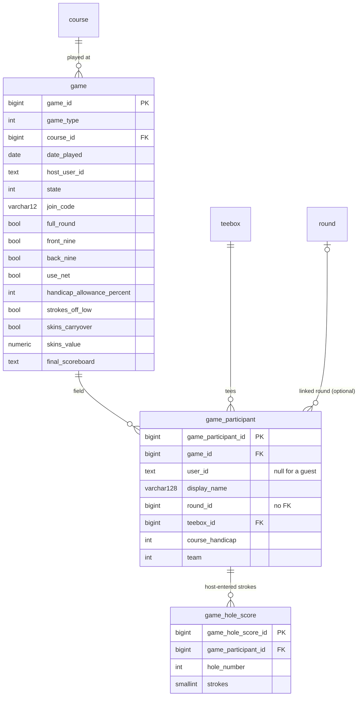
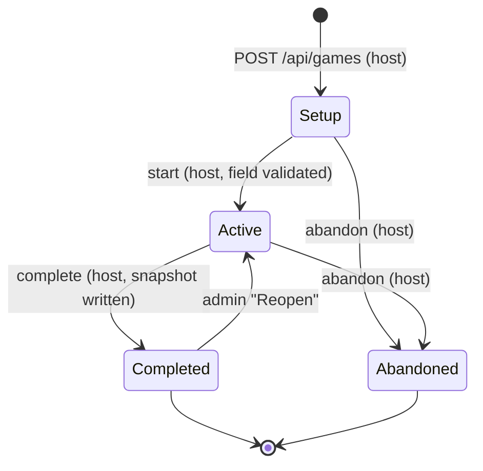
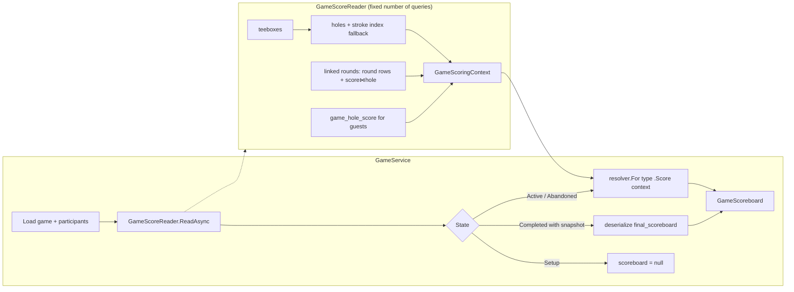

# Games

A game is a side contest (match play, skins, High-Low) laid over rounds people are already entering. It holds the field, where each player's strokes come from, and the rules; a pure scoring engine turns that into a scoreboard the iOS app polls. This doc covers the schema, the service, the reader → engine pipeline, each engine's rules as coded, and the admin scorecard.

The original design is in [`../games-implementation-plan.md`](../games-implementation-plan.md). It is kept for its reasoning, but its header lists corrections and where it disagrees with the code, the code is right. Endpoint-by-endpoint reference lives in [`../api/endpoints.md`](../api/endpoints.md).

## Where the code lives

| Piece | Path |
|---|---|
| Entities and enums | `src/FairwayFinder.Data/Entities/Game.cs` (`Game`, `GameType`, `GameState`), `GameParticipant.cs`, `GameHoleScore.cs` |
| EF mapping and indexes | `src/FairwayFinder.Data/ApplicationDbContext.cs` (the `// Game` block) |
| Service | `src/FairwayFinder.Features/Services/GameService.cs`, `Services/Interfaces/IGameService.cs` |
| Result type | `src/FairwayFinder.Features/Games/GameResult.cs` (`GameResult<T>`, `GameResultStatus`) |
| Reader | `src/FairwayFinder.Features/Games/GameScoreReader.cs` |
| Engine input | `src/FairwayFinder.Features/Games/GameScoringContext.cs`, `GameSides.cs` |
| Engines | `src/FairwayFinder.Features/Games/IGameScoringEngine.cs`, `GameScoringEngineResolver.cs`, `Engines/*ScoringEngine.cs` |
| Scoreboard contract | `src/FairwayFinder.Features/Games/GameScoreboard.cs` |
| Handicaps | `src/FairwayFinder.Features/Helpers/GameHandicapHelper.cs` |
| Push | `src/FairwayFinder.Features/Helpers/GameNotifications.cs` |
| DTOs | `src/FairwayFinder.Features/Data/GameDtos.cs` |
| API | `src/FairwayFinder.Api/Endpoints/GameEndpoints.cs`, `src/FairwayFinder.Api/Validators/GameValidators.cs` |
| Admin | `src/FairwayFinder.Features/Services/Admin/AdminGameService.cs`, `src/FairwayFinder.Admin/Components/Pages/Games/**` |
| Tests | `tests/FairwayFinder.Features.Tests/Games/*`, `GameServiceTests.cs`, `GameRoundLinkageTests.cs`, `GamePreviewAndHolesTests.cs`, `AdminGameServiceTests.cs`, `Helpers/GameHandicapHelperTests.cs`, `Helpers/GameScoringTestData.cs`; `tests/FairwayFinder.Api.IntegrationTests/Endpoints/GameEndpointsTests.cs`; `tests/FairwayFinder.Admin.IntegrationTests/Pages/GameCardModelTests.cs` |

DI (`src/FairwayFinder.Features/ServiceRegistration.cs`): `IGameService` and `GameScoreReader` are transient; each engine is registered as a singleton `IGameScoringEngine`, and `GameScoringEngineResolver` (singleton) indexes them by `GameType`. `AdminGameService` is registered on the admin side only.

## Concepts

**Game** (`game` table). A type, a course, a calendar `DatePlayed` (`DateOnly`, see [`../data/database.md`](../data/database.md)), a host, a state, a join code, the hole set, and the rule settings. Settings are typed columns rather than jsonb, because the union across shipped types is five fields:

| Column | Meaning | Default |
|---|---|---|
| `use_net` | Settle on net scores instead of gross | `false` |
| `handicap_allowance_percent` | Percent of course handicap a player gets (1 to 100) | `100` |
| `strokes_off_low` | Everyone plays off the lowest handicap in the field | `true` |
| `skins_carryover` | A tied skin carries to the next hole | `true` |
| `skins_value` | Money per skin, optional, `numeric(10,2)` | null |

The rule fields are stored for every game type, whatever the type. Match play and High-Low ignore the skins fields.

**Participant** (`game_participant`). One player: a registered golfer (`UserId` set) or a guest (`UserId` null) the host scores by hand. Each carries:

- `DisplayName`: a snapshot taken when they were added (via `DisplayNameHelper.Build`, falling back to `"Guest"`), so scoring never touches `AspNetUsers`. Guests' names are free text.
- `TeeboxId`: par and stroke index come from the participant's own tees, so a mixed-tee field is normal.
- `CourseHandicap`: strokes over **the holes this game covers**, not necessarily an 18-hole course handicap. A nine-hole game expects the nine-hole number; nothing halves it automatically. Validated to -10..54 on create, join, add participant and update participant (where it is optional and only checked when sent).
- `Team`: null for individual games, an int for team games.
- `RoundId`: optional link to the participant's own round.

**Score sources.** Every participant's strokes come from exactly one of two places:

| Source | When | Stored in |
|---|---|---|
| Linked round | `RoundId` is set | `score` rows of that `Round`, joined to `hole` for the hole number |
| Host-entered | `RoundId` is null (guests, or a registered golfer who didn't link) | `game_hole_score` rows keyed by `(game_participant_id, hole_number)` |

When a round is linked, `game_hole_score` rows for that participant are ignored, and the API refuses to write them (`ParticipantUsesLinkedRound`). Unlinking (`POST /api/games/{id}/round` with a null `roundId`) makes host-entered rows the source again; any rows written before the link are still there.

`GameHoleScore` is deliberately not a shadow `Round`: `ix_round_user_id_active` is keyed on `user_id`, so a guest would need a synthetic user, and those rounds would leak into lists and stats. It keys on hole *number*, not hole id, because hole rows hang off a teebox; moving a guest between tees would otherwise strand every row on the old tee. The cost is no FK to `hole`, so membership is checked on write (`HoleNotInGame`) and by teebox coverage checks on join.

A game never posts a linked round. Completing a game is the host's action and must not fire another golfer's stats and friend notifications. Instead the response carries `RoundIsComplete` and `RoundReadyToPost` so the app can offer each golfer a one-tap post of their own round. "Ready" is judged on the round's own holes (`RoundScoringHelper.MissingHoles` against the teebox's nine/eighteen shape), not the game's. Round posting itself is covered in [`rounds.md`](rounds.md).

### Schema



All three tables implement `IAuditable`, soft-delete with `is_deleted`, and use `Restrict` deletes. Indexes:

| Index | Columns | Filter | Purpose |
|---|---|---|---|
| `ix_game_join_code_live` (unique) | `join_code` | `state < 2 AND is_deleted = false` | Codes only need to be unique among Setup/Active games |
| `ix_game_host_state` | `host_user_id, state` | | |
| `ix_game_participant_game_user` (unique) | `game_id, user_id` | `user_id IS NOT NULL AND is_deleted = false` | A golfer joins once; any number of guests |
| `ix_game_participant_user` | `user_id, game_id` | | "My games" |
| `ix_game_participant_round` | `round_id` | `round_id IS NOT NULL AND is_deleted = false` | "Which games did this round feed?" |
| `ix_game_hole_score_participant_hole` (unique) | `game_participant_id, hole_number` | `is_deleted = false` | Makes the per-hole upsert safe under concurrency |

Full column reference: [`../data/schema.md`](../data/schema.md).

### Game types

`GameType` is persisted as an int and must never be renumbered:

| Value | Name | Engine |
|---|---|---|
| 0 | `MatchPlay` | `MatchPlayScoringEngine` |
| 1 | `Skins` | `SkinsScoringEngine` |
| 2, 3, 4 | reserved for StrokePlay, Nassau, Stableford | none yet |
| 5 | `HighLow` | `HighLowScoringEngine` |

Only types with an engine are declared, so `IsInEnum()` in `CreateGameRequestValidator` keeps an unscoreable game out of the database. `CreateGameAsync` also asks `IGameScoringEngineResolver.Supports` and returns `GameTypeNotSupported` as a second line of defence.

## Lifecycle



The admin console's `SetGameStateAsync` can force any state; the page exposes Reopen (Completed → Active) and Abandon.

What each state allows (as enforced in `GameService`):

| Operation | Setup | Active | Completed | Abandoned |
|---|---|---|---|---|
| Join by code | yes | yes, field re-validated | no (code no longer resolves) | no |
| Host adds / removes participant | yes | no (`GameNotInSetup`) | no | no |
| Update participant (handicap, tees, team, guest name) | yes | yes | yes | yes |
| Link / unlink own round | yes | yes | yes | yes |
| Write / clear host-entered hole | yes | yes | no (`GameAlreadyComplete`) | no (`GameNotActive`) |
| Start | yes | `GameNotInSetup` | `GameNotInSetup` | `GameNotInSetup` |
| Complete | `GameNotActive` | yes | `GameAlreadyComplete` | `GameNotActive` |
| Abandon | yes | yes | `GameAlreadyComplete` | yes (no-op) |
| Scoreboard in response | null | computed live | stored snapshot | computed live |

Update and link have no state guard. On a completed game they change the participant row but not what is served, because the snapshot wins; an admin "Re-run scoring" would pick the change up.

**Create.** `CreateGameAsync` validates the host's teebox, then inserts the game and the host's participant row in one transaction (skipped on the InMemory provider), so a game never exists without its host holding a join code. If `RoundId` is supplied the round is linked in the same transaction; a link failure rolls back the whole create.

**Start.** `StartGameAsync` runs `ValidateField` (below). Validation happens at start rather than create so the host can build the field in any order.

**Join after start.** Joining is the one path that changes the field of a running game, so `JoinGameAsync` re-runs `ValidateField` with the joiner included when the game is not in Setup. Without that, a third player could walk into a live two-sided match and match play would stop scoring.

**Join with a round.** If `RoundId` is supplied, `JoinGameAsync` links it before saving, so the participant row and its link are written in one `SaveChanges`. A link failure (`RoundNotOwned`, `RoundNotOnGameCourse`, a teebox error) returns the 409 with no participant left behind, and the golfer can simply join again.

**Complete.** `CompleteGameAsync` reads and scores the game, serializes the board into `game.final_scoreboard`, sets `Completed`, then reuses that same read to build the response.

### Field validation (`ValidateField`)

Common to all types: at least two participants, and either everyone has a `Team` or nobody does ("Either everyone is on a team or nobody is."). Then per type:

| Type | Rule |
|---|---|
| `MatchPlay` | Exactly two sides: two individuals, or exactly two distinct teams (any sizes) |
| `Skins` | No teams |
| `HighLow` | Exactly two teams, equal size, at least two per team |

Failures return `ParticipantCountInvalid` with a message naming the fix, which the API returns as a 409.

### Join codes

Six characters drawn with `RandomNumberGenerator` from `ABCDEFGHJKLMNPQRSTUVWXYZ23456789` (no I, O, 0, 1, because codes are read aloud). `SaveWithFreshJoinCodeAsync` retries up to five times on a unique violation of `ix_game_join_code_live`. Unique violations are detected by reflection on the inner exception's `SqlState == "23505"` so Features stays free of an Npgsql reference.

Lookups (`FindGameByJoinCodeAsync`) trim and upper-case the input, and filter on `State < Completed` and not deleted, matching the partial index. A bare code match could otherwise hit last season's game.

`GET /api/games/preview?joinCode=` resolves a code to course, date, hole numbers, host name, participant count and `AlreadyJoined` without joining, because the joiner needs the course to pick a teebox. An unknown code is a 404, the same as a game you cannot see.

### Hole set (shape flags)

`FullRound`, `FrontNine`, `BackNine` are fixed at create, mirroring `Round`'s flags. `GameScoreReader.HoleNumbersFor(game)` turns them into 1–18, 1–9, or 10–18 (falling back to 1–18; the validator requires one flag). The hole set is the game's own, not derived from participants' tees, so a player joining late with a nine-hole teebox cannot shrink a running match.

Every teebox chosen for a participant goes through `ValidateTeeboxAsync`:

- it must exist and belong to the game's course (`TeeboxNotOnCourse`);
- it must not be archived (`TeeboxArchived`), except when inherited from a linked round, since an admin may have versioned the course mid-round;
- it must have a hole row for every number the game covers (`TeeboxShapeMismatch`, with the missing holes in `Detail`).

Linking a round forces `participant.TeeboxId = round.TeeboxId`. The round's scores join to holes on that teebox, so any other tee would read par and stroke index off a different hole set. For the same reason a participant with a linked round cannot change tees (`ParticipantUsesLinkedRound`); unlink first.

## Handicaps and stroke allocation

All handicap math lives in `GameHandicapHelper` and runs once, in the reader. Engines only ever see `StrokesReceived` per hole.

1. **Playing handicap** (`PlayingHandicaps`): `round(CourseHandicap × allowance / 100)` with `MidpointRounding.AwayFromZero` (golf convention; banker's rounding would turn 90% of 25 into 22 instead of 23). If `StrokesOffLow`, the lowest playing handicap is subtracted from everyone so the best player plays off scratch.
2. **Rank the game's holes** (`RankHolesByStrokeIndex`): sort the covered holes by stroke index, 1 = hardest. Unset indexes (`0`) sort last; ties break on hole number. Ranking within the game's holes is what makes a back-nine game work, since raw indexes there are 2, 4, …, 18.
3. **Strokes per hole** (`StrokesReceived`): with `n` holes and handicap `h`, every hole gets `|h| / n`, and the `|h| % n` hardest-ranked holes get one more. A negative handicap (plus player) gives strokes back instead, taking the extras from the *easiest* holes.

`Net = Strokes − StrokesReceived`. `GameHoleLine.Effective(useNet)` returns net or gross, and is the only score an engine compares.

Handicaps are computed for every game, but only matter when `UseNet` is true. Nothing is stored: playing handicap, strokes received and the whole scoreboard are re-derived on every read, so changing a handicap on a live game takes effect on the next poll.

**Missing stroke indexes.** Imported courses sometimes leave `hole.handicap` at 0. `GameScoreReader.LoadHolesAsync` borrows the index from the newest teebox (highest `TeeboxId`) in the same lineage that has one. A lineage is keyed by course *and* `TeeboxGroupId`, so an index is never borrowed from another course, and a teebox still on group `0` (no lineage) borrows nothing. The lineage query only runs when some teebox in the field has a gap. Tests: `tests/FairwayFinder.Admin.IntegrationTests/Services/GameScoreReaderTests.cs`.

## Reader → engine



`GameScoreReader` is the only place the two score sources meet. It reads `score` straight through the DbContext rather than through `IRoundService`, so the `IsComplete` gate that hides in-progress rounds from friends does not apply: scoring a game while it is played is the point, and a game is authorized on "are you a participant", not "are you friends". Every query is batched across the field (teeboxes, holes, linked rounds, round scores, host-entered scores), so the query count is flat in the number of participants. It runs on every poll.

`ReadAsync` returns a `GameReadModel`: the `GameScoringContext` plus side data for the response (hole numbers, playing handicaps, holes entered per participant, `RoundUnavailable` when a linked round has been deleted, round post states, teebox names).

`GameScoringContext` contains:

- `GameType`, `GameRules` (the five settings), `HoleNumbers`;
- one `GameParticipantLine` per participant (id, name, course and playing handicap, team, and a `GameHoleLine` per covered hole with `Par`, `StrokeIndex`, `Strokes` (null until played) and `StrokesReceived`);
- `SettledHoleNumbers`: the longest leading run of `HoleNumbers` on which **every** participant has a score. A gap stops it. This is the only hole set engines walk, which is what keeps skins carryover from leaping an unscored hole. It is a computed property on purpose: a record's `with` copies fields without re-running initializers.

`GameSides.Resolve` turns a field into sides: all-null teams gives one side per participant; all-set gives one side per distinct team, ordered by team number; a mix returns null. A side's `KeyParticipantId` is its first member and identifies the side on the wire; its `DisplayName` joins member names with " / ". `BestBall` and `WorstBall` return a side's lowest and highest effective score on a hole.

Engines implement `GameScoringEngine<TScoreboard>`. They are pure: no database, no clock, no DI state. The same engine scores a live game, posts it, and re-scores it from the admin console. `IGameScoringEngineResolver.For` throws `NotSupportedException` for an unregistered type.

## Engines

All three share these conventions: `HolesPlayed` = settled hole count; `HolesRemaining` = covered holes − settled; summaries read "No holes scored yet" before any hole settles; par shown per hole is the first participant's (a mixed-tee field has no single par); a field the engine cannot score returns an empty board with an explanatory `Summary` rather than throwing.

### Match play (`MatchPlayScoringEngine`)

- Exactly two sides (individuals, or teams playing best ball). Otherwise: empty board, "Match play needs exactly two sides".
- Each settled hole: lower `BestBall` wins the hole, equal is halved. A running signed holes-up count is kept toward the first side.
- **Close-out and freeze.** After settled hole *i*, if `|holesUp|` exceeds the covered holes left after it, the match is decided on that hole: `DecidedOnHole`, the holes-up and the leader are frozen there. Holes played afterwards (groups play out for skins) still appear in `Holes` with their own running state, but cannot change `HolesUp`, `LeaderParticipantId`, `ResultLine` or `Summary`.
- `IsDecided` = closed out, or no holes remain.
- `IsDormie` = not decided, holes remain, and `|holesUp| == HolesRemaining`.
- `ResultLine`: closed out with holes left → `"4 & 3"`; closed out on the last hole → `"1 UP"`; otherwise `"AS"` or `"N UP"`.
- `Summary`: "All square thru N" / "Match halved" / "{side} {ResultLine} thru N" / "… and dormie thru N" / "{side} wins {ResultLine}".
- Standings: one row per side, `"N UP"` / `"N DN"` / `"AS"`, leader position 1, trailer 2; both 1 when level.
- `MatchPlayHoleSide` reports the strokes, net and strokes received of the member whose ball counted (lowest effective score), plus every member id.

### Skins (`SkinsScoringEngine`)

- Individual. Teams are refused at start; the engine itself ignores `Team`.
- Each settled hole: the lowest effective score wins if it is unique. The winner takes `1 + carried` skins and the carry resets.
- A tie: with `SkinsCarryover`, the carry grows by one; without it, the skin is void and the carry resets to 0.
- A carry still pending after the last hole is never awarded; it shows as `CarriedSkins` and the summary reads "N skins on the line thru 18".
- `IsDecided` = no holes remaining.
- Tallies: skins won and, when `SkinsValue` is set, `skins × value`. Sorted by skins desc, then name.
- Standings use standard competition ranking (ties share a position, the next skips). `IsLeader` is set for everyone on the top count, only if that count is above zero.
- `Summary` priority: skins on the line → "No skins won thru N" → "{name} N skins thru N" → "{a} and {b} tied on N skins thru N".

### High-Low (`HighLowScoringEngine`)

- Two teams of equal size, at least two each. Otherwise: empty board, "High-Low needs two equal teams of at least two".
- Each settled hole is worth two points: one for the better (lower) low ball (`BestBall`), one for the better (lower) high ball (`WorstBall`). A tied point goes to nobody and does not carry.
- Nothing freezes. `IsDecided` = no holes remaining, or `margin > 2 × HolesRemaining` (the trailing side can no longer catch up). The margin keeps moving after that.
- `HighLowHoleSide` records the side's low and high numbers and which member made each (on a tie inside the side, the first listed member is reported), plus the points the side took on the hole.
- `Summary`: "All square thru N" / "Match halved X–X" / "{side} lead by M thru N (X–Y)" / "{side} win X–Y".
- Standings: one row per side, `"N pts"` (`"1 pt"`), leader position 1, other 2, both 1 when level.

## Scoreboard contract

`GameScoreboard` is an abstract record serialized polymorphically, with the discriminator in `gameType`:

```csharp
[JsonPolymorphic(TypeDiscriminatorPropertyName = "gameType")]
[JsonDerivedType(typeof(MatchPlayScoreboard), "MatchPlay")]
[JsonDerivedType(typeof(SkinsScoreboard), "Skins")]
[JsonDerivedType(typeof(HighLowScoreboard), "HighLow")]
public abstract record GameScoreboard
```

The discriminator equals the `GameType` name. Every board carries the base fields `HolesPlayed`, `HolesRemaining`, `IsDecided`, `Summary` (one complete sentence for the app header) and `Standings` (`GameStanding`: participant id, name, position, short value string, `IsLeader`), so a client that does not know a type can still render a generic leaderboard. Type-specific fields:

| Board | Fields | Per hole |
|---|---|---|
| `MatchPlayScoreboard` | `LeaderParticipantId`, `HolesUp`, `IsDormie`, `DecidedOnHole`, `ResultLine`, `Holes` | `MatchPlayHole`: winner side key, `IsHalved`, running leader and holes up, two `MatchPlayHoleSide` |
| `SkinsScoreboard` | `CarriedSkins`, `Holes`, `Tallies` | `SkinsHole`: winner, `SkinsAwarded`, `CarriedIn`, `IsTied` |
| `HighLowScoreboard` | `LeaderParticipantId`, `Margin`, `Sides`, `Holes` | `HighLowHole`: low and high winner side keys, running leader and margin, two `HighLowHoleSide` |

Sides are named by `SideKeyParticipantId` (the side's first member) and also carry `ParticipantIds`. This is a wire contract with a shipped iOS app: add fields, never rename or retype one.

**Serialize through the base type.** `JsonSerializer.Serialize<GameScoreboard>(board)` writes the discriminator; serializing the concrete type omits it and the result cannot be read back as `GameScoreboard`. This matters most for the snapshot, and both writers (`CompleteGameAsync`, `AdminGameService.RecomputeFinalScoreboardAsync`) do it explicitly. In API responses `GameStateResponse.Scoreboard` is typed `GameScoreboard?`, so the discriminator is emitted there automatically.

### The response

Every mutating call ends in `BuildStateAsync` and returns the full `GameStateResponse`, so the app never needs a follow-up GET. It contains the game fields, `Rules`, `HoleNumbers`, `Participants` and `Scoreboard`. Each `GameParticipantResponse` adds `PublicIdentifier` (from `user_profile`, queried only for the field), `IsGuest`, `IsHost`, `TeeboxName`, `PlayingHandicap`, `HolesEntered`, `RoundUnavailable`, `RoundIsComplete`, `RoundReadyToPost`, and `Holes`: every entered `(HoleNumber, Strokes)` from whichever source. The scoreboard only covers the settled prefix, so `Holes` is how a client renders and edits what has been entered beyond it.

`GET /api/games` returns `GameSummaryResponse` rows with no scoreboard: scoring every game in a list would run the reader per row. `activeOnly` defaults to true (Setup and Active).

## Final snapshot

Rounds stay editable after they are posted, so without a snapshot a settled bet could change months later. On complete, the board is written to `game.final_scoreboard`, and from then on `ResolveScoreboard` serves the stored board instead of recomputing. If the stored JSON no longer deserializes (schema drift), it logs an error and falls back to a live recompute rather than failing the read.

The snapshot is also what `RoundService.GetRoundByIdAsync` shows on a round: `RoundResponse.Games` is a list of `RoundGameSummary` (found via `ix_game_participant_round`), whose `ResultSummary` is the snapshot's `Summary`, or null while the game is live. The engine is never run on a round read.

Admin can overwrite the snapshot with "Re-run scoring" (`RecomputeFinalScoreboardAsync`, Completed games only), or reopen the game (Completed → Active), correct it, and have the host post again.

## Live polling and ETags

The app polls `GET /api/games/{gameId}` every few seconds during a game; there is no SignalR. `GameEndpoints.WithETag` serializes the whole `GameStateResponse`, takes the first 32 hex characters of its SHA-256, and returns it as a weak ETag (`W/"…"`). A matching `If-None-Match` gets a `304` with no body.

The hash covers the whole response, not just strokes, because a handicap, tee or rule change moves net scores without touching a stroke. This saves bandwidth only: the reader and engine have already run by the time the hash is taken. Only the GET applies ETags; mutation responses are plain 200s.

## Authorization

All endpoints require a JWT. The service takes the caller's user id and decides:

| Action | Who |
|---|---|
| Read a game | Any participant (`GetGameAsync` with a user id). The admin console passes `userId: null` to read across users. |
| Preview / join by code | Any signed-in user holding a live code |
| Add a participant | Host only, Setup only. A registered user must be a friend of the host (`IFriendService.AreFriendsAsync`), otherwise `NotFriends`; anyone can be added as a guest |
| Remove a participant | Host only, Setup only (on a running game, abandon instead) |
| Update a participant | The host, or the participant themselves. Only a guest's display name can be edited |
| Write / clear host-entered strokes | The host, or the participant themselves; refused for a participant scored from a linked round |
| Link / unlink a round | The participant themselves, with a round they own on the game's course (`RoundNotOwned`, `RoundNotOnGameCourse`) |
| Start, complete, abandon | Host only |

`GameEndpoints.MapGameResult` is the single status → HTTP mapping:

| `GameResultStatus` | HTTP |
|---|---|
| `Ok` | 200 (201 on create) |
| `GameNotFound`, `NotParticipant`, `JoinCodeInvalid`, `ParticipantNotFound`, `HoleNotInGame` | 404 |
| `NotHost` | 403 |
| Everything else (state, teebox, field, link, friendship, type errors) | 409, with `Detail` as the message |

A non-participant gets 404 rather than 403 so the response doesn't confirm the game exists. Errors go out as ProblemDetails via the API's exception types; see [`../api/overview.md`](../api/overview.md).

Concurrency: two devices joining at once hit `ix_game_participant_game_user` and the loser gets `AlreadyJoined`; two devices writing the same hole first hit `ix_game_hole_score_participant_hole` and the loser re-reads and applies its value as an update, the same pattern as round hole entry.

## Notifications

`GameNotifications` sends two pushes, mirroring `RoundNotifications`:

| When | Title | Body |
|---|---|---|
| `StartGameAsync` | "{Match / Skins game / High-Low} started" | "Your game at {course} is underway" |
| `CompleteGameAsync` | "{label} final" | "{scoreboard Summary} at {course}" |

Recipients are registered participants other than the host (guests have no device; the host pressed the button). Payload data is `{ "type": "game", "gameId": "…" }` for routing a tap. Every send is wrapped in try/catch and logged at Error on failure: polling is the source of truth and a push failure must not cost the host their game. Joining, abandoning and admin repairs send nothing. Delivery is covered in [`notifications-and-email.md`](notifications-and-email.md).

Telemetry: the `FairwayFinder.Games` meter and activity source (`games.created`, `games.started`, `games.completed`, `game.holes.posted`; activities `game.create`, `game.score`, `game.complete`). See [`../operations/logging-and-observability.md`](../operations/logging-and-observability.md).

## Admin console

Pages `/games` (list) and `/games/{GameId}` (detail) call `AdminGameService`, which follows the `AdminRoundService` rule: participant repairs take only a participant id, never a game or user id, so a repair cannot move a line between games or golfers. The admin id is used for audit stamping and logging only, and admin paths never push.

| Method | Does |
|---|---|
| `GetAllGamesAsync` | Grid rows with host name, participant count, shape |
| `GetGameForAdminAsync` | The API's `GameStateResponse` plus raw per-hole lines (gross, net, strokes received) and the pretty-printed snapshot JSON |
| `RepairParticipantAsync` | Fix handicap, tees (refused for a linked-round participant; any tee on the course, archived allowed) or team |
| `RelinkParticipantRoundAsync` | Point at another of the participant's own rounds on the course, or unlink; forces the round's teebox |
| `RefreshParticipantDisplayNameAsync` | Re-snapshot a registered golfer's name |
| `RemoveParticipantAsAdminAsync` | Soft-delete a participant, allowed on a live game (unlike the API) |
| `RecomputeFinalScoreboardAsync` | Re-score and overwrite the snapshot (Completed only) |
| `SetGameStateAsync` | Force any state; the page offers Reopen (Completed → Active) and Abandon |
| `DeleteGameAsync` | Soft-delete the game and its participants |

The rest of the console is described in [`../admin/console.md`](../admin/console.md).

### Scorecard: `GameCardModel`

`Games/Components/GameScorecardGrid.razor` renders every game type the same way and knows nothing about game types. It consumes `GameCardModel` (`Games/Components/GameCardModel.cs`), built by `GameCardModel.From(state, lines)`, which reduces any scoreboard to:

- `Sides` (`GameCardSide`: index for colour, short label, display name, member ids). Teams become "T1", "T2"; individuals use a shortened first name. Skins returns no sides, so rows are not colour-striped.
- `Holes`: one `GameCardHole` per settled hole with
  - `Awards`: participant id → optional tag, lighting the cell of the golfer whose ball won something (`null` plain win, `"L"`/`"H"` for High-Low, `"×3"` for a multi-skin win);
  - `Result` chip: winning side, `"½"` halved, `"Carry"`/`"Push"` for a tied skin, `"1–1"` for a split High-Low hole;
  - `Standing` chip: `"2 UP"`, `"+3"`, `"AS"`, or none for skins (`StandingLabel` null hides the row);
  - `AfterDecided`: true for match-play holes after `DecidedOnHole`, which the grid fades.

Match play uses the raw `lines` to light only the best-ball member(s) of the winning side. An unknown scoreboard type still renders scores and sides, just no hole winners. A new game type adds one case to `GameCardModel.From` and tests in `GameCardModelTests`; never add type checks to the grid. Scores are drawn with `Shared/Scoring/ScoreMark`.

## Adding a new game type

Use the `new-game-type` skill (`.claude/skills/new-game-type/SKILL.md`). It walks through pinning the house rules down, the enum value (respecting reserved numbers), the scoreboard record and `JsonDerivedType`, the engine and its DI line, the `ValidateField` case, optional rule columns plus migration, the three label switches (`Games.razor`, `GameDetail.razor`, `GameNotifications`), the `GameCardModel.From` case, tests at every layer, and the iOS follow-up. Commit `95cfe83` ("high low game") is a complete worked example. Games that need rotating partners (Wolf) or events not derivable from strokes (Bingo Bango Bongo) do not fit the current model, where teams are fixed per participant, and need a schema discussion first.

Test helpers: `tests/FairwayFinder.Features.Tests/Helpers/GameScoringTestData.cs` builds contexts (`Context`, `Line`, `Rules`) for pure engine tests. Service behaviour is covered over InMemory in `GameServiceTests`, `GameRoundLinkageTests` and `GamePreviewAndHolesTests`; anything depending on the partial unique indexes belongs in `GameEndpointsTests` against Postgres (see [`../testing.md`](../testing.md)).
