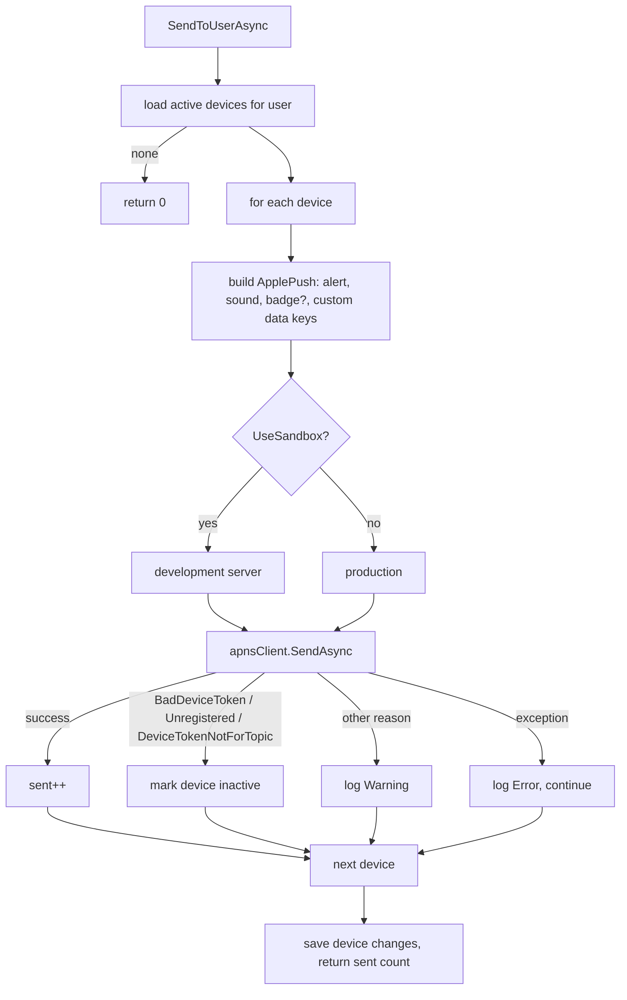

# Push notifications and email

The API sends iOS push notifications through Apple Push Notification service (APNs) to devices the app registers, and sends transactional email (invitations, password resets) through Resend. In development, email is written to the log instead of sent.

Related: [users and social](users-and-social.md) (invites, password reset), [rounds](rounds.md), [games](games.md), [hosting and configuration](../architecture/hosting-and-configuration.md).

## Push notifications

### Components

| Piece | File | Role |
|---|---|---|
| `IApnsClient` | `dotAPNS` package, registered in `src/FairwayFinder.Features/ServiceRegistration.cs` | Singleton built with `ApnsClient.CreateUsingJwt` over the named `HttpClient` `"apns"`, using token-based (`.p8` key) auth. |
| `PushNotificationService` | `src/FairwayFinder.Features/Services/PushNotificationService.cs` | Device registration and `SendToUserAsync`. Scoped. |
| `UserDevice` | `src/FairwayFinder.Data/Entities/UserDevice.cs` | One row per APNs device token. |
| `RoundNotifications` | `src/FairwayFinder.Features/Helpers/RoundNotifications.cs` | "Friend posted a round" fan-out. |
| `GameNotifications` | `src/FairwayFinder.Features/Helpers/GameNotifications.cs` | Game started / game final. |
| `DeviceEndpoints` | `src/FairwayFinder.Api/Endpoints/DeviceEndpoints.cs` | Register, unregister, admin test push. |

### Configuration (`Apns` section, `ApnsSettings`)

| Key | Meaning |
|---|---|
| `Apns:BundleId` | App bundle id (the APNs topic). |
| `Apns:KeyId` | Key id of the `.p8` signing key. |
| `Apns:TeamId` | Apple developer team id. |
| `Apns:P8Contents` | Contents of the `.p8` key. |
| `Apns:UseSandbox` | `true` sends to the APNs development server. Set in both hosts' `appsettings.Development.json`. |

Both `Program.cs` files throw at startup if `BundleId`, `KeyId`, `TeamId` or `P8Contents` is empty. The admin console never sends a push, but `RoundService` and `FriendService` inject `IPushNotificationService`, so the client must resolve there too; failing at startup is clearer than failing when an admin first opens a round. Tests set placeholder values in `TestSettings` and replace the client with `FakeApnsClient`.

### Device registration

`user_device` columns: `UserId`, `DeviceToken` (unique, max 256), `DeviceName`, `Platform` (always `"ios"`), `CreatedAt`, `UpdatedAt`, `LastSeenAt`, `IsActive`. Index `(user_id, is_active)` serves the send query. This table does not implement `IAuditable`; the service sets the timestamps itself.

| Call | Behaviour |
|---|---|
| `POST /api/devices` `{ deviceToken, deviceName? }` | `RegisterDeviceAsync`. Upsert by token. A new token is inserted active. An existing token is reassigned to the caller, reactivated, and `LastSeenAt` bumped. The app calls this on every launch. Only a brand-new token emits the `push_device_registered` analytics event. |
| `DELETE /api/devices/{token}` | `UnregisterDeviceAsync`. Sets `IsActive = false`. It does not check that the token belongs to the caller. |
| `POST /api/devices/test` | Admin role only. Sends a push with the given title/body/badge to every active device of `targetUserId` and returns how many succeeded. |

Because the token is unique and moves with the latest registration, a phone that signs into a different account stops receiving the previous account's pushes.

The admin console's `/devices` page lists devices through `AdminDeviceService`.

### Sending

`SendToUserAsync(userId, title, body, badge?, data?)`:

- Devices are sent to one at a time, in sequence.
- Apple's "this token is dead" responses deactivate the device so it is not tried again.
- `data` entries become custom keys next to `aps`. The app reads them on tap to open the right screen.

### What triggers a push

| Trigger | Recipient | Title / body | `data` |
|---|---|---|---|
| Friend request sent (`FriendService.SendRequestAsync`) | Addressee | "{name} sent you a friend request" / "Tap to view and respond." | none |
| Friend request accepted, or auto-accepted by a reverse request | Original requester | "{name} accepted your friend request" / "You're now friends." | none |
| Round completed: `RoundEntryService.CompleteRoundAsync` (hole-by-hole) or `RoundService.CreateRoundAsync` (deprecated full-card submit) | Every accepted friend of the golfer | "{FirstName} posted a round" / "Shot {score} at {course}" | `type=round`, `roundId`, `userPublicId` |
| Game started (`GameService.StartGameAsync`) | Linked participants except the host | "{Game} started" / "Your game at {course} is underway" | `type=game`, `gameId` |
| Game completed (`GameService.CompleteGameAsync`; not on abandon) | Linked participants except the host | "{Game} final" / "{summary} at {course}" | `type=game`, `gameId` |

The round push fires once, when the round is completed, never at start or per hole. Both round paths call the same `RoundNotifications.NotifyFriendsOfNewRoundAsync` so the message is identical. Game notifications skip guests (no user id) and the host. Game details are in [games](games.md).

**Push is never allowed to fail the operation.** Every caller wraps the send in `try/catch` and logs at Error. A golfer keeps their round, friendship or game even if APNs is down. Push is also not the source of truth: the app polls for game state and request counts.

## Email

`IEmailSender` (`src/FairwayFinder.Features/Services/Interfaces/IEmailSender.cs`) has three methods:

| Method | Used by |
|---|---|
| `SendInvitationEmailAsync(to, registrationLink, appInstallUrl?)` | `UserInvitationService` create and resend. |
| `SendPasswordResetEmailAsync(to, resetLink)` | `PasswordResetService` (golfer and admin paths). |
| `SendConfirmationEmailAsync(to, confirmationLink)` | Nothing at present. Registration from an invite sets `EmailConfirmed = true` directly. |

### Which sender is used

`RegisterFeatureServices` picks the implementation by environment:

| Environment | Implementation | Behaviour |
|---|---|---|
| Development | `DevEmailSender` (`Services/Email/DevEmailSender.cs`) | Logs the recipient and link at Information with a `[DEV EMAIL]` prefix. Nothing is sent. Copy the link from the console to test a flow. |
| Anything else | `ResendEmailSender` (`Services/Email/ResendEmailSender.cs`) | Sends through the Resend SDK with the `Resend:ApiKey` setting, from `noreply@fairwayfinder.pro`. |

Integration tests replace the sender with `RecordingEmailSender`, which keeps sent emails so a test can read the invite or reset link from `Email`.

### Resend sender details

- HTML bodies are inline in the class. The invitation email has two versions: with `Invites:AppInstallUrl` configured it walks the recipient through installing TestFlight, installing the app, then tapping the invite link; without it, it only contains the invite link.
- `SendAsync` records `FairwayFinderDiagnostics.EmailSent`, `EmailFailed` (tagged with exception type) and `EmailSendDuration`, tagged by kind (`invitation`, `password_reset`, `confirmation`). See [logging and observability](../operations/logging-and-observability.md).
- On failure it logs at Error and **rethrows**. The callers decide what the user sees: invitations report "email failed to send" to the admin; the golfer-facing password reset swallows it so the response does not reveal whether the account exists.

## Tests

| Test file | Covers |
|---|---|
| `tests/FairwayFinder.Api.IntegrationTests/Endpoints/DeviceEndpointsTests.cs` | Register upsert, token moving between accounts, unregister, validation, admin-only test push reaching the fake APNs client, analytics only for new devices. |
| `tests/FairwayFinder.Api.IntegrationTests/Endpoints/FriendEndpointsTests.cs` | Request and accept notify each golfer. |
| `tests/FairwayFinder.IntegrationTests.Common/Fakes/FakeApnsClient.cs`, `RecordingEmailSender.cs` | The fakes. The real `PushNotificationService` still runs over the fake client. |
