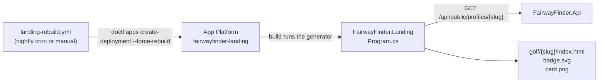

# Public profile

A golfer can publish a read-only stats page at `https://fairwayfinder.pro/golf/{slug}/`, meant for a
"See my golf stats" link on LinkedIn, a resume or a portfolio. It is opt-in, has per-section privacy
toggles, and counts only completed rounds that aren't excluded from stats, like every other stat.

The page is **static**. The Landing site's build fetches each profile from the API and bakes it into
HTML, a badge and a preview image. A nightly GitHub Action rebuilds the Landing site, so the numbers
are at most a day old.



## Opting in

The settings live on `user_profile` ([schema](../data/schema.md#user_profile-userprofile)):

| Field | Meaning |
|---|---|
| `IsPublic` | Master switch. Off by default |
| `PublicSlug` | The URL segment. Separate from the username, so renaming yourself never breaks a printed link. A blank slug when going public is derived from the username (`tee.time_42` → `tee-time-42`) |
| `ShowStrokesGained` | Show the strokes-gained chart |
| `ShowRecentRounds` | Show the five most recent rounds, and publish their scorecards (plus the best round's). Off means no round pages at all |
| `ShowCourseNames` | Name courses anywhere on the page. Off nulls every `CourseName` |

Golfers set these with `PUT /api/profile/public` ([endpoints](../api/endpoints.md#profile-endpointsprofileendpointscs)).
Admins set them in the Edit User dialog ([console](../admin/console.md#users)). Both go through
`IProfileService.UpdatePublicProfileAsync`, so the rules are identical.

`PublicSlugRules` (`src/FairwayFinder.Features/Helpers/PublicSlugRules.cs`) allows 3–30 characters of `a-z`,
`0-9` and single hyphens, starting and ending with a letter or digit. Slugs are stored lowercase. The
username reserved list applies, plus `badge`, `card`, `golf` and `index`. A slug someone else holds
returns 409. The unique-violation retry covers the race between the check and the save.

## The endpoint

`GET /api/public/profiles/{slug}` (`src/FairwayFinder.Api/Endpoints/PublicProfileEndpoints.cs`) is the
only anonymous data the API serves:

- **404 for unknown and private slugs alike**, with the same body, so nobody can probe which slugs exist.
- **Its own rate limit**, `PublicProfile`, 30 requests per 60 s per IP ([rate limiting](../api/overview.md#rate-limiting)).
- **No identifying data**: `PublicProfileResponse` has no user id, email, username or public identifier.
  The display name is first and last name, falling back to the username, never `DisplayNameHelper.Build(user)`,
  which falls back to the email.
- `Cache-Control: public, max-age=300`.

### Scorecards

`Scorecards` carries a hole-by-hole card for every round the page links to: the five recent rounds, plus
the best 18-hole round. Each is loaded with `IRoundService.GetRoundByIdAsync` at the golfer's strokes-gained
level and holds only the holes actually played. `RecentRounds[].Key` and `Headline.BestRound.Key` point at
them.

A card's **key** is its URL segment and is never the round id. It is the date played (`2026-09-21`), then
`-2`, `-3`… for later rounds that day in creation order (`PublicProfileService.ScorecardKeys`). Keys are
computed over every counted round, not just the published ones, so a round keeps its URL as the window moves.

Each card carries the teebox's `TeeboxName`, `Rating` and `Slope`, and every hole its `Yardage`, `Handicap`
(stroke index; 0 when unset), `Par` and `Score`. When hole stats were tracked it also has `Putts`, `Fairway`
(null on par 3s) and `Green`, plus `FairwayMiss`/`GreenMiss`: `Left`, `Right`, `Short` or `Long` on a miss,
and null when hit or when no direction was recorded.

The round page lays the card out like the admin console's `FairwayFinderScorecard`
(`Components/Scorecard.razor`):
- **Layout:** one table with Out, In and Total columns.
- **Rows:** the tee name on the yardage row, a handicap row totalling slope / rating, and a larger score row.
- **Tracked rows:** Fairways, GIR, Putts and Up & Down, with the same check and miss-direction icons as the admin card.
- **Small screens:** the card scrolls sideways with the row labels pinned.

Change the two together. Landing also uses the admin's Archivo font.

Score marks on the card copy the admin console's `ScoreMark` exactly: the same circles and squares in the
fairway (`#2f9e6b`), sand (`#d6a945`) and flag (`#d64550`) theme colours (`site.css`, `.score-mark`, and
`Components/ScoreMark.razor`). Change the two together.

`PublicProfileService` builds the response from `IStatsService.GetUserStatsAsync` (at the golfer's saved
strokes-gained level) and `IRoundService.GetRoundsByUserIdAsync`, dropping `ExcludeFromStats` rounds
from the latter.

### Handicap estimate

There is no official handicap in FairwayFinder. `HandicapCalculator` (`src/FairwayFinder.Features/Helpers/HandicapCalculator.cs`)
computes a WHS-shaped **estimate**, shown everywhere as "Handicap (est.)":

1. For each completed 18-hole round on an 18-hole teebox: differential = `(113 / slope) × (score − rating)`, rounded to one decimal.
2. Take the most recent 20.
3. Average the lowest N with the WHS Rule 5.2a adjustment (3 rounds → lowest 1 − 2.0, … 20 rounds → lowest 8).
4. Truncate to one decimal and cap at 54.0. Fewer than 3 rounds gives no index.

It differs from an official index: it uses the gross score, with no net-double-bogey cap per hole. It also
does not combine 9-hole rounds, and applies no playing-conditions calculation and no soft or hard cap.

## The Landing build

`src/FairwayFinder.Landing/Program.cs` generates the page after the static pages, when both build-time
variables are set (App Platform: set them on the static site component, scope **build time**):

| Variable | Example |
|---|---|
| `PUBLIC_PROFILE_API_URL` | `https://api.fairwayfinder.pro` |
| `PUBLIC_PROFILE_SLUGS` | `george` (comma-separated) |

Locally they come from appsettings instead (below). With either blank, the site builds without profile pages. With them set, **any non-200 fails the build**.
That means an API outage, a typo or a profile turned private, and App Platform keeps serving the previous
deploy. Turning a profile private therefore needs its slug removed from `PUBLIC_PROFILE_SLUGS` too.

For each slug it writes:

| File | What |
|---|---|
| `golf/{slug}/index.html` | `Pages/ProfilePage.razor`: stat strip (handicap estimate, scoring average, rounds this year, best round), scoring trend over the last 20 18-hole rounds, strokes-gained diverging bars, scoring-distribution donut, recent rounds, and a "Built with FairwayFinder" footer. Every chart is inline SVG or CSS rendered at build time, with no JavaScript |
| `golf/{slug}/rounds/{key}/index.html` | `Pages/RoundPage.razor`: one page per round the profile links to (the recent rounds and the best round). Header with score, putts, fairways and greens, then the card as one admin-style table (`Components/Scorecard.razor`) with fairway/GIR/putts/up-and-down rows when tracked, the score-mark legend, and that round's strokes gained |
| `golf/{slug}/badge.svg` | `Profiles/BadgeSvg.cs`: a shields-style badge, "⛳ golf \| 8.4 HCP · 79.2 avg" |
| `golf/{slug}/card.png` | `Profiles/OgCardRenderer.cs`: the 1200×630 `og:image` that LinkedIn, Slack and iMessage show. Rendered with SkiaSharp |

Landing references no other project, so `Profiles/PublicProfile.cs` is its own copy of `PublicProfileResponse`.
Keep the two in step.

**Fonts.** SkiaSharp's `NativeAssets.Linux.NoDependencies` (what the Linux App Platform build loads) has no
fontconfig and therefore no default typeface. The card loads `Fonts/Inter.ttf` (SIL OFL, licence beside it)
explicitly. Without it every label would render as nothing.

**Embedding the badge** in a README or portfolio:

```markdown
[](https://fairwayfinder.pro/golf/george/)
```

### Locally

Landing reads the `PublicProfiles` section of its appsettings; non-blank `PUBLIC_PROFILE_*` environment
variables override it. `src/FairwayFinder.Landing/appsettings.Development.json` points `ApiUrl` at the
local API (`http://localhost:5227`) and leaves `Slugs` blank, so the site builds without profile pages
until you fill it in. Under the AppHost, `PUBLIC_PROFILE_API_URL` is set to the API's real endpoint.
To preview a page:

1. Make a local profile public.
2. Put its slug in `PublicProfiles:Slugs` in `appsettings.Development.json`.
3. Restart `fairwayfinder-landing`, or run `dotnet run --project src/FairwayFinder.Landing -- --serve` with the API running, then open `/golf/{slug}/`.

To check a link preview after a deploy, paste the URL into LinkedIn's Post Inspector.

## Nightly rebuild

`.github/workflows/landing-rebuild.yml` runs at 10:00 UTC and on demand ("Run workflow"):

```
doctl apps create-deployment $LANDING_APP_ID --force-rebuild --wait
```

- It redeploys **only** the landing app. The Api and Admin containers are untouched.
- `--force-rebuild` is required: with no new commit, App Platform would reuse the previous build and the
  stats would never change.
- `--wait` fails the job when the build fails.
- Secrets: `DIGITALOCEAN_ACCESS_TOKEN` (an API token scoped to Apps, read and update) and `LANDING_APP_ID`.

## Tests

| Test file | Covers |
|---|---|
| `tests/FairwayFinder.Api.IntegrationTests/Endpoints/PublicProfileEndpointsTests.cs` | Anonymous fetch with stats and handicap; no identifying fields; private and unknown slugs are identical 404s; turning off takes the page down; case-insensitive lookup; in-progress rounds ignored; hidden sections null; scorecards keyed by date and linked from recent and best rounds, none when recent rounds are hidden, course names hidden on them too; slug from username; settings round trip; invalid, reserved and taken slugs; settings need sign-in |
| `tests/FairwayFinder.Api.IntegrationTests/Auth/RateLimitingTests.cs` | The `PublicProfile` limit, per IP |
| `tests/FairwayFinder.Api.IntegrationTests/Conventions/EndpointAuthorizationConventionTests.cs` | The endpoint is on the anonymous list, with its reason |
| `tests/FairwayFinder.Admin.IntegrationTests/Services/UserAdminServiceTests.cs` | Admin publishing acts on the target and stamps the admin; taken slugs refused |
| `tests/FairwayFinder.Features.Tests/Helpers/HandicapCalculatorTests.cs` | Differentials, the WHS table, the 20-round window, truncation, the cap |
| `tests/FairwayFinder.Features.Tests/Helpers/PublicSlugRulesTests.cs` | Slug validation, normalization and the username-derived default |
| `tests/FairwayFinder.Features.Tests/Helpers/PublicScorecardKeyTests.cs` | Date keys and same-day suffixes |

The Landing generator has no test project. Verify it by running it against the local API (above).
