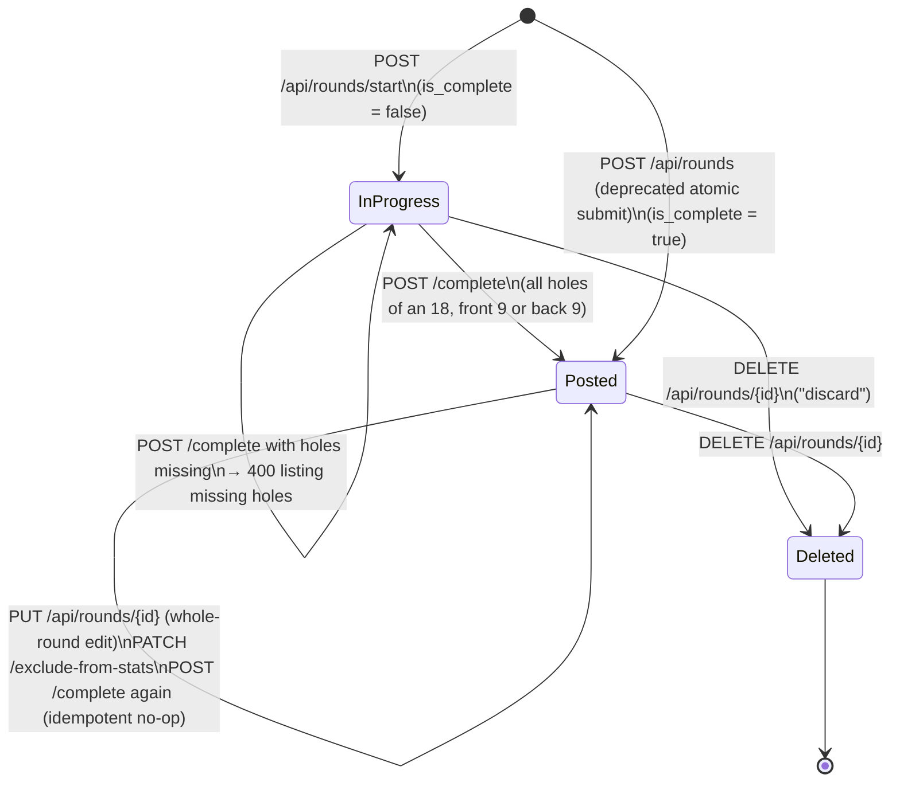
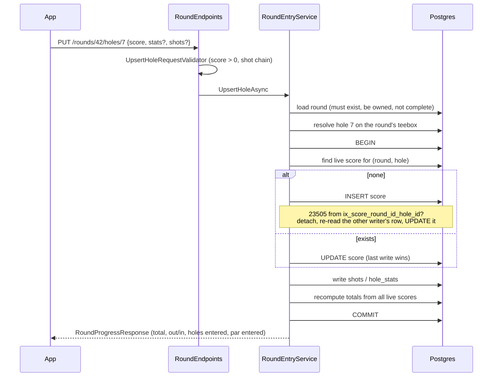

# Rounds

A round is one golfer's card on one teebox: a `round` row, one `score` per hole, optional
`hole_stats` per hole, optional `shot` rows per hole, and a `round_stats` row holding the scoring
distribution. This page covers how rounds are written (hole by hole, or the deprecated whole-card
submit), read, edited and deleted, and the scoring rules both write paths share.

Strokes gained and the stats dashboards that read these rows are in
[stats-and-strokes-gained.md](stats-and-strokes-gained.md). The HTTP surface is in
[../api/endpoints.md](../api/endpoints.md); table definitions are in [../data/schema.md](../data/schema.md).

## The pieces

| Type | File | Job |
|---|---|---|
| `RoundService` | `src/FairwayFinder.Features/Services/RoundService.cs` | Reads (lists, details, single round, shots), the deprecated atomic create, whole-round update, delete, exclude-from-stats |
| `RoundEntryService` | `src/FairwayFinder.Features/Services/RoundEntryService.cs` | Hole-by-hole entry: start, upsert hole, clear hole, complete, get active |
| `RoundScoringHelper` | `src/FairwayFinder.Features/Helpers/RoundScoringHelper.cs` | Totals, scoring distribution, shape flags, missing holes, shot numbering, hole-stat derivation |
| `RoundNotifications` | `src/FairwayFinder.Features/Helpers/RoundNotifications.cs` | Push to friends when a round is posted |
| `StrokesGainedCalculator` | `src/FairwayFinder.Features/Helpers/StrokesGainedCalculator.cs` | Shot-chain validation and `DeriveHoleStatFromShots` (used here), SG math (see stats doc) |
| `RoundEndpoints` | `src/FairwayFinder.Api/Endpoints/RoundEndpoints.cs` | Maps `/api/rounds/*`, ownership checks, maps `RoundEntryResult` to HTTP |
| Validators | `src/FairwayFinder.Api/Validators/RoundEntryValidators.cs`, `CreateRoundRequestValidator.cs`, `UpdateRoundRequestValidator.cs` | Request shape and shot-chain rules |
| DTOs | `src/FairwayFinder.Features/Data/RoundEntryDtos.cs`, `CreateRoundRequest.cs`, `UpdateRoundRequest.cs`, `RoundResponse.cs`, `ShotData.cs` | Requests and responses |

Rounds are the one domain split across two services. The split is by lifecycle: `RoundEntryService`
owns a round while it is being played, `RoundService` owns it once posted. Both write the same
columns, so all the arithmetic lives in `RoundScoringHelper` and neither service computes a total or
a distribution itself.

## Data written per round

| Row | When it exists | Notes |
|---|---|---|
| `round` | Always | `score`, `score_out`, `score_in`, shape flags (`full_round`, `front_nine`, `back_nine`), `using_hole_stats`, `using_shot_tracking`, `exclude_from_stats`, `is_complete`, `date_played` (`DateOnly`, the golfer's local date) |
| `score` | One per entered hole | `hole_score`. Unique on `(round_id, hole_id)` where not deleted (`ix_score_round_id_hole_id`) |
| `hole_stats` | Per hole when `using_hole_stats` | Fairway/green hit and miss direction, putts, approach yardage, out-of-position and penalty flags |
| `shot` | Per shot when `using_shot_tracking` | Start/end distance, unit, lie, penalty strokes, `shot_number` |
| `round_stats` | Once the round is posted | Counts of aces, albatrosses, eagles, birdies, pars, bogeys, doubles, triple-or-worse. Also has `sg_*` columns that nothing writes or reads (SG is computed live) |

Tracking level is derived from the two flags by `RoundTracking.Classify`
(`src/FairwayFinder.Features/Enums/RoundTrackingLevel.cs`): `ShotTracked` if `UsingShotTracking`,
else `HoleStats` if `UsingHoleStats`, else `Basic`. Both write paths force `UsingHoleStats = true`
whenever shot tracking is on, because shot-tracked rounds also get derived hole stats.

Everything is soft-deleted (`is_deleted`). Audit columns are stamped by the interceptor; services set
only `CreatedBy`/`UpdatedBy` (see [../data/database.md](../data/database.md)).

## Lifecycle

### Start (`RoundEntryService.StartRoundAsync`)

1. If the golfer already has a round with `!IsDeleted && !IsComplete`, return `ActiveRoundExists`
   with that round's id. The endpoint returns 409 with `roundId` in the body so the app can offer
   "resume or discard".
2. Reject an unknown or archived teebox (`TeeboxArchived`). New rounds can only go on the active
   version of a teebox; see [courses.md](courses.md) for teebox versioning.
3. Insert the round with zero totals and `IsComplete = false`. The shape flags from the request are
   stored as a plan; they are overwritten at completion.
4. If the insert hits the unique index (two devices started at once), catch the `23505`
   unique violation, re-read the winner and return `ActiveRoundExists` the same way as step 1.
5. Return the round id and the teebox's holes (id, number, par, yardage, handicap), so the client
   has par and hole ids pinned to the exact teebox version.

The request validator requires at least one of `FullRound`, `FrontNine`, `BackNine`.
Start emits the `round_started` analytics event and the `RoundsStarted` counter, but no
notification.

### One open round per golfer

`ix_round_user_id_active` is a unique index on `round.user_id` filtered by
`is_complete = false AND is_deleted = false` (`src/FairwayFinder.Data/ApplicationDbContext.cs`). The
service check in step 1 exists for the nicer response; the index is what actually holds under a
race. Discarding an open round is a normal `DELETE /api/rounds/{id}`, which soft-deletes it and
frees the slot.

### Upsert a hole (`RoundEntryService.UpsertHoleAsync`)

`PUT /api/rounds/{roundId}/holes/{holeNumber}` (hole number constrained to 1–18 in the route).

Points worth knowing:

- **The client sends no hole id and no par.** `UpsertHoleRequest` carries only the score and
  detail; the hole is resolved from the round's own teebox by number (`ResolveHoleAsync`). A client
  cannot post a hole from another teebox or invent a par. An unknown number returns
  `HoleNotOnTeebox` (404).
- **Only the owner can write, and only while the round is open.** A posted round returns
  `RoundAlreadyComplete` (409) pointing the caller at `PUT /api/rounds/{id}`, so the per-hole writer
  and the whole-round editor never interleave on the same rows.
- **Totals are recomputed, never accumulated.** `RecomputeTotalsAsync` reloads every live score and
  calls `RoundScoringHelper.ComputeTotals`. Posting the same hole twice lands on identical state, and
  any interleaving between devices corrects itself on the next write.
- **Concurrency.** `ix_score_round_id_hole_id` (unique on `(round_id, hole_id)` where
  `is_deleted = false`) means two first writes of the same hole cannot both insert. The loser
  catches the unique violation (`IsUniqueViolation` checks `SqlState == "23505"` by reflection so
  Features needs no Npgsql reference), detaches its entity, re-reads the winner's row and applies
  its score on top. The whole write runs in a transaction when the provider is relational (the
  InMemory provider used by unit tests has none, so `BeginTransactionAsync` returns null there).
- **Hole detail** (`WriteHoleDetailAsync`):
  - Shot-tracked round and the request has shots: soft-delete the hole's existing shots, insert the
    new list via `BuildShots`, and derive hole stats from the shots (`ApplyDerivedHoleStat`). Shots
    are replaced wholesale rather than reconciled because the round is still in progress and no
    client holds shot ids yet.
  - Otherwise, if the round tracks hole stats (including a shot-tracked hole sent without shots):
    copy the client's stat fields (`ApplyClientHoleStat`). Existing shots on that hole are left
    in place in this case.
  - Otherwise, soft-delete any hole-stat row left over.
- Emits the `RoundHolesPosted` counter. No notification, no analytics event.

### Clear a hole (`RoundEntryService.ClearHoleAsync`)

`DELETE /api/rounds/{roundId}/holes/{holeNumber}` soft-deletes the hole's score, hole stats and
shots, then recomputes totals. Clearing a hole that was never entered succeeds. Because both unique
indexes are filtered on `is_deleted = false`, a cleared hole can be entered again.

### Complete (`RoundEntryService.CompleteRoundAsync`)

`POST /api/rounds/{roundId}/complete`:

1. Missing round → 404; another user's → 403.
2. **Already complete → return the round.** Completion is idempotent so a retry over bad signal
   neither fails nor notifies friends twice.
3. Load entered holes and call `RoundScoringHelper.MissingHoles`. A round must be a full 18, the
   front nine or the back nine (or all nine holes of a nine-hole teebox). Otherwise return
   `RoundIncomplete` with the missing hole numbers, which the endpoint turns into a 400
   `ValidationProblem` naming them. A round with no holes reports every hole as missing.
4. In a transaction: recompute totals, overwrite the shape flags with `ClassifyShape` on the holes
   actually played (the start request was a plan, the holes are the record), create or update
   `round_stats` with `ApplyScoringDistribution`, and set `IsComplete = true`.
5. Record telemetry (`RoundsCreated`, `ShotsLogged`, `RoundSaveDuration` with operation
   `complete`), capture `round_completed` with `entry = hole_by_hole`, and notify friends.
6. Return the full `RoundResponse` at the caller's SG baseline level.

`RoundsCreated` is counted at completion, not at start, so it stays comparable with the atomic path:
a round becomes real when it is posted.

### Resume (`GET /api/rounds/active`)

`RoundEntryService.GetActiveRoundAsync` finds the golfer's open round and returns it through
`RoundService.GetRoundByIdAsync`, or 204 when there is none (asked on every app launch, so "none" is
not an error).

### Deprecated atomic submit (`RoundService.CreateRoundAsync`)

`POST /api/rounds` takes the whole card (`CreateRoundRequest` with a list of `HoleScoreEntry`, each
carrying `HoleId`, `HoleNumber`, `Par`, score, stats and shots). It is kept for iOS builds already
in the field and marked deprecated in OpenAPI. Differences from the hole-by-hole path:

- The client supplies hole ids and par (validated: par 3–6, hole number 1–18).
- The round is inserted with `IsComplete = true` and the shape flags as sent; they are not
  re-derived on create.
- It saves in several `SaveChangesAsync` calls without an explicit transaction.
- Unknown/archived teebox throws `InvalidOperationException` rather than returning a status.
- It emits the same `round_completed` event with `entry = full_card`, and notifies friends.

## Scoring rules (`RoundScoringHelper`)

All inputs are reduced to `HoleScoreLine(HoleNumber, Score, Par)`.

| Method | Rule |
|---|---|
| `ComputeTotals` | Holes 1–9 sum into `ScoreOut`, 10–18 into `ScoreIn`; `Total = Out + In`. Also returns `ParEntered` and `HoleCount`. Only the holes supplied count, so it is correct mid-round. |
| `ApplyScoringDistribution` | A score of 1 is a hole-in-one on any par (so a par-3 ace is not also an eagle), matching `StatsCalculator.CalculateHoleScoringDistribution`. Everything else buckets by `score - par`: ≤ −3 double eagle; −2 eagle; −1 birdie; 0 par; +1 bogey; +2 double; anything worse triple-or-worse. Assigns rather than increments, so it is safe to call repeatedly on the same `RoundStat`. Rows written before this rule filed par-3 aces under `eagles`; migration `20261031120000_BackfillParThreeAces` moved them to `hole_in_one`. |
| `ClassifyShape` | `FrontNine` = all of 1–9 present; `BackNine` = all of 10–18; `FullRound` = both. On a nine-hole teebox, covering 1–9 sets `FullRound` and `FrontNine`. A finished 18 sets all three, matching the TGTR importer. |
| `MissingHoles` | Infers the target from what is entered: nine-hole teebox → 1–9; holes on both sides of the turn → 1–18; only back-nine holes → 10–18; otherwise 1–9. Returns target holes not yet entered. Empty input returns empty (the caller handles that case). |
| `BuildShots` | Numbers shots 1..n by list position. The client's `ShotNumber` is ignored; the server owns ordering. |
| `ApplyClientHoleStat` | Copies all ten client stat fields. Used for hole-stats-only rounds. |
| `ApplyDerivedHoleStat` | Takes putts, fairway hit, green hit, approach yardage, tee-shot penalty and approach penalty from `StrokesGainedCalculator.DeriveHoleStatFromShots`; takes only the two miss directions and two out-of-position flags from the client, since shots cannot prove those. |

`IHoleStatSource` is the interface both `HoleScoreEntry` (atomic) and `UpsertHoleRequest`
(hole-by-hole) implement, so the same helpers serve both request shapes.

### Shots and derived hole stats

A shot is `ShotData` (`src/FairwayFinder.Features/Data/ShotData.cs`): start distance, unit
(`yards`/`feet`), lie (`Tee`, `Fairway`, `Rough`, `Sand`, `Green`), end distance/unit/lie, and
penalty strokes. A holed shot has `EndDistance` and `EndLie` both null.

`StrokesGainedCalculator.ValidateShots` defines a valid chain. It runs in the API validators for both
write paths and again on every read before computing SG:

- At least one shot; the first starts from the tee (and at hole yardage, when the caller passes it;
  the API validators do not).
- Every start distance ≥ 1. A 0 would read as "already holed" in the SG tables.
- Only the last shot is holed; every other shot ends at a distance ≥ 1 with a lie.
- Each shot's end distance and lie equal the next shot's start distance and lie.
- Shot count + penalty strokes equals the hole score.
- Penalty strokes are 0, 1 or 2.

`DeriveHoleStatFromShots(shots, par)`:

| Field | Derivation |
|---|---|
| `NumberOfPutts` | Shots that start on the green |
| `HitFairway` | Par 4/5 only: first shot ends in the fairway. Null on par 3 |
| `HitGreen` | Strokes (each shot + its penalties) before the first putt ≤ par − 2. A chip-in with no putts uses all strokes. |
| `ApproachYardage` | Start distance of the first shot classified as `Approach` (on a par 3 that is the tee shot) |
| `TeeShotPenalty` | First shot has penalty strokes |
| `ApproachShotPenalty` | That approach shot has penalty strokes |

## Reading rounds

| Method | Used by | Includes incomplete? | Includes excluded? | Detail |
|---|---|---|---|---|
| `GetRoundsByUserIdAsync(userId[, filter])` | `GET /api/rounds`, friend round list, years list | No | Yes (flag rides along so the UI can badge it) | Header only: no holes, no SG |
| `GetRoundsWithDetailsAsync(userId, filter, level)` | `GET /api/rounds/details`, all stats | No | No | Holes, hole stats, round stats, shots and live SG for shot-tracked rounds |
| `GetRoundByIdAsync(roundId, level)` | `GET /api/rounds/{id}`, resume, complete, friend round view, admin | **Yes** | Yes | Everything above plus the games the round was played for |
| `GetPlayedCoursesByUserId` | `GET /api/rounds/courses`, stats course list | No | Depends on `statRounds` | Distinct courses |
| `GetShotsByRoundIdAsync` | `GET /api/rounds/{id}/shots` | n/a | n/a | Shots keyed by score id |

**The `is_complete` rule.** Every list, stats and friend query filters `IsComplete == true`; an
in-progress round's running score would otherwise read as a great round.
`GetRoundByIdAsync` is deliberately not gated, because the resume endpoint and the admin console
need it. The friend single-round endpoint checks ownership against the friend and then calls it;
see [users-and-social.md](users-and-social.md). `RoundEntryServiceTests.A_round_in_progress_stays_out_of_lists_and_stats_until_it_is_posted`
pins this.

The `StatsFilter` (`src/FairwayFinder.Features/Data/StatsFilter.cs`) used by list and detail reads
supports `FullRoundOnly`, `StartDate`/`EndDate` (inclusive `DateOnly`), `CourseId` and `Year`. `Year`
is ignored when either date bound is set.

`GetRoundsWithDetailsAsync` and `GetRoundByIdAsync` load shots in one batched query
(`LoadShotsForRoundsAsync`, using score ids already on the mapped holes) and then compute SG per
hole and per round (`PopulateStrokesGained`). Holes whose stored shots fail `AreShotsScorable` are
skipped with a warning log rather than producing made-up SG. SG is never persisted; see
[stats-and-strokes-gained.md](stats-and-strokes-gained.md).

`RoundResponse` also exposes computed totals the app uses directly: `ScoreToPar` (against the par of
holes actually loaded, falling back to the teebox par, halved for a nine on an 18-hole teebox, when
holes are not loaded), fairways/greens/putts split out and in, `TotalPenalties`, and up-and-down
counts (`RoundHole.IsUpAndDownAttempt`: missed green with putts and score recorded;
`IsUpAndDown`: that plus ≤ 1 putt and par or better).

## Editing a posted round (`RoundService.UpdateRoundAsync`)

`PUT /api/rounds/{id}` sends the whole round (`UpdateRoundRequest`: teebox, date, tracking flags,
every hole). The endpoint first checks ownership and returns 409 if the round is still in progress.
The service then:

- Returns `false` (→ 404) if the round is missing or not owned by `request.UserId`.
- Allows keeping an archived teebox the round is already on, but refuses to move it to a different
  archived or unknown teebox.
- Recomputes totals and the scoring distribution from the request's holes, and re-derives the shape
  flags with `ClassifyShape` (an edit can turn a nine into an eighteen).
- **Updates rows in place.** Scores are matched by `ScoreId`, falling back to `HoleId` so a client
  that omits or sends a stale id does not create a duplicate (which the unique index would reject
  anyway). Shots are matched by position within the hole: existing shot *i* is overwritten by
  request shot *i*, extra new shots are inserted, surplus old shots are soft-deleted. Hole stats are
  matched by score id. This follows the project rule of updating in place rather than deleting
  and re-inserting.
- Soft-deletes only what is genuinely gone: the score of a hole the request leaves out (so stored
  scores always agree with the recomputed totals), along with that hole's shots and hole stats;
  every shot on the round when shot tracking is switched off (for example, shot tracking to hole
  stats); and the round's hole stats when tracking is switched off entirely.
- Writes hole stats through the shared helpers, `ApplyDerivedHoleStat` for shot-tracked holes and
  `ApplyClientHoleStat` for hole-stats rounds, the same as both other write paths.

The `round_edited` analytics event is captured in the endpoint, not the service, because the admin
console calls the same method. Admins edit through `AdminRoundService.UpdateRoundAsAdminAsync`,
which re-resolves the owner server-side and submits under that identity so the ownership guard still
holds; see [../admin/console.md](../admin/console.md).

### Exclude from stats

`PATCH /api/rounds/{id}/exclude-from-stats` flips `round.exclude_from_stats`
(`SetExcludeFromStatsAsync`). Excluded rounds still appear in round lists but are dropped from every
stats query. It is a separate endpoint because the PUT takes a whole round and cannot express a lone
flag change.

## Deleting

`DELETE /api/rounds/{id}` (`RoundService.DeleteRoundAsync`) soft-deletes the round, its scores, hole
stats, shots and round stat, stamping `UpdatedBy`. The service matches on round id only and does no
ownership check; the endpoint's `EnsureRoundAccess` does (404 if missing, 403 if not yours). The
admin console relies on the missing guard to delete cross-owner. Deleting an open round is how the
app discards it. `round_deleted` is captured in the endpoint.

## Notifying friends

`RoundNotifications.NotifyFriendsOfNewRoundAsync` runs exactly once per round, at posting: from
`CompleteRoundAsync` (only on the first, non-idempotent call) and from the deprecated
`CreateRoundAsync`. Never at start, never per hole, never on edit.

It loads the poster's friends, builds "`{FirstName}` posted a round" / "Shot `{score}` at
`{course}`" (falling back to "A friend" and "a course"), and sends a push to each friend with data
`type = round`, `roundId`, and `userPublicId` (the poster's profile public id, which the app needs to
open a friend's round). It never throws: any failure is logged at Error and swallowed so a push
problem cannot cost the golfer their round. Delivery is covered in
[notifications-and-email.md](notifications-and-email.md).

## Telemetry

`FairwayFinderDiagnostics` counters and activities: `RoundsStarted`, `RoundHolesPosted`,
`RoundsCreated`, `ShotsLogged`, `RoundsUpdated`, `RoundsDeleted`, `RoundSaveDuration` (tagged
`create`/`update`/`complete`). PostHog events: `round_started`, `round_completed` (both paths, told
apart by `entry`), `round_edited`, `round_deleted`. See
[../operations/logging-and-observability.md](../operations/logging-and-observability.md) and
[../operations/analytics.md](../operations/analytics.md).

## Tests

- `tests/FairwayFinder.Features.Tests/RoundEntryServiceTests.cs`: start, one-open-round, upsert
  idempotency, hole resolution from the teebox, shot renumbering and replacement, clear and
  re-enter, completion rules, single notification on retry, and in-progress rounds staying out of
  lists and stats.
- `tests/FairwayFinder.Features.Tests/RoundServiceExcludeFromStatsTests.cs`,
  `Data/RoundResponseTests.cs`, `Helpers/StrokesGainedCalculatorTests.cs` (validation and
  derivation).
- Concurrency and the filtered unique indexes only behave on real Postgres, so they belong in
  `tests/FairwayFinder.Api.IntegrationTests`; see [../testing.md](../testing.md).

## Changing scoring

Put any new scoring rule in `RoundScoringHelper` and call it from both services. If a new rule
depends on shots, put the derivation in `StrokesGainedCalculator.DeriveHoleStatFromShots` and the
copy in `ApplyDerivedHoleStat`.
