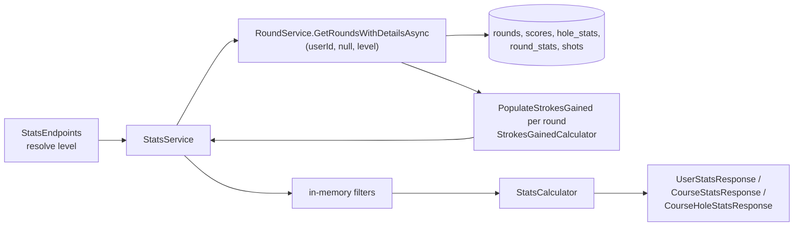
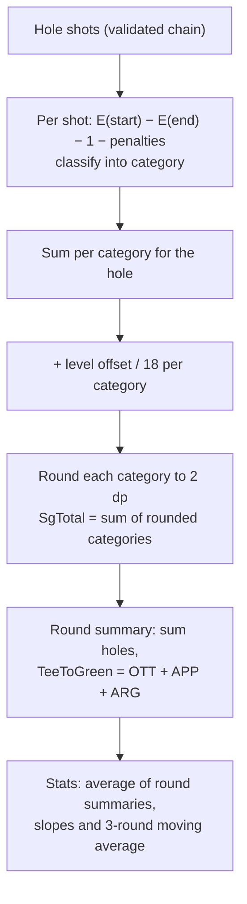

# Stats and Strokes Gained

Stats are computed on every request from a golfer's posted rounds; nothing aggregate is stored
except each round's scoring distribution. Strokes gained (SG) is computed live from shot data
against a single expected-strokes table, then shifted by a per-category offset for the selected
golfer level (default Scratch).

How rounds, hole stats and shots are written is in [rounds.md](rounds.md). Endpoint parameters are
in [../api/endpoints.md](../api/endpoints.md). The original design is
[../strokes-gained-spec.md](../strokes-gained-spec.md); where it disagrees with this page, this page
describes the code (see [Differences from the spec](#differences-from-the-original-spec)).

## The pieces

| Type | File | Job |
|---|---|---|
| `StatsService` | `src/FairwayFinder.Features/Services/StatsService.cs` | Builds the user, course and course-hole stats responses; years and course filter lists |
| `StatsCalculator` | `src/FairwayFinder.Features/Helpers/StatsCalculator.cs` | Pure static functions: averages, trends, FIR/GIR, short game, par-type, distribution, per-hole aggregates |
| `StrokesGainedCalculator` | `src/FairwayFinder.Features/Helpers/StrokesGainedCalculator.cs` | Per-shot, per-hole, per-round SG; shot classification; shot validation; hole-stat derivation |
| `StrokesGainedBaseline` | `src/FairwayFinder.Features/Helpers/StrokesGainedBaseline.cs` | Expected-strokes lookup tables and the per-level offsets |
| `SgCategoryOffsets` | `src/FairwayFinder.Features/Helpers/SgCategoryOffsets.cs` | Record of the four per-round category offsets |
| `BaselineLevel` | `src/FairwayFinder.Features/Enums/BaselineLevel.cs` | `Tour`, `Scratch` (default), `Hcp5`…`Hcp25` |
| `ShotCategory`, `LieType`, `DistanceUnit` | `src/FairwayFinder.Features/Enums/` | SG categories, lies, `yards`/`feet` |
| `StatsEndpoints` | `src/FairwayFinder.Api/Endpoints/StatsEndpoints.cs` | `/api/stats/*`, level resolution, `stats_viewed` event |
| DTOs | `src/FairwayFinder.Features/Data/UserStatsResponse.cs`, `CourseStatsResponse.cs`, `CourseHoleStatsResponse.cs`, `StrokesGainedSummary.cs`, `StrokesGainedHoleResult.cs`, `StrokesGainedTrendPoint.cs`, `StatsFilter.cs` | Responses and filter |

## Data flow



`StatsService` holds no `DbContext`. It asks `RoundService.GetRoundsWithDetailsAsync` for **all** of
the golfer's stat-eligible rounds (it passes a null filter), already carrying holes, hole stats,
round stats, shots, `HoleByHoleSg` and a round `StrokesGained` summary at the requested level. It then
filters in memory and hands the list to `StatsCalculator`. The calculator works only on
`RoundResponse` objects, which is why it can be unit tested without a database
(`tests/FairwayFinder.Features.Tests/Helpers/StatsCalculatorTests.cs`).

### Which rounds count

A round is in stats when it is not deleted, `IsComplete == true` and `ExcludeFromStats == false`. The
database query in `GetRoundsWithDetailsAsync` applies all three; `StatsService` re-checks the last two
in memory as a backstop. In-progress rounds are excluded so a partial score is never read as a great
round (see [rounds.md](rounds.md#reading-rounds)).

### Filters

`StatsFilter` (`src/FairwayFinder.Features/Data/StatsFilter.cs`):

| Field | Effect |
|---|---|
| `FullRoundOnly` | `true` = rounds with `FullRound`, `false` = the rest, null = both |
| `StartDate`, `EndDate` | Inclusive bounds on `DatePlayed` (`DateOnly`) |
| `Year` | Calendar year of `DatePlayed`. Ignored if either date bound is set |
| `CourseId` | One course (user stats only; course stats take it from the route) |

Course stats take `teeboxId` instead of a filter object. It is a **teebox group id**
(`teebox_group_id`), so every version of a re-rated tee is one option. `TeeboxOptions` is built from
all of the golfer's rounds at the course before filtering, so the dropdown does not shrink when a
filter matches nothing.

### Golfer level

Every stats and round-detail endpoint accepts `?level=` (`BaselineLevel` by name, e.g. `Hcp10`). When
it is absent, `ResolveLevelAsync` uses the golfer's saved `SgBaselineLevel` from their profile,
which defaults to `Scratch` (0). The golfer sets it with the profile endpoint
(`UpdateSgBaselineLevelRequest`, see [users-and-social.md](users-and-social.md)). Friend stats and
friend round views do not pass a level, so they always use Scratch. The admin Stats Explorer can
show two levels side by side; see [../admin/console.md](../admin/console.md).

## What stats exist

### `GET /api/stats` → `StatsService.GetUserStatsAsync`

| Group | Fields | Computed by | Rounds used |
|---|---|---|---|
| `Scoring` | Round counts (18/9), average 18- and 9-hole score, score trend slope, best 18 and best 9, score trend points | `CalculateAverageScore`, `CalculateScoreTrend`, `FindBestRound`, `BuildScoreTrend` | All, split by `FullRound` |
| `BallStriking` | FIR %, GIR %, off-the-tee penalty %, each with a trend slope and per-round trend points | `CalculateBallStriking`, `BuildFirTrend`, `BuildGirTrend`, `BuildTeePenaltyTrend` | `UsingHoleStats` rounds |
| `ShortGame` | Up-and-down %, average putts (18/9), average 3-putts (18/9), slopes and trend points | `CalculateShortGame`, `BuildPuttsTrend`, `BuildThreePuttsTrend`, `BuildUpAndDownTrend` | `UsingHoleStats` rounds |
| `ParTypeScoring` | Average score and count on par 3s, 4s, 5s | `CalculateParTypeScoring` | All holes with a score |
| `ScoringDistribution` | Sum of each round's `round_stats` counts | `AggregateScoringDistribution` | Rounds with a `round_stats` row |
| `MostPlayedCourses` | Top N courses by round count (default 5) with 18/9 averages | `CalculateCourseStats` | All |
| `StrokesGained` | Average SG summary, trend slopes, and total/putting/tee-to-green trend points with a 3-round moving average | `AggregateStoredSg`, `BuildSgTrendFromStored` in `StatsService` | Rounds with a non-null `StrokesGained` (shot-tracked) |

### `GET /api/stats/courses/{courseId}` → `GetCourseStatsAsync`

The same scoring, ball-striking, short-game, par-type and distribution groups for one course, plus
`HoleStats` (per-hole aggregates from `CalculateHoleAggregateStats`), `TeeboxOptions`, and an SG
summary (no trend points). Returns null (404) when the golfer has no rounds at the course, and an
empty shell with `TeeboxOptions` when filters remove every round.

### `GET /api/stats/courses/{courseId}/holes` → `GetCourseHoleStatsAsync`

One `HoleStatsDetail` per hole number played: the aggregate row, a per-hole scoring distribution
(`CalculateHoleScoringDistribution`), every play newest first, a score trend slope, and the average
per-hole SG (`StrokesGainedCalculator.AverageHoleSg`) when any play was shot-tracked.

`CalculateHoleAggregateStats` groups by hole number, not hole id, because each teebox version has its
own hole rows. Par, stroke index and yardage come from the newest teebox version played (highest
`TeeboxId`), so a re-rating is reflected even if older versions have more history. Scores and
percentages aggregate across all versions.

### `GET /api/stats/years` and `GET /api/stats/courses`

Distinct years with stat-eligible rounds, newest first, and the courses where the golfer has
stat-eligible hole-stats rounds (`GetPlayedCoursesByUserId(userId, statRounds: true)`).

## Calculation rules

- **Averages** round to 1 decimal for scores and putts per round, 2 for per-hole figures,
  percentages to 1 decimal.
- **Trend slopes** are least-squares slopes over the per-round values in date order, with x as the
  round index (`StatsCalculator.CalculateLinearRegression`). Negative means the number is falling
  over time; for score that is improvement. A slope needs at least 2 points (3 for SG summary
  slopes). The round list arrives newest first, so the calculator reverses it before regressing.
- **FIR %**: par 4 and 5 holes where `HitFairway` is set; hit / attempts.
- **GIR %**: all holes where `HitGreen` is set.
- **Off-the-tee penalty %**: holes with hole stats, every par. On par 4/5 it reads
  `TeeShotPenalty`; on par 3 the tee shot is the approach, so it reads `ApproachShotPenalty`
  (`IsOffTheTeePenalty`).
- **Up-and-down %**: attempts are missed greens with putts and score recorded; conversions are
  those with ≤ 1 putt and par or better (`RoundHole.IsUpAndDownAttempt`/`IsUpAndDown`). Aggregated
  over holes, not by averaging per-round percentages.
- **Putts per round**: total putts per round, averaged separately for 18- and 9-hole rounds. 3-putts
  count holes with 3 or more putts.
- **Miss breakdowns** (per hole): left/right/short/long/other counts from `MissFairwayType` and
  `MissGreenType` on missed fairways/greens (`MissType.MissTypeEnum`; `999` is the "None"/other row
  in the `miss_type` table).
- **18 vs 9**: everything is split on `RoundResponse.FullRound`. Completed rounds on a nine-hole
  teebox are classified `FullRound = true` (see `ClassifyShape` in [rounds.md](rounds.md)), so they
  count in the 18-hole figures.

## Strokes gained

### Model

For each shot:

```
SG = E(start) − E(end) − (1 + penalty strokes)
```

`E(d, lie)` is the expected strokes to hole out (`StrokesGainedBaseline.GetExpectedStrokes`). A holed
shot has `E(end) = 0`. A shot that loses nothing to the benchmark scores 0; positive is better.

### Expected-strokes tables

`StrokesGainedBaseline` holds one benchmark: Mark Broadie's *Every Shot Counts* (2014) tables, as
arrays indexed by distance for O(1) lookup.

| Table | Range | Used when |
|---|---|---|
| Green | 1–90 feet | Lie is `Green`, or the distance unit is `feet` (whatever the lie) |
| Tee | 100–600 yards | Lie is `Tee` |
| Fairway | 3–600 yards | Lie is `Fairway` (and any unknown lie) |
| Rough | 3–600 yards | Lie is `Rough` |
| Sand | 3–600 yards | Lie is `Sand` |

Distances below a table's minimum clamp to the first value, above the maximum to the last.
Caveat: the fairway, rough and sand arrays hold 596 values (3–598 yards), not 598, so a 599 or 600
yard lookup on those lies indexes past the end and throws. Tee and green arrays are complete. A distance
of 0 or less returns 0 ("in the hole"), which is why shot validation rejects zero start distances.

### Categories (`StrokesGainedCalculator.ClassifyShot`)

Decided by the shot's start lie and distance and the hole's par, checked in this order:

| Condition | Category |
|---|---|
| Start lie is `Green` | `Putting` |
| Start lie is `Tee`, par ≥ 4 | `OffTheTee` |
| Start lie is `Tee`, par 3 | `Approach` |
| Start distance ≤ 50 | `AroundTheGreen` |
| Otherwise | `Approach` |

Tee-to-green in the round summary is `OffTheTee + Approach + AroundTheGreen`.

### Golfer-level offsets

The benchmark table is never swapped. The selected level adds a fixed per-category offset: the
strokes a golfer of that level is expected to lose to the benchmark over an 18-hole round, from the
"Every Shot Counts" reference charts. A golfer playing exactly at the selected level reads about 0
in every category.

| Level | Off the tee | Approach | Around the green | Putting | Total per 18 |
|---|---|---|---|---|---|
| `Tour` | 0.00 | 0.00 | 0.00 | 0.00 | 0.00 |
| `Scratch` (default) | 1.78 | 2.03 | 0.39 | 0.94 | 5.14 |
| `Hcp5` | 3.31 | 4.29 | 0.97 | 1.42 | 9.99 |
| `Hcp10` | 3.61 | 6.11 | 1.33 | 2.77 | 13.82 |
| `Hcp15` | 4.86 | 8.54 | 4.46 | 4.46 | 22.32 |
| `Hcp20` | 5.75 | 11.26 | 4.48 | 4.48 | 25.97 |
| `Hcp25` | 7.53 | 14.23 | 4.71 | 4.71 | 31.18 |

`CalculateHoleSg` adds `offset / 18` to each category on every hole it scores (holes with a valid shot
chain), whatever happened on the hole, so a nine-hole round gets half the round offset and the per-hole, per-round and averaged
figures all read relative to the same level. `Tour` is raw SG against the benchmark. Unknown enum
values get a zero offset. `StrokesGainedOffsetTests` pins the chart values and the linear scaling
with holes played.

`BaselineLevel` values are persisted (as `int`) on the user, so do not renumber them. They serialize
by name in the API.

### Per hole, per round, across rounds



- **Per hole** (`CalculateHoleSg`): also stamps `StrokesGained` (2 dp) and `Category` onto each
  `ShotData`, which is how the app shows per-shot SG. The shot's own SG does not include the offset;
  only the category totals do. The hole total is derived from the rounded categories so the parts
  always add up to the total.
- **Per round** (`CalculateRoundSg`): sums holes that have shots, a score, and pass
  `AreShotsScorable`. `HolesWithShots` is the number counted.
- **Across rounds** (`StatsService.AggregateStoredSg`): plain average of each round's summary,
  rounded to 2 dp, with trend slopes once there are 3 or more rounds. "Stored" in the method name
  means "already on the `RoundResponse`"; it is not read from the database.
- **Per hole across rounds** (`AverageHoleSg`): averages each hole number's `HoleByHoleSg` entries.

### Never persisted

`round_stats` has `sg_*` columns, but nothing writes or reads them. `RoundService.PopulateStrokesGained`
computes SG on every read of shot-tracked rounds (`GetRoundByIdAsync`, `GetRoundsWithDetailsAsync`)
at the level passed in. That keeps a level change, or a correction to the tables or offsets, effective
immediately without re-saving rounds. The cost is CPU per request, traced separately under the
`RoundsStrokesGainedCompute` activity.

### Bad shot data

`StrokesGainedCalculator.ValidateShots` (rules listed in [rounds.md](rounds.md#shots-and-derived-hole-stats))
runs on input in the API validators and again on read. On read a hole that fails is skipped and logged
at Warning ("Skipping strokes gained for round {RoundId} hole {HoleNumber}"), so legacy rows such as
`StartDistance = 0` placeholders do not produce invented SG.

## Differences from the original spec

`docs/strokes-gained-spec.md` was written before implementation. The code differs in these ways:

- **Levels.** The spec proposed separate expected-strokes tables per level (Scratch / Bogey / High
  Handicap), passed into `GetExpectedStrokes`. The code keeps one table and applies per-category
  round offsets for `Tour`, `Scratch`, and 5 to 25 handicap in steps of 5. `GetExpectedStrokes` takes
  no level.
- **Persistence.** The spec stored SG on `round_stats`; the code computes it live and leaves those
  columns unused.
- **Default and selection.** Default is Scratch as specified, but the level is a per-user preference
  (`SgBaselineLevel`) with a per-request `?level=` override.
- The spec's UI sections describe the old web app. End users now see stats only in the iOS app via
  the API; the admin console has its own explorer.

The spec is still the best explanation of SG concepts, penalty-shot examples and category reasoning.

## Adding a stat

1. **Make sure the data exists on `RoundResponse`.** If it needs a new per-hole field, add it to the
   entity and `hole_stats`, to `IHoleStatSource` and both request DTOs, and to
   `RoundScoringHelper.ApplyClientHoleStat`/`ApplyDerivedHoleStat` (and the inline copy in
   `RoundService.UpdateRoundAsync`). See [rounds.md](rounds.md#changing-scoring).
2. **Write the calculation as a pure static method in `StatsCalculator`** taking
   `IReadOnlyList<RoundResponse>`. Decide which rounds it uses (all, or `UsingHoleStats` only) and
   whether it splits 18/9. If it is a percentage across holes, count holes, do not average
   per-round percentages.
3. **Add the field to the response group** (`ScoringStats`, `BallStrikingStats`, `ShortGameStats`,
   or `HoleAggregateStats` for per-hole) and set it in `StatsService` (`BuildBallStriking` /
   `BuildShortGame` are shared by user and course stats).
4. **Add tests** in `StatsCalculatorTests` (empty input, single round, 9 vs 18 split).
5. If the iOS app should show it, the API response changes automatically; tell the app side.

An SG change belongs in `StrokesGainedCalculator` (math) or `StrokesGainedBaseline` (tables,
offsets), with tests in `StrokesGainedCalculatorTests`, `StrokesGainedBaselineTests` or
`StrokesGainedOffsetTests`. A new level means a new `BaselineLevel` value with a stable number, a
row in `LevelOffsets`, and an entry in `DisplayName`/`AllInDisplayOrder`.

## Telemetry

Activities and histograms under `FairwayFinderDiagnostics.StatsActivity`: user, course and
course-hole generate/calculate spans with child spans per group, and `StatsDashDuration`,
`StatsCourseDuration`, `StatsCourseHolesDuration` tagged with whether rounds or SG were present. The
`stats_viewed` PostHog event (scope, level, filtered, course) is captured in `StatsEndpoints`, not the
service, because the admin console and friend endpoints also call `StatsService`. See
[../operations/analytics.md](../operations/analytics.md).
