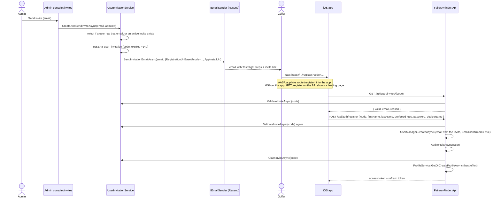
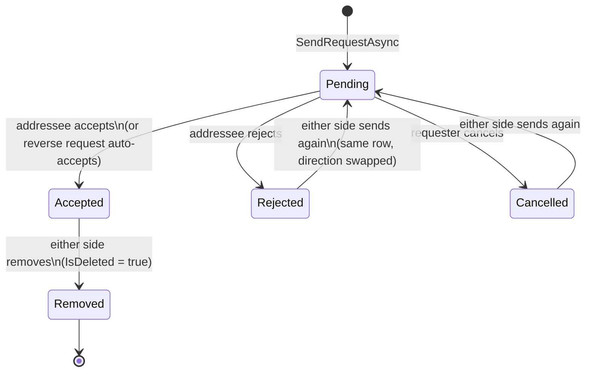
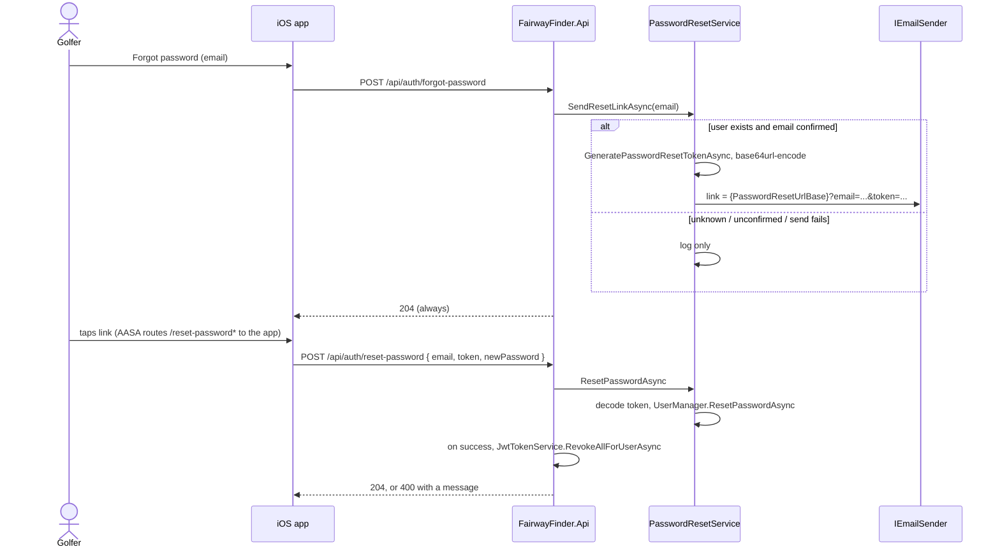

# Users, profiles and friends

Golfers are ASP.NET Core Identity users. Accounts are invite-only: an admin sends an email invitation, and the recipient registers in the iOS app with the code from the link. Each golfer has a `UserProfile` with a public id, and golfers can friend each other to see one another's rounds and stats. This page also covers password reset.

Related: [API overview](../api/overview.md) (JWT, refresh tokens, AASA and landing pages), [notifications and email](notifications-and-email.md), [admin console](../admin/console.md).

## Identity and roles

`src/FairwayFinder.Identity` holds only the types:

| Type | Purpose |
|---|---|
| `ApplicationUser : IdentityUser, IAuditable` | Adds `FirstName`, `LastName`, `PreferredTees`, `SgBaselineLevel` (int, the `BaselineLevel` enum value, kept as int so Identity does not depend on Features), `IsSearchHidden`, `CreatedOn`/`UpdatedOn`. `IsAdmin` is `[NotMapped]` and filled by admin queries. |
| `ApplicationRoles` | Two role names: `Admin` and `User`. |
| `PreferredTees` | `Mens = 0`, `Womens = 1`. Filters the teebox picker ([courses](courses.md)). |

The password policy is configured in each host, not in the Identity project: `src/FairwayFinder.Api/Program.cs` and `src/FairwayFinder.Admin/Startup/AuthenticationConfiguration.cs`. Both set minimum length 8 with no character-class rules and `RequireUniqueEmail`, and both call `AddDefaultTokenProviders()`. They are kept identical on purpose so a password set through one host is valid on the other.

Roles are seeded at Admin startup by `ApplicationStartupService.EnsureRolesExistAsync` (`src/FairwayFinder.Admin/Services/ApplicationStartupService.cs`). `SeedDefaultUserAsync` creates an Admin from the `SeedUser` settings section if it is set and the email does not exist yet, marks the email confirmed (the admin login refuses unconfirmed accounts), and creates its profile.

| Who | Role | How they get it |
|---|---|---|
| Golfer registered from an invite | `User` | `POST /api/auth/register` adds it. |
| Seed user | `Admin` | Admin startup. |
| Any user | `Admin` toggled | `UserAdminService.ToggleAdminRoleAsync` from the admin Users page. |

Authentication itself differs by host (JWT in the API, cookies in Admin). See [API overview](../api/overview.md) and [admin console](../admin/console.md). Failed API logins use Identity lockout (`CheckPasswordSignInAsync(..., lockoutOnFailure: true)`), and an admin can lock an account indefinitely with `UserAdminService.SetLockoutAsync`.

## Invite-only registration

There is no open sign-up. `UserInvitationService` (`src/FairwayFinder.Features/Services/UserInvitationService.cs`) manages `user_invitation` rows (`src/FairwayFinder.Data/Entities/UserInvitation.cs`):

| Column | Meaning |
|---|---|
| `InvitationIdentifier` | The code in the link: a GUID formatted `"N"` (32 hex chars). |
| `SentToEmail` | The invited address. The account is created with exactly this email. |
| `SentByUser` | Admin who sent it. |
| `ExpiresOn` | `UtcNow + 14 days` (`InviteValidityDays`). |
| `ClaimedOn` | Set when the invite is used. |
| `IsDeleted` | Set when revoked. |

An invite is **valid** when it exists, is not deleted, is not claimed, and has not expired.

### Flow

Details that matter:

- **The email comes from the invite, never the request.** `RegisterRequest` has no email field. This is what ties an account to the address that was invited. Because of this, registration also sets `EmailConfirmed = true`; receiving the link proves the address.
- **The invite is validated twice**: once for the app to show the email, and again inside `/register`. Claiming happens after the user is created. `ClaimInviteAsync` re-checks validity, but registration does not fail if the claim returns false, and nothing wraps user creation and claim in one transaction. The unique email constraint on Identity is what stops a second account for the same invite.
- **Profile creation is best effort.** A failure is logged and registration still succeeds; `GetOrCreateProfileAsync` creates the profile lazily on the next `/api/profile` call. Creating it up front makes the new golfer searchable immediately.
- **Deep link.** `Invites:RegistrationUrlBase` sets the link base (code default `https://fairwayfinder.pro/register`; appsettings use `https://api.fairwayfinder.pro/register`). The API serves `/.well-known/apple-app-site-association` with `applinks` for `/register*` and `/reset-password*`, and a static landing page at `GET /register` for people without the app. `Invites:AppInstallUrl` (a TestFlight link) is added to the email and the landing page.
- **Resend** (`ResendInviteAsync`, admin console only) rolls `ExpiresOn` forward 14 days and mails the **same code**, so an older copy of the link keeps working. Claimed or revoked invites cannot be resent. If the email fails, the extended expiry is kept and the error is reported.
- **Revoke** soft-deletes the invite.
- **Email failure on create** leaves the invite row in place and returns an error, so the admin can use Resend.

Admins can manage invites from the console (`/invites`) or through the API (`/api/admin/invites`: list, create, revoke; Admin role required). See [API endpoints](../api/endpoints.md).

### Users created by an admin

The admin console's `CreateUserDialog` (`src/FairwayFinder.Admin/Components/Pages/Users/Dialogs/CreateUserDialog.razor`) creates a confirmed account directly with `UserManager`, bypassing invites. It does not add the `User` role and does not create a profile (the profile appears on first `/api/profile` call; until then the user is not in friend search).

## Profiles

`UserProfile` (`src/FairwayFinder.Data/Entities/UserProfile.cs`) is a small row next to the Identity user:

| Column | Meaning |
|---|---|
| `UserId` | Unique (`ix_user_profile_user_id`). |
| `PublicIdentifier` | Random `Guid`, unique. This is the id other golfers use to address you; the Identity user id is not used in friend URLs. |
| `IsPublic` | Defaults to `false`. |

The name, email, preferred tees and SG baseline level live on `ApplicationUser`, not the profile. `ProfileService` (`src/FairwayFinder.Features/Services/ProfileService.cs`) merges the two into `UserProfileResponse`.

| Method | Use |
|---|---|
| `GetOrCreateProfileAsync` | `GET /api/profile`. Creates the profile on first access. |
| `UpdateSgBaselineLevelAsync` | `PUT /api/profile/sg-baseline-level`. See [stats and strokes gained](stats-and-strokes-gained.md). |
| `UpdatePreferredTeesAsync`, `UpdateProfileVisibilityAsync` | Exist in the service but no API endpoint calls them at present. |
| `GetUserIdByPublicIdIgnoringVisibilityAsync` | Used by friend endpoints, which apply their own friendship check. |
| `GetPublicProfileAsync`, `GetUserIdByPublicIdAsync`, `GetProfileForViewerAsync` | Visibility-gated lookups (public, or viewer is self or a friend). Not currently called by the API. |

`DisplayNameHelper` (`src/FairwayFinder.Features/Helpers/DisplayNameHelper.cs`) is the one place a name is rendered. `Build(first, last, userName)` returns first + last, else the user name; `BuildForAdmin` falls back to email and then `"Unknown"`. It is not EF-translatable, so call it after `ToListAsync()`.

`IsSearchHidden` on the user hides them from friend search. Only an admin can set it (`UserAdminService.SetSearchHiddenAsync`, from the Edit User dialog).

## Friendships

`Friendship` (`src/FairwayFinder.Data/Entities/Friendship.cs`) is one row per pair, directional: `RequesterUserId` sent the request to `AddresseeUserId`. `Status` is stored as an int:

`FriendService` (`src/FairwayFinder.Features/Services/FriendService.cs`) rules:

- **Sending** (`SendRequestAsync`) looks for an existing non-deleted row in either direction:
  - `Accepted`: error "already friends".
  - `Pending` from the other person: **auto-accepts** that request in place (both people wanted it).
  - `Pending` from you: error "already pending".
  - `Rejected` or `Cancelled`: the row is reused. Requester and addressee are set to the current direction, status goes back to `Pending`. The `FriendshipId` is kept.
  - None: insert a new row.
  Errors are `InvalidOperationException`, which the endpoint maps to **409 Conflict**.
- **Accept / reject** only by the addressee, only while `Pending`. **Cancel** only by the requester. Each sets `RespondedOn`. A wrong user or state returns `false`, which the endpoint maps to **404**.
- **Remove** works on an `Accepted` row for either side and soft-deletes it. Sending again later creates a new row because lookups ignore deleted rows.
- `GetFriendsAsync`, incoming/outgoing request lists and the incoming count join `UserProfiles`, so a user without a profile does not appear. `FriendsSince` is the row's `CreatedOn` (when the first request was sent, not when it was accepted).
- There is no unique index on the user pair. Two simultaneous requests in opposite directions could create two rows.

The service projects the stored status into a viewer-relative `FriendshipState` (`None`, `PendingOutgoing`, `PendingIncoming`, `Accepted`) for search results and `GetFriendshipStatusWithUserAsync`.

### User search

`SearchUsersAsync(viewer, query, take = 20)` requires at least 2 characters (the endpoint returns 400 below that). It uses `EF.Functions.ILike` with `%query%` against first name, last name and `"First Last"`, excludes the viewer, `IsSearchHidden` users, and users without a profile. Results are ordered by first name, last name, then id, so `Take` is stable between calls. Each result carries the viewer's `FriendshipState` with that user.

### Friend visibility

Friend endpoints address the other golfer by `PublicIdentifier` (`src/FairwayFinder.Api/Endpoints/FriendEndpoints.cs`):

| Endpoint | Returns |
|---|---|
| `GET /api/friends/{publicId}/rounds` | The friend's completed rounds. |
| `GET /api/friends/{publicId}/rounds/{roundId}` | One round, 404 if it is not the friend's or is still in progress. |
| `GET /api/friends/{publicId}/stats` | The friend's stats. |

`EnsureFriendAccessAsync` resolves the public id ignoring `IsPublic`, then requires an accepted friendship (or that it is yourself). Strangers get **404**, not 403, so the endpoint does not confirm a profile exists. `IsPublic` currently has no effect on these endpoints.

### Side effects

- **Push notifications**: a sent request notifies the addressee ("X sent you a friend request"); an accept or auto-accept notifies the original requester. Failures are logged and swallowed. See [notifications and email](notifications-and-email.md).

## Password reset

`PasswordResetService` (`src/FairwayFinder.Features/Services/PasswordResetService.cs`) is registered in both hosts. A golfer starts a reset from the app; an admin can send the same link from the Edit User dialog.

- **No account enumeration.** `/forgot-password` always returns 204. Unknown emails, unconfirmed emails and send failures are logged but not reported. On redemption, an unknown email, a malformed token and an expired or used token all return the same message ("invalid or has expired").
- **Bad password vs bad link.** If Identity rejects the new password (not an `InvalidToken` error), its messages are returned so the user knows to pick another password rather than request a new link.
- **Single use.** `ResetPasswordAsync` rotates the security stamp, which invalidates the token.
- **Signs out everywhere.** After a successful reset the API endpoint revokes every refresh token the golfer holds, so a device signed in with the old password cannot refresh. Access tokens already issued stay valid until they expire (`Jwt:AccessTokenExpirationMinutes`). This is done in the API, which owns refresh tokens; the service returns the user id in `ResetPasswordResult.UserId` for it.
- **Token encoding.** Identity's token is base64url-encoded for the query string and decoded on redemption.
- **Admin path.** `SendResetLinkAsAdminAsync(userId, adminId)` reports problems (missing user, no email, unconfirmed email, send failure) because the admin can act on them, and logs which admin sent it.
- **Cross-host tokens.** The admin console mints tokens that the API must decrypt. Reset tokens are Data Protection payloads, so `RegisterFeatureServices` (`src/FairwayFinder.Features/ServiceRegistration.cs`) persists the key ring to Postgres (`data_protection_key`) and pins `SetApplicationName("FairwayFinder")`. Changing that name invalidates every outstanding reset link and admin cookie. `PasswordResetServiceTests` checks both conditions.
- `Auth:PasswordResetUrlBase` sets the link base (default `https://api.fairwayfinder.pro/reset-password`). The API serves the landing page at `GET /reset-password`.

## Refresh tokens

`RefreshToken` (`src/FairwayFinder.Data/Entities/RefreshToken.cs`) stores a hash of each issued refresh token per device, with rotation (`ReplacedByTokenHash`) and revocation. Issuing, rotation and reuse detection are covered in [API overview](../api/overview.md).

## Tests

| Test file | Covers |
|---|---|
| `tests/FairwayFinder.Api.IntegrationTests/Auth/AuthEndpointsTests.cs` | Login, lockout, refresh rotation and reuse, invite lookup, register (role, profile, claim), forgot/reset password (including revoking earlier sessions), login validation. |
| `tests/FairwayFinder.Api.IntegrationTests/Endpoints/FriendEndpointsTests.cs` | Search, request lifecycle, auto-accept/conflicts, removal, friend round/stats visibility, in-progress rounds hidden. |
| `tests/FairwayFinder.Api.IntegrationTests/Endpoints/AdminInviteEndpointsTests.cs` | Admin invite endpoints. |
| `tests/FairwayFinder.Api.IntegrationTests/Endpoints/ProfileAndLookupEndpointsTests.cs` | Profile endpoints. |
| `tests/FairwayFinder.Features.Tests/PasswordResetServiceTests.cs` | Cross-host token redemption, single use, enumeration-safe failures, admin path. |
| `tests/FairwayFinder.Features.Tests/UserInvitationServiceResendTests.cs` | Resend rules. |
| `tests/FairwayFinder.Admin.IntegrationTests/Services/UserAdminServiceTests.cs` | Admin user operations. |
