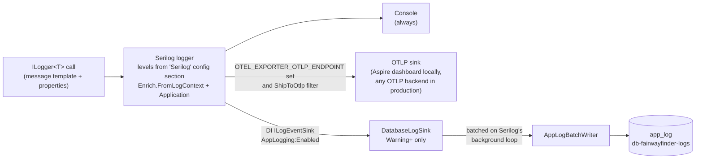
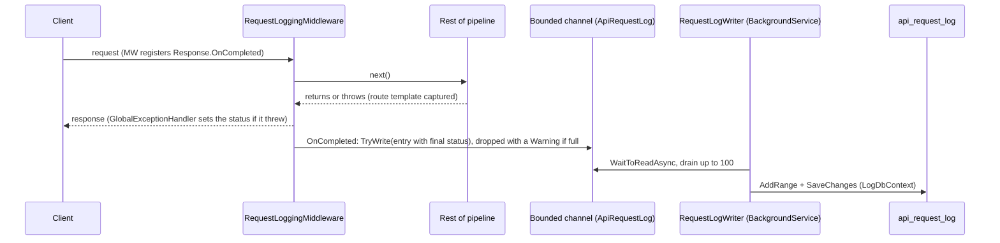

# Logging and observability

Both hosts log through Serilog, export traces, metrics and logs over OTLP when an endpoint is configured, persist Warning-and-worse events to the logs database for the admin console, and (API only) record one row per HTTP request. This page covers how each of those is wired, what ends up where, and how to look at it.

The logs database itself (`LogDbContext`, migrations) is in [../data/database.md](../data/database.md).

## The pipeline

Every `ILogger<T>` in both hosts writes through Serilog. `AddServiceDefaults()` (in `src/FairwayFinder.ServiceDefaults/Extensions.cs`) calls `ConfigureSerilog()` (`src/FairwayFinder.ServiceDefaults/LoggingExtensions.cs`), which builds one logger with these outputs:



The DI sink is registered in `RegisterFeatureServices()` (`src/FairwayFinder.Features/ServiceRegistration.cs`) as a plain `ILogEventSink` singleton. `ReadFrom.Services(services)` in `ConfigureSerilog` picks up every registered `ILogEventSink`, so adding a sink is a DI registration, not a change to the logger setup.

There is deliberately no static `Log.Logger` or bootstrap logger. The integration tests build several hosts per process, and a frozen bootstrap logger can only be frozen once.

### Console

Always on. The template depends on environment:

| Environment | Template |
|---|---|
| Development | `[HH:mm:ss.fff LVL] SourceContext: message` |
| Anything else | `[LVL] SourceContext: message` (no timestamp: the hosting platform's log viewer already prefixes one) |

Structured fields are not printed. Stdout is only meant to be read by a person; the structured copy goes to OTLP.

### OTLP

Only wired when the `OTEL_EXPORTER_OTLP_ENDPOINT` environment variable is set. Aspire sets it for both hosts in local dev, so logs, traces and metrics show up in the Aspire dashboard. In production, point `OTEL_EXPORTER_OTLP_ENDPOINT` (plus `OTEL_EXPORTER_OTLP_PROTOCOL` and `OTEL_EXPORTER_OTLP_HEADERS` as the backend requires) at whichever OTLP backend should receive them. The sink reads the standard `OTEL_*` variables itself; the code only adds `service.name` and `deployment.environment` resource attributes.

Not everything is shipped. `ShipToOtlp` lets through:

- anything at Warning or worse, from any source;
- anything from a `FairwayFinder*` source context, at any enabled level;
- the one request summary line per request from `Serilog.AspNetCore.RequestLoggingMiddleware`.

Framework Information chatter (EF, hosting, routing) stays on the console only.

Nothing in code is vendor-specific; the destination is purely the `OTEL_*` environment.

### The database sink (`app_log`)

`DatabaseLogSink` (`src/FairwayFinder.Features/Services/Logging/DatabaseLogSink.cs`) persists events so the admin console can show them without an external log tool.

- **Filter** (`ShouldPersist`): level at or above `AppLogging:MinimumLevel` (default `Warning`); not raised inside `LogWriteScope`; not from `Serilog.AspNetCore.RequestLoggingMiddleware`. The request summary is excluded because every API request already has a row in `api_request_log`, and a 5xx's exception is logged separately by the exception handler, so storing the summary would duplicate every failure.
- **Batching**: `Emit` only filters and enqueues into a private Serilog pipeline using Serilog's `BatchingOptions` (batch size 100, `FlushIntervalMs`, `QueueLimit`). The write happens on Serilog's background loop, so logging never waits on Postgres. When the queue is full, new events are dropped. A batch that throws is retried, then dropped.
- **Writing**: `AppLogBatchWriter` resolves `IDbContextFactory<LogDbContext>` lazily on the first batch. It cannot take it in the constructor: EF's options factory resolves `ILoggerFactory`, which is Serilog, which is still being built when it resolves this sink.
- **No feedback loops**: the write runs inside `LogWriteScope.RunAsync`, an `AsyncLocal` flag. Anything logged during the write (an Npgsql failure, say) is rejected by `ShouldPersist`. `LogDbContext` also uses `NullLoggerFactory`, so EF does not log about its own writes into the sink. Keep both.
- **Mapping**: `AppLogEntryMapper` turns a `LogEvent` into an `AppLogEntry`. `SourceContext`, `UserId`, `UserEmail`, `RequestPath` and `Application` get their own columns; every other property is serialized into the `properties` JSON column. The message is rendered with `{Message:l}` so string values are not wrapped in quotes. Values are truncated to the column lengths in `AppLogColumns`.

`AppLogEntry` columns (`src/FairwayFinder.Data/Entities/AppLogEntry.cs`): `Timestamp` (UTC), `Level`, `Message`, `MessageTemplate`, `Exception` (full `ToString()`), `SourceContext`, `Application` (`FairwayFinder.Api` or `FairwayFinder.Admin`), `UserId`, `UserEmail`, `RequestPath`, `TraceId`, `Properties`. Rows are immutable and have no audit fields.

## Settings

`Serilog` section: levels only (sinks are chosen in code). Both `appsettings.json` files use `Default: Information` with `Microsoft`, `Microsoft.EntityFrameworkCore`, `Npgsql`, `System.Net.Http` and `Polly` overridden to `Warning`, and `Microsoft.Hosting.Lifetime` at `Information`. Do not put levels in the `Logging` section; Serilog ignores it.

`AppLogging` section (`src/FairwayFinder.Shared/Settings/AppLoggingSettings.cs`):

| Key | Default | Meaning |
|---|---|---|
| `Enabled` | `true` | Register `DatabaseLogSink` at all. Read at DI registration time. |
| `MinimumLevel` | `Warning` | Lowest Serilog level written to `app_log`. Unparseable values fall back to `Warning`. |
| `RetentionDays` | `30` | `AppLogPurgeService` deletes older rows. |
| `QueueLimit` | `10000` | Events buffered while the DB is slow or down; beyond this new events are dropped. |
| `FlushIntervalMs` | `2000` | How long events are buffered before a batch is written. |

`RequestLogging` section (`src/FairwayFinder.Shared/Settings/RequestLoggingSettings.cs`), API only:

| Key | Default | Meaning |
|---|---|---|
| `Enabled` | `true` | Master switch for `api_request_log` rows. |
| `RetentionDays` | `30` | `RequestLogPurgeService` deletes older rows. |
| `ExcludedPathPrefixes` | `/health`, `/alive`, `/openapi`, `/scalar` | The API's `appsettings.json` adds `/.well-known`, `/register`, `/reset-password`. |
| `ChannelCapacity` | `10000` | Bounded in-memory buffer; overflow entries are dropped. |

`ExcludedPathPrefixes` is shared further than its name suggests: `Extensions.GetExcludedPaths()` merges it with `/health` and `/alive`, and the result also filters trace spans and demotes the Serilog request summary. If a path is not worth a request-log row, it is not worth a span or a log line either. Admin has no `RequestLogging` section and falls back to the health paths.

## Levels policy

Everything at Warning or above is persisted to `app_log` and shipped to OTLP. Choose the level for what it costs and who needs to see it:

| Level | Use for | Where it ends up |
|---|---|---|
| Debug | Detail useful only while debugging. Static-file request summaries. | Console, if enabled. |
| Information | Normal events worth seeing in a trace: purge counts, writer start/stop, rejected 4xx requests. | Console; OTLP if from a `FairwayFinder*` source. |
| Warning | Something unexpected that the code handled: a dropped request-log entry. | Console, OTLP, `app_log`. |
| Error | A real failure: an unhandled exception, a failed batch write, a failed purge. | All of the above. |

A 4xx is the client's mistake, not an error. `GlobalExceptionHandler` (`src/FairwayFinder.Api/Exceptions/GlobalExceptionHandler.cs`) logs status 500+ at Error with the exception and anything below at Information without a stack trace. The request is still in `api_request_log`.

Always log with message templates, never string interpolation:

```csharp
logger.LogError(ex, "Round {RoundId} failed", roundId);   // yes
logger.LogError(ex, $"Round {roundId} failed");           // no
```

The template is what groups occurrences (`message_template` in `app_log`, `message_template.text` over OTLP), and each value is stored as a filterable property.

## Who caused it: user context enrichment

`Enrich.FromLogContext()` copies any `LogContext` property onto every event. Three places push the current user:

| Where | What | Covers |
|---|---|---|
| `UseUserLogContext()` in `LoggingExtensions.cs` | Pushes `UserId` and `UserEmail` from the `NameIdentifier` and `Email` claims for the rest of the request. Registered right after `UseAuthentication()` in both `Program.cs` files. | API requests, Admin plain HTTP requests (login, logout). |
| `LogContextCircuitHandler` (`src/FairwayFinder.Admin/Services/LogContextCircuitHandler.cs`) | A Blazor `CircuitHandler` that wraps each inbound circuit activity (click, form submit, JS interop callback) in the same two properties. Reads the user once per circuit. | Admin interactive pages, which run outside any HTTP request. Registered in `src/FairwayFinder.Admin/Startup/ServiceRegistration.cs`. |
| Request summary `EnrichDiagnosticContext` | Adds `RouteTemplate` and `UserId` to the per-request summary line. | The summary line only. |

`UserId` and `UserEmail` become columns in `app_log`. Background jobs (purges, imports) have no user, so their events carry neither.

## Request logging

There are two separate request records. They serve different purposes.

### The Serilog summary line (both hosts)

`UseFairwayFinderRequestLogging()` replaces ASP.NET Core's several per-request lines with one:

```
HTTP GET /api/rounds/42 responded 200 in 12.3 ms
```

It is registered before `UseExceptionHandler` so it sees the final status code. Its level is computed per request:

- Error if an exception escaped or the status is 500+;
- Verbose (below every minimum, so dropped) for excluded paths, plus `/_framework`, `/_content` and `/_blazor` on Admin;
- Debug for static files (any path with an extension);
- Information otherwise.

It carries `RouteTemplate` (groups every `/api/rounds/{roundId}` call together) and `UserId`. It goes to the console and OTLP, but never to `app_log` (see the database sink filter above).

### `api_request_log` (API only)

A row per API request in the logs database, shown in the admin console at `/logs`.



- `RequestLoggingMiddleware` (`src/FairwayFinder.Api/Middleware/RequestLoggingMiddleware.cs`) runs just inside the exception handler. When an endpoint throws, the status is still 200 as the exception passes back through it, because `GlobalExceptionHandler` only writes the real one afterwards, so the entry is built in `Response.OnCompleted` once the final status is on the response. The route template is captured on the way out instead, since the exception handler clears the endpoint before writing the error. It records method, path, route template, query string, status, duration, user id and email, IP (first `X-Forwarded-For` entry, else the remote address), user agent and trace id. Any failure is caught and logged; the request is never affected.
- The channel is `BoundedChannelFullMode.DropWrite` with `ChannelCapacity` slots, registered in `src/FairwayFinder.Api/Program.cs`.
- `RequestLogWriter` (`src/FairwayFinder.Api/BackgroundServices/RequestLogWriter.cs`) batch-inserts up to 100 entries at a time. A failed batch is logged at Error and discarded.

Admin has no equivalent table: what an admin did is visible through the Serilog summary line and `app_log`.

## Retention

Both log tables are hard-deleted on a timer. Each purge job runs once at startup and then every 24 hours, and uses `ExecuteDeleteAsync`.

| Table | Job | Host | Setting |
|---|---|---|---|
| `api_request_log` | `RequestLogPurgeService` (`src/FairwayFinder.Api/BackgroundServices/`) via `ApiRequestLogService.PurgeOlderThanAsync` | Api | `RequestLogging:RetentionDays` |
| `app_log` | `AppLogPurgeService` (`src/FairwayFinder.Admin/Services/`) via `AppLogService.PurgeOlderThanAsync` | Admin | `AppLogging:RetentionDays` |

The logs live in a separate database (`db-fairwayfinder-logs`) so log volume and these purges never touch golf data. The admin pages also have a manual "Purge older than 30 days" button, which is hard-coded to 30 rather than reading the setting.

## Metrics and traces

`ConfigureOpenTelemetry()` in `src/FairwayFinder.ServiceDefaults/Extensions.cs` sets up both. Exporters are only added when `OTEL_EXPORTER_OTLP_ENDPOINT` is set.

### Metrics

Meters are named explicitly rather than using the ASP.NET Core and HttpClient instrumentation packages, which subscribe to a family of meters (Routing, Kestrel, SignalR...) nobody queries.

| Meter | Gives you |
|---|---|
| `Microsoft.AspNetCore.Hosting` | `http.server.*`: route latency, in-flight requests |
| `System.Net.Http` | `http.client.*`: outbound latency, connection pool |
| `Npgsql` | `db.client.*`: pool health, command duration |
| `FairwayFinder.Rounds`, `.Stats`, `.Imports`, `.Email`, `.Games`, `.Agents` | App counters and histograms, listed below |

The app instruments live in `src/FairwayFinder.Features/Diagnostics/FairwayFinderDiagnostics.cs` (and `src/FairwayFinder.Agents/Diagnostics/AgentDiagnostics.cs` for `FairwayFinder.Agents`). A new meter must also be added to `Extensions.FairwayFinderMeters` or it is never exported.

| Meter | Instruments |
|---|---|
| Rounds | `fairwayfinder.rounds.created`, `.rounds.updated`, `.rounds.deleted`, `.rounds.started`, `fairwayfinder.round.holes.posted`, `fairwayfinder.shots.logged`, histogram `fairwayfinder.round.save.duration` (ms) |
| Games | `fairwayfinder.games.created`, `.games.started`, `.games.completed`, `fairwayfinder.game.holes.posted` |
| Stats | histograms `fairwayfinder.stats.dashboard.duration`, `.stats.course.duration`, `.stats.course_holes.duration` (ms) |
| Imports | `fairwayfinder.gca.courses.imported`, `.updated`, `.skipped`, `fairwayfinder.gca.import.errors`, histogram `fairwayfinder.gca.import.duration`; `fairwayfinder.tgtr.rounds.imported`, `.skipped`, `fairwayfinder.tgtr.import.errors`, histogram `fairwayfinder.tgtr.transfer.duration` |
| Email | `fairwayfinder.email.sent`, `fairwayfinder.email.failed`, histogram `fairwayfinder.email.send.duration` |
| Agents | `fairwayfinder.agents.calls`, `.call.errors`, `.tokens.input`, `.tokens.output`, histogram `.call.duration` |

Metric tag keys are flat (`holes`, `shot_tracking`, `game_type`, `result`, `kind`) and live in `FairwayFinderDiagnostics.Tags`; enum-like values are in `TagValues`. Keep them low-cardinality: no ids.

### Traces

- **Instrumentation**: ASP.NET Core (incoming requests, minus the excluded paths), HttpClient (outbound) and Npgsql (every DB command).
- **App spans**: `ActivitySource`s named `FairwayFinder.Rounds`, `.Stats`, `.Imports`, `.Games`, `.Agents` (listed in `Extensions.FairwayFinderSources`). Span names are in `FairwayFinderDiagnostics.ActivityNames` (`round.create`, `round.hole.upsert`, `stats.user.generate`, `stats.calc.strokes_gained`, `imports.gca.run`, `game.score`...). Span tag keys are dotted, following OTel convention, and live in `ActivityTags` (`round.id`, `stats.round_count`, `game.type`...). There is no `FairwayFinder.Email` activity source; email has metrics only.
- **Every request is its own root trace.** Callers are phones, not services we trace. A client SDK's `traceparent` points at a parent span that never reaches the backend, which orphaned every request under a "(missing)" root, and an unsampled header (`-00`) made the default parent-based sampler drop the request span and every DB span under it. So:
  - `IgnoreIncomingTraceContextPropagator` (`src/FairwayFinder.ServiceDefaults/`) replaces ASP.NET Core's `DistributedContextPropagator`: it extracts nothing but still injects outbound.
  - `Sdk.SetDefaultTextMapPropagator` is set to an empty composite so the OTel ASP.NET Core instrumentation does not re-extract the header.
  - The sampler is `AlwaysOnSampler`.
  - `tests/FairwayFinder.Api.IntegrationTests/Logging/TracingTests.cs` guards this.
- **Correlation**: Serilog events carry the current trace id. It is stored in `app_log.trace_id` and exported over OTLP with each log event. `api_request_log.trace_id` holds `Activity.Current.Id` (the full W3C id, not just the trace id part), falling back to `HttpContext.TraceIdentifier`.

## Health checks

`AddDefaultHealthChecks()` registers one check, `self`, tagged `live`, in both hosts. Admin adds `FairwayFinderDatabase`, an `AddNpgSql` check on the main database (`src/FairwayFinder.Admin/Program.cs`). The logs database has no health check.

`MapDefaultEndpoints()` maps `/health` (all checks) and `/alive` (checks tagged `live`) **only in Development**. In production there is no HTTP health endpoint on either host; the admin console page is the way to check.

The admin console page at `/health` (`src/FairwayFinder.Admin/Components/Pages/Diagnostics/Pages/HealthChecks.razor`) calls `HealthCheckService.CheckHealthAsync()` in-process and shows each check's status, duration and description, plus the total duration.

## Viewing logs

| What | Where |
|---|---|
| Live console output, traces, metrics, structured logs (local) | Aspire dashboard, after `dotnet run --project src/FairwayFinder.AppHost/` |
| Warnings and errors from both hosts | Admin console `/app-logs` (`AppLogs.razor`, backed by `AppLogService`). Auto-refreshes (pausable). Filter by level and application, search message, source or user email, expand an entry for the stack trace and properties, purge. |
| Every API request | Admin console `/logs` (`RequestLogs.razor`, backed by `ApiRequestLogService`). Search path, route or user email; filter by status. |
| Production logs and traces | Whatever OTLP backend `OTEL_EXPORTER_OTLP_ENDPOINT` points at |
| Health | Admin console `/health` |

The admin pages are described with the rest of the console in [../admin/console.md](../admin/console.md).

## Tests that cover this

- `tests/FairwayFinder.Features.Tests/Logging/DatabaseLogSinkTests.cs`: the level and source filter, the `LogWriteScope` guard, the mapper.
- `tests/FairwayFinder.Api.IntegrationTests/Logging/AppLogTests.cs`: real rows in the real logs database, user attribution inside a request, 4xx not stored. Uses a polling `WaitForAsync` because writes are batched (`TestSettings` sets `AppLogging:FlushIntervalMs` to 100).
- `tests/FairwayFinder.Api.IntegrationTests/Logging/RequestLogTests.cs`: a request that throws `NotFoundException` lands in `api_request_log` as 404 with its route template. Request logging is off in the shared test host, so the test switches it on and runs its own `RequestLogWriter` for its duration.
- `tests/FairwayFinder.Api.IntegrationTests/Logging/TracingTests.cs`: root spans regardless of `traceparent`.
- `tests/FairwayFinder.Admin.IntegrationTests/Services/AppLogServiceTests.cs` and `AdminOperationsServiceTests.cs`: paging, filtering, purge for both tables.

See [../testing.md](../testing.md) for how these suites are set up.
