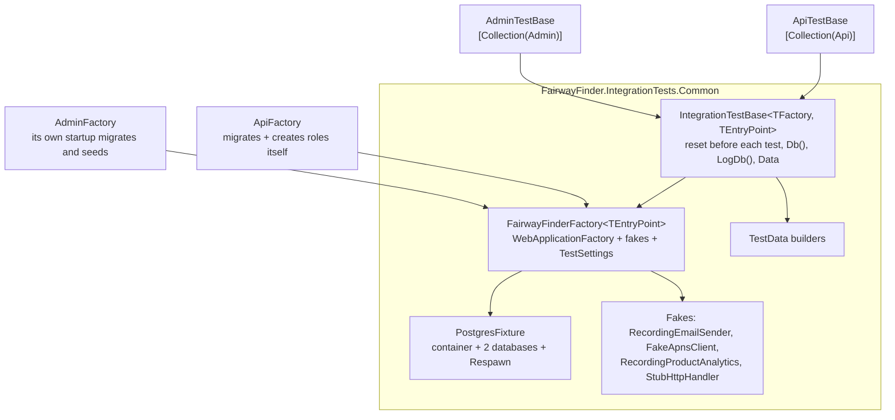

# Testing

There are three test projects and one shared library. Unit tests cover pure logic and services over EF InMemory; integration tests boot the real API and Admin hosts in-process against real Postgres in a Testcontainers container. All of them are xUnit 2 and all run with a plain `dotnet test`, locally and in CI.

## Projects

| Project | Kind | Covers | Needs Docker |
|---|---|---|---|
| `tests/FairwayFinder.Features.Tests` | Unit | Scoring engines, `StatsCalculator`, strokes-gained calculator/baseline/offsets, handicap and display-name helpers, services built by hand over EF InMemory (`RoundEntryService`, `GameService`, `AdminGameService`, `CourseService`, `PasswordResetService`, invitations), audit stamping, the logging and PostHog sinks, `ActiveGolferTracker` | No |
| `tests/FairwayFinder.Api.IntegrationTests` | Integration | The real API host over HTTP: JWT auth, validation, ProblemDetails, every endpoint group, analytics events, app logs, tracing, and the convention tests | Yes |
| `tests/FairwayFinder.Admin.IntegrationTests` | Integration | The real Admin host: startup migrations and seeding, page authorization, cookie login, admin and import services. Also `GameCardModelTests`, which are plain unit tests of the admin scorecard model. | Yes |
| `tests/FairwayFinder.IntegrationTests.Common` | Library (not a test project) | `PostgresFixture`, `FairwayFinderFactory`, `IntegrationTestBase`, `TestSettings`, `TestData`, fakes | |

Packages: xUnit 2.9, `Microsoft.AspNetCore.Mvc.Testing` (`WebApplicationFactory`), `Testcontainers.PostgreSql`, Respawn, `Microsoft.EntityFrameworkCore.InMemory`, coverlet.

## Running

```bash
dotnet test                                              # everything (Docker must be running)
dotnet test tests/FairwayFinder.Features.Tests/          # unit tests only, no Docker
dotnet test tests/FairwayFinder.Api.IntegrationTests/
dotnet test tests/FairwayFinder.Admin.IntegrationTests/
dotnet test --filter "FullyQualifiedName~RoundEntryTests"  # one class
```

Each integration assembly starts its own `postgres:17-alpine` container the first time a test in it runs, and disposes it at the end. The first run pulls the image.

### CI

`.github/workflows/build-and-test.yml` runs on pull requests to `main`, on manual dispatch, and as a `workflow_call` from the image pipelines, so nothing is pushed to GHCR without passing tests. On `ubuntu-latest` (which has Docker for Testcontainers) it restores, builds `FairwayFinder.sln` in Release, runs `dotnet test FairwayFinder.sln --configuration Release --no-build` with a TRX logger, and uploads `TestResults/*.trx` as the `test-results` artifact even on failure. A newer push to the same PR cancels the running job. Deployment pipelines are covered in [architecture/deployment.md](architecture/deployment.md).

## Why real Postgres

Integration tests run against real Postgres because several behaviours only exist there, or behave differently on InMemory:

- the filtered unique indexes that guard round entry (`ix_round_user_id_active`, `ix_score_round_id_hole_id`) and game join codes;
- `ILIKE` search;
- `ExecuteUpdate` / `ExecuteDelete` (the log purges, cascades);
- `PostgresException` unique-violation retries;
- migrations themselves, and `timestamptz` rejecting non-UTC `DateTime`s.

InMemory is fine for logic that only reads and writes rows. Anything that depends on the database engine gets an integration test.

## Integration test infrastructure



### `PostgresFixture`

`tests/FairwayFinder.IntegrationTests.Common/PostgresFixture.cs`. One container per test assembly holding both databases, as production holds both on one server:

- `db-fairwayfinder` is created by Testcontainers; `db-fairwayfinder-logs` is created with a `CREATE DATABASE` right after the container starts, because the API host never creates databases.
- `ResetAsync()` wipes both with Respawn before every test. Respawn reads the table graph on its first run, so the schemas must already be migrated by then.
- Kept between tests: `__EFMigrationsHistory`, `miss_type` (a migration-seeded lookup), `AspNetRoles` (every host expects the roles), and `data_protection_key` (the shared key ring). Everything else is deleted.

### `FairwayFinderFactory<TEntryPoint>`

`tests/FairwayFinder.IntegrationTests.Common/FairwayFinderFactory.cs`. A `WebApplicationFactory` that owns a `PostgresFixture` and is shared by every test class in the assembly through an xUnit collection fixture. Tests reset the data, not the host.

- Environment is `Testing`.
- Applies `TestSettings` (plus per-factory `SettingOverrides`) with `UseSetting`.
- Swaps the edges for fakes: `IEmailSender` → `RecordingEmailSender`, `IApnsClient` → `FakeApnsClient`, `IProductAnalytics` → `RecordingProductAnalytics`. Everything between the HTTP request and the database row is the production code path.
- `ResetAsync()` resets both databases and clears every fake.
- Lifecycle: start container → `PrepareDatabaseAsync()` (abstract, per host) → first reset.

The two concrete factories differ because the hosts do:

| | `ApiFactory` (`tests/FairwayFinder.Api.IntegrationTests/Infrastructure/`) | `AdminFactory` (`tests/FairwayFinder.Admin.IntegrationTests/Infrastructure/`) |
|---|---|---|
| Schema | The API assumes the schema exists, so `PrepareDatabaseAsync` migrates both contexts and creates the `Admin`/`User` roles, doing the admin's job. | Touching `Services` boots the host, and Admin's `Program.cs` migrates, creates roles and seeds the admin user itself. |
| Overrides | Removes the `RequestLogWriter` and `RequestLogPurgeService` hosted services, which would race the per-test reset. | Sets `SeedUser:*` so the seed admin exists. Adds `TestAuthHandler` behind a `TestOrCookie` policy scheme. Routes `GolfCourseApiHttpClient` and `TgtrHttpClient` through `ExternalHttp`. |
| Collection | `ApiCollection` ("Api") | `AdminCollection` ("Admin") |

### `TestSettings`

`tests/FairwayFinder.IntegrationTests.Common/TestSettings.cs` holds every configuration key either host refuses to start without: both connection strings, `Jwt:*`, `Apns:*` (never used to reach Apple), `Invites:*`, `Auth:PasswordResetUrlBase`, `Tgtr:BaseUrl`, `GolfCourseApi:*`, `Resend:ApiKey`, `SeedUser:*`. It also sets `RequestLogging:Enabled = false` and `AppLogging:FlushIntervalMs = 100` (the database log sink stays on so its tests see real rows, quickly).

They are applied with `UseSetting` rather than `ConfigureAppConfiguration` because both `Program.cs` files read the connection string, `Jwt` and `Apns` sections before `builder.Build()`, and under minimal hosting only host settings are visible that early.

**If you add a config key a host needs at startup, add it here**, or neither host boots under test.

The URL bases are public constants (`TestSettings.RegistrationUrlBase`, `PasswordResetUrlBase`, `AppInstallUrl`) so tests can assert on the links in sent emails.

### Base classes

`IntegrationTestBase<TFactory, TEntryPoint>` (Common) resets before every test (`InitializeAsync`) and exposes:

| Member | Use |
|---|---|
| `Data` | `TestData` builders |
| `Email`, `Apns`, `Analytics` | The fakes, for assertions |
| `Db()`, `LogDb()` | A fresh `ApplicationDbContext` / `LogDbContext` for arranging or asserting on rows directly |
| `WithServiceAsync<TService>(...)` | Resolve a service in its own scope, as a request would |

`ApiTestBase` (`[Collection(ApiCollection.Name)]`) adds:

| Member | Use |
|---|---|
| `SignInNewUserAsync(email?, firstName, roles...)` | Creates a user and logs in through the real `POST /api/auth/login`, returning an `ApiUser` with an `HttpClient` carrying the bearer token. Every authenticated test also exercises token issuance. |
| `SignInNewAdminAsync()` | Same, with the `Admin` role. |
| `AnonymousClient()` | No credentials, no auto-redirect, `https://localhost`. |
| `LoginAsync`, `MakeFriendsAsync(a, b)`, `RegisterDeviceAsync(user)` | Common flows through the real endpoints. |
| `AssertStatusAsync`, `ReadAsync<T>`, `GetAsync<T>`, `GetJsonAsync` | Status assertions that put the response body in the failure message. `Json` matches the API's web serializer defaults. |

`AdminTestBase` (`[Collection(AdminCollection.Name)]`) adds:

| Member | Use |
|---|---|
| `BrowserClient()` | https (the auth cookie is Secure-only), cookies kept, redirects not followed. |
| `ClientAs(userId, roles...)` | Signed in through `TestAuthHandler`, which reads `X-Test-User` / `X-Test-Roles` headers. Without those headers the real Identity cookie is used, so challenge/forbid redirects are the production ones. |
| `SignInAdminAsync()` | A real admin account plus a client signed in as them. |
| `Service<T>()` | Resolve a service from a fresh scope, the way a Blazor circuit would. |

Because each assembly shares one host and one database, all classes in an assembly are in one xUnit collection and run serially. The two integration assemblies can run in parallel with each other; each has its own container.

### Fakes

All in `tests/FairwayFinder.IntegrationTests.Common/Fakes/`, all cleared before each test.

| Fake | Replaces | Use in tests |
|---|---|---|
| `RecordingEmailSender` | `IEmailSender` | `Email.Sent`, or `Email.LastTo(address, SentEmailKind.Invitation \| PasswordReset \| Confirmation)` to read the link a golfer would click. |
| `FakeApnsClient` | `IApnsClient` | Only the network hop is faked; the real `PushNotificationService` still looks up devices, builds payloads and deactivates dead tokens. Assert on `Apns.Sent`. Set `FailWith` to simulate a network failure. |
| `RecordingProductAnalytics` | `IProductAnalytics` | `Analytics.For(userId, AnalyticsEvents.X)` returns the captured events with their properties and person properties. `Analytics.Captured` for everything. See [operations/analytics.md](operations/analytics.md). |
| `StubHttpHandler` | Primary handler for GolfCourseAPI and TGTR clients (Admin only) | `ExternalHttp.RespondJson(path, body)` or `Respond(path, req => ...)`. Unregistered paths return 404, so a test never reaches the internet. `ExternalHttp.Requests` records what was sent. |

### `TestData` builders

`tests/FairwayFinder.IntegrationTests.Common/TestData.cs` arranges rows the way the application creates them, so a schema change is fixed in one place.

| Builder | Creates |
|---|---|
| `CreateUserAsync(email?, password, firstName, lastName?, roles...)` | A confirmed user through `UserManager` (real hash and security stamp), roles, and the profile registration would create. Password defaults to `TestData.DefaultPassword`. |
| `CreateAdminAsync(email?)` | Same, with the `Admin` role. |
| `CreateCourseAsync(courseName?, nineHole, teeboxName, createdBy)` | A course with one teebox and its holes, returned as `SeededCourse(CourseId, TeeboxId, CourseName, Pars)`. Pars are `TestData.StandardPars` (par 72). |
| `CreateCompletedRoundAsync(userId, course, overPar, datePlayed?)` | A posted 18-hole round through `IRoundService`, each hole at par + `overPar`. |
| `CreateGameAsync(hostUserId, course, gameType)` | A game in setup, through `IGameService`. |
| `CreateInvitationAsync(email, sentByUserId, expiresOn?)` | An unclaimed invitation. |
| `CreateAppLogAsync(message, level, timestamp?, ...)` | An `app_log` row inserted directly, so the test controls the timestamp. To test the sink itself, log through a real `ILogger`. |

Don't construct entities inline in a test; add a builder here.

### Flows

`RoundFlows` (`tests/FairwayFinder.Api.IntegrationTests/Infrastructure/RoundFlows.cs`) drives the hole-by-hole flow the iOS app uses, over HTTP:

- `StartRequest(course, ...)` / `StartRoundAsync(client, request)` → `POST /api/rounds/start`
- `UpsertHoleAsync(client, roundId, hole, score)` → `PUT /api/rounds/{id}/holes/{n}`
- `PlayCompletedRoundAsync(client, course, overPar, datePlayed?)` → start, write every hole at par + `overPar`, `POST .../complete`

Prefer driving the real flow over inserting rows. It also exercises the analytics events, push notifications and diagnostics on the way.

## Convention tests

These fail when something new is added without the matching protection. They are cheap to satisfy and should not be weakened.

| Test | File | Fails when |
|---|---|---|
| `EndpointAuthorizationConventionTests` | `tests/FairwayFinder.Api.IntegrationTests/Conventions/` | An API endpoint neither requires authorization nor is on the explicit `AnonymousEndpoints` list; a listed anonymous endpoint is not `AllowAnonymous` or no longer exists; an endpoint under `/api/admin/` (or on `AdminOnlyEndpoints`) does not require the `Admin` role. |
| `MigrationTests` | same folder | Any migration fails to apply to an empty Postgres, or the EF model (main or logs) has changes with no migration. The failure message has the exact `dotnet ef migrations add` command. |
| `PageAuthorizationTests` | `tests/FairwayFinder.Admin.IntegrationTests/Pages/` | Discovers every routable admin component by reflection. Fails if one lacks `[Authorize(Policy = Policies.AdminOnly)]`, if anonymous visitors are not redirected to `/login`, if golfers are not redirected to `/access-denied`, or if an admin does not get a 200. |
| `AuditStampTests` | `tests/FairwayFinder.Features.Tests/` | An entity with `created_on`/`updated_on` doesn't implement `IAuditable`, a `DateTime` maps to anything but `timestamptz`, or `DatePlayed` stops being a `date`. |

Never add an endpoint to `AnonymousEndpoints` without a reason, and when you do, add a test for it in `PublicEndpointsTests` or `AuthEndpointsTests`. If a new admin route has a parameter, `PageAuthorizationTests.Resolve` fills `:long` constraints with `1` and anything else with `placeholder`; extend it if that is not enough.

## Writing each kind of test

### New API endpoint

Add tests to the matching `tests/FairwayFinder.Api.IntegrationTests/Endpoints/*Tests.cs` (or `Auth/AuthEndpointsTests.cs`), through HTTP:

```csharp
public class RoundReadTests(ApiFactory factory) : ApiTestBase(factory)
{
    [Fact]
    public async Task A_golfer_sees_their_own_rounds()
    {
        var me = await SignInNewUserAsync();
        var course = await Data.CreateCourseAsync();
        var roundId = await RoundFlows.PlayCompletedRoundAsync(me.Client, course, overPar: 1);

        var round = await GetJsonAsync(me.Client, $"/api/rounds/{roundId}");

        Assert.Equal(course.CourseId, round.GetProperty("courseId").GetInt64());
        Assert.Single(Analytics.For(me.Id, AnalyticsEvents.RoundCompleted));
    }
}
```

Cover the happy path, the auth boundary (another golfer gets 404/403, anonymous gets 401), validation (400 ProblemDetails), and any analytics event or push the endpoint should produce. `EndpointAuthorizationConventionTests` will catch a missing `.RequireAuthorization()` on its own.

### New admin page

`PageAuthorizationTests` covers its authorization automatically. Prerendering is off, so page bodies are not rendered over HTTP; test the service the page calls instead, in `tests/FairwayFinder.Admin.IntegrationTests/Services/`, with `Service<T>()` and `Data`. When the page acts on another user's data, assert that the target user is changed and the admin only appears in `UpdatedBy` (see `AdminRoundServiceTests`).

### New Features service behaviour

- Pure logic (calculators, scoring engines, helpers): a plain unit test in `FairwayFinder.Features.Tests`. `Helpers/GameScoringTestData` holds shared fixtures for the game engines.
- Service logic that only reads and writes rows: build the service by hand over `InMemoryDbContextFactory(uniqueDbName)` (`Helpers/InMemoryDbContextFactory.cs`), passing `NullProductAnalytics.Instance`, `NullLogger<T>.Instance`, and doubles from `Helpers/RoundServiceTestDoubles.cs` (`StubFriendService`, `ThrowingFriendService`, `NoOpPushNotificationService`, `CountingPushNotificationService`). Use the test name as the database name so tests don't share state. `RoundEntryServiceTests` shows the pattern with a `Harness` record.
- Anything that depends on Postgres (constraints, concurrency, raw SQL, `ILike`, `ExecuteUpdate`/`ExecuteDelete`, unique-violation retries): an integration test, not an InMemory unit test.

`FairwayFinder.Features` has `InternalsVisibleTo("FairwayFinder.Features.Tests")`, which is how the sink tests reach their internal constructors.

### New entity or schema change

Add the migration. `MigrationTests` fails until you do. Add or update the `TestData` builder for it.

### Logging and analytics

- Analytics: assert with `Analytics.For(userId, AnalyticsEvents.X)` in the API test that drives the action.
- `app_log`: log through a real `ILogger` resolved from `Services` and poll `LogDb()` until the row appears, since the sink writes in batches (`AppLogTests.WaitForAsync`).

## Gotchas

- `TestData.CreateCompletedRoundAsync` goes through the deprecated whole-card `CreateRoundAsync`, so it records a `round_completed` event with `entry = full_card`. Use `RoundFlows` when the test cares how the round was entered.
- Request logging is off in tests and its hosted services are removed from the API host. The request-log purge is covered by calling `ApiRequestLogService.PurgeOlderThanAsync` directly (`AdminOperationsServiceTests`).
- Tests within an assembly run serially. Don't add parallelism: they share a database that is wiped before each test.
